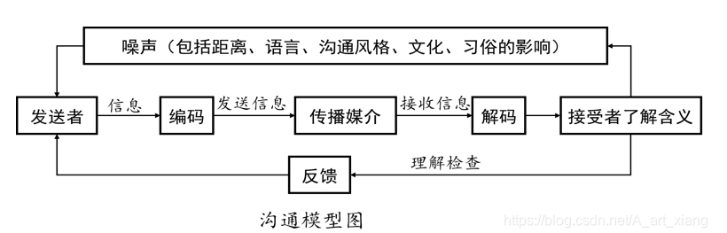
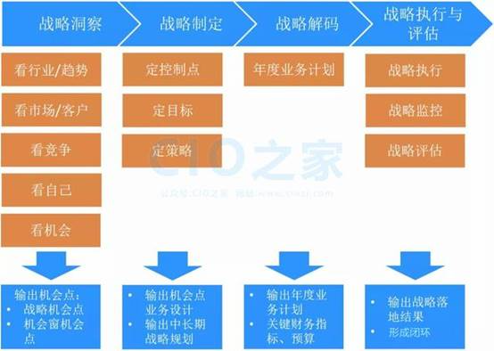

# 工作方法论

> 来源：为知笔记分享（zhengguosheng163@163.com，2026/10/21 更新）

## 1 课程互动

### 1.1 调研

#### 1.1.1 问题

一堆吹牛皮，PUA的价值观，价值观啥用啊？
我天天这么忙，时间该怎么管理？要先做哪些事？
我天天这么忙，根本没空做那个事情，而且未来看起来也没头，怎么办？
给他说了啊，他应该明白了，我等着吧。这样行吗？
他就是会找领导拍MP, 研发上没有我出活,我需要向他学习吗？学什么？
领导最近也没找我，任务安排也不多，没有挑战，怎么才能主动找找他呢？
找客户沟通时，咂沟通来沟通去，又带着客户新需求来了呢？应该如何做？
哎呀，系统又卡了，家人们谁懂啊？怎么体会这句话？
客户说了，要增加两个按钮，完成明细数据的汇总功能。怎么体会这句话？
领导上次你说了，这里加个图片，那里加个按钮，现在怎么变了呢，我都快做完了。怎么体会这句话
那个美女/帅哥不错，追的人挺多，怎么分析一下自己优劣势，定个追到手的策略？
写10个正能量的词或句子
写10个负能量的词或句子
写三个最能代表年轻人价值观的词

#### 1.1.2 反馈

- 大家的反馈

深入思考了就能更好的听明白我的观点
没有正确答案，要找到适合自己的方法

- 我的目的

一堆吹牛皮，PUA的价值观，价值观啥用啊？
我天天这么忙，时间该怎么管理？要先做哪些事？                                     -- 第2象限工作法
我天天这么忙，根本没空做那个事情，而且未来看起来也没头，怎么办？   -- 要事第一，跳出圈圈
给他说了啊，他应该明白了，我等着吧。这样行吗？                                  -- 沟通需要反馈
他就是会找领导拍MP, 研发上没有我出活,我需要向他学习吗？学什么？      -- 学会汇报
领导最近也没找我，任务安排也不多，没有挑战，怎么才能主动找找他呢？-- 学会主动沟通，创造机会沟通
找客户沟通时，咂沟通来沟通去，又带着客户新需求来了呢？应该如何做？-- 重要沟通做好沟通预案
哎呀，系统又卡了，家人们谁懂啊？怎么体会这句话？                               -- 描述问题方法
客户说了，要增加两个按钮，完成明细数据的汇总功能。怎么体会这句话？ -- 描述需求方法
领导上次你说了，这里加个图片，那里加个按钮，现在怎么变了呢，我都快做完了。怎么体会这句话  -- 学会反馈任务，要评审
那个美女/帅哥不错，追的人挺多，怎么分析一下自己优劣势，定个追到手的策略？-- SWOT分析法
写10个正能量的词或句子                                                                            -- 让自己成为正能量的磁场源，远离一切负能量
写10个负能量的词或句子
写三个最能代表年轻人价值观的词

### 1.2 现场小纸条

#### 1.2.1 关于价值观，方法论，时间管理，沟通能能力，你有什么想问的吗？

#### 1.2.2 你认为的重要事情有哪一些？

## 2 价值观

### 2.1 引子

#### 2.1.1 什么是价值观

就是大家碰到事情时，决定“做与不做，怎么做的”的最底层逻辑

#### 2.1.2 各公司的价值观

- LC

创新、诚信、协作、担当、稳健、高效

- HW

对打Z有利，对客户有利

- 字节范

- 阿里味

- XXX

对领导负责

#### 2.1.3 国家价值观

富强、民主、文明、和谐 是国家层面的价值目标，；
自由、平等、公正、法治 是社会层面的价值取向；
爱国、敬业、诚信、友善 是公民个人层面的价值准则

### 2.2 不想给别人输出价值观

人教人，教不会，事教人，一次就够

### 2.3 还是想说点方向性建议

爱国
抓住国家崛起的机会
努力了的都是自己的

## 3 方法库

### 3.1 象限工作法

### 3.2 问题描述法

### 3.3 需求描述法

### 3.4 计划制定法

### 3.5 故障跟踪法

### 3.6 风险分析法

### 3.7 控制二分法

### 3.8 三兄弟方法

## 4 沟通能力

### 4.1 引子

#### 4.1.1 沟通能力 大于 业务能力

### 4.2 沟通机会

#### 4.2.1 充分利用各种制度和机会

例会，周报，总结会，座谈会，党会，领导找你时的沟通

- 秦绍襄王的例子

在政56年，老妈管了41年

#### 4.2.2 主动创造沟通机会

- 主动汇报

咱们部门的各个领导，都可以直接去找，不官僚

- 主动总结

转正总结，年总结，大项目总结，知识总结

### 4.3 沟通模型

#### 4.3.1 沟通模型图

### 4.4 沟通的误区

#### 4.4.1 认为别人已经听明白了

#### 4.4.2 默认不回复就是同意了

### 4.5 沟通预案

#### 4.5.1 本次沟通的目的

#### 4.5.2 沟通机会

与谁，什么时间

#### 4.5.3 我需要表达几个观点，才能达到目的？

#### 4.5.4 对方可能的反馈和我期望的反馈是什么？

#### 4.5.5 哪些问题可能在本次沟通中打不成一致，可遗留处理

### 4.6 问题描述

#### 4.6.1 引子

- 概念

  - Question和Problem的区别

    - Question：与[Answer]是一对Question是要加问号，要回答的

    - Problem/Issue：与[Solution]是一对Problem是个要解决的问题，要清楚的表达Problem，寻求解决方案。

- 问题描述的重要性

  - 问题描述的不清楚，别人帮不上忙，甚至与会被瞎指挥

  - 问题描述的清楚，很多情况下，自己都可以解决

  - 看几个反例

    - 系统卡住了，怎么处理啊

      - 分析：现象不明确，怎么卡了？卡住是什么意思？不同的人有不同的理解

    - WEB容器没有分开，HA用不了了

      - 分析：HA用不了的现象是什么?WEB容器这个结论是个人分析还是客户建议，是否是解决问题的权威方案？

#### 4.6.2 问题描述的模板

- 【问题现象】

现象是被你所感知的，如屏幕截屏，日志内容，操作过程和现象；要1、2、3的把现象列全；必要时要补充当前物理和环境部署情况；

- 【问题影响】

对别人产生了什么影响，如某某业务不能工作了

- 【我的分析】

先独立的描述清楚了现象和影响后，再自己展开可能的分析，避免问题现象和自己的分析绕着讲。自己是对这个问题的第一发现人和描述人，在描述问题上自己是权威的，分析问题上可能有局限性，但也要用自己的能力进行某些层次和某些路径上的分析。

### 4.7 需求描述

#### 4.7.1 引子

- 概念

  - 业务需求

客户提出的是业务需求

  - 功能需求

我们需要奖客户提出的业务需求转换成系统能够实现的功能需求

  - 反例

    - 一句话需求：要一个项目管理功能；需要一个BI, BigData, Loyalty

    - 客户直接提出功能需求：在这里加个按钮，点击一下，计算XXX数据的汇总

#### 4.7.2 需求描述的模板

- 【需求背景】

客户为什么提出这个需求，提出需求的动机和出发点是什么？客户想解决什么业务问题？

- 【需求场景】

谁，在什么时候，通过什么操作，达到什么目的；

- 【功能要求】

前面两个说清楚了，才展开客户对功能是如何要求的，对性能是如何要求，对操作方式是如何要求

### 4.8 三兄弟法（总分法）

这个方法不仅仅是沟通的能力，更是一种分析能力，设计能力

#### 4.8.1 应用场景

如何描述一个问题：如何分析一个问题；如何看一个设计是否合理

#### 4.8.2 描述问题

在发邮件，写文档，口头汇报时，一定要遵循这个规范：标题XXX, 详情如下：123

#### 4.8.3 方法要点：

- 要坚持自己的表达什么，标题是否命名好了

- 要检查1,2,3是否是兄弟，是否厚此薄彼了

- 要坚持1,2,3是否分解了（或者说基本上分解）题目

#### 4.8.4 反例

- 反例1-设计时厚此薄彼

有个针对某个业务场景功能设计，要实现三种情况利旧，需要升级，需要新建；前两个业务流程几乎一致，第三个几乎完全不一样。厚此薄彼了。客户需求永远不会错，错的是我们对这个需求的设计。

## 5 时间管理

### 5.1 第二象限工作法（四象限工作法）

#### 5.1.1 I重要且紧急

救火队员必须做公司发的邮件，不得不做，立马就做

#### 5.1.2 II重要不紧急

每天应该在80%的时间做这样的事情，才井井有条重要的事情，有足够的时间，神思熟虑去做，能保证质量和效率要避免将重要不紧急的事情拖成了重要且紧急因为我很忙，所以那些事情顾不过来。F因为我很忙，所以我要尽快识别重要事情并落地下去，避免下一步更忙。T重要的事情紧急做，质量存疑

#### 5.1.3 IV紧急不重要

这样的事情，对自己不重要；（对别人重要）做到支撑到位即可，短平快，不要过多占用自己的时间

#### 5.1.4 V不紧急不重要

不做计划考虑

## 6 任务管理

### 6.1 接收任务

#### 6.1.1 任务清楚吗？

能用三句话讲清楚吗？能说明白这个任务的场景吗？ 谁，什么时间，用什么功能，达成什么目的

#### 6.1.2 任务的控制点做好了吗？

2%，50%，90%

- 任务反讲了吗？

#### 6.1.3 这个工作是谁授权的，谁评审的？

避免做拍脑袋的研发，返工后自己很受伤

### 6.2 管理任务

#### 6.2.1 任务分解（WBS分解）

计划总目标分解成N个小目标，无论是大目标还是小目标，必须是可测量的，有明确的完成标准；小目标之间的关系，一定是并列的兄弟关系，避免出现男人，女人，老人这样的分解；要问自己完成了N个小目标是否完整了大目标；同样的，N个小目标进一步分解到多个小小目标…一般的，要渐进明细，对两周内的工作，要分解到两三天粒度，两周后的工作可进行粗粒度处理，待分解；

#### 6.2.2 任务起点终点

起点：一般用个“开工会”作为起点，这个也是依赖的总起点终点：任务的完成时间，在安排好WBS和依赖后，务必紧盯这个终点

#### 6.2.3 任务依赖

1. 逻辑依赖（先设计再研发）2. 资源依赖（同一个负责人）

#### 6.2.4 MS Project使用

在Porject软件中，几个原则：1. 只有一个小日历图标（起点，手动设置，一般是个启动会之类的）2. 全部都是自动任务3. 不要手工调整开始时间和结束时间，只能调市场和依赖

#### 6.2.5 任务追踪

- 原则

1. 计划就是用来更新的，计划更新的过程就是保证任务终点完成的过程；2. 不能存在过去时间点的任务；-- 经常有项目经理投诉，你看这是上个月要完成的，现在还没有做完。（这个我是不认的）3. 在追踪过程中，只能调整时长和依赖关系，不能手工调整开始时间和终止时间4. 如果发现影响总进度和关键里程碑，就要采取措施

- 赶工措施（万能6条）

赶工，并行，减范围好资源（人，设备），好方法提高质量（减少返工）

### 6.3 任务暂停

说实话，这更多是对有管理职责的同事的要求；
如果自己是新员工，其实不做下面的要求，大家了解下即可

#### 6.3.1 太忙了，有些干不过来，怎么办

- 给领导吧：呵呵

- 安排给别人吧：这里的安排，仍然表示自己是第一责任人

- 停停吧：可以停，但是要先把问题打开（至少按照上面的问题描述方法进行了描述），再经过重要性排序后，可停
否则，不能让一个盲盒放在自己工作台上不管。

#### 6.3.2 一定将盒子打开后再暂停

- 知道是什么，知道大体什么工作量，知道有什么影响

### 6.4 故障日报推进法

#### 6.4.1 图示

#### 6.4.2 要点

1.现象要描述清楚
2.列清楚目标，给领导和团队汇报好进展
3.WBS分解要全面，专业（要请专业人士参与）
4.WBS每项的落地要坚决执行和记录详实
5.WES每项的明日计划要清晰

## 7 跳出圈圈

### 7.1 引子

放羊娃的圈子： 放羊-赚钱-找媳妇-生娃-放羊农民的圈子码农的圈子管理者的圈子

### 7.2 观点

#### 7.2.1 圈子无好坏，都有各自价值，不需要妄自菲薄

#### 7.2.2 圈子内的过程同样精彩

工匠的故事

#### 7.2.3 要不断地增加圈子的厚度，或者跳出更高的圈子

### 7.3 想跳出圈圈的办法

#### 7.3.1 退出舒适地带，进入学习地带

主动挑战难度--摆脱路径依赖不断为自己充电

#### 7.3.2 抢做超值任务

要在保证完成自己任务情况下，看看自己的领导，自己的“样板”同事在做什么，怎么做的，做好接收超值任务的准备然后，在某一天你才能突然接收到了超值任务，站在了新的平台上，得到了新平台上的收获。用自己的技能能干什么就干什么，技能是很快贬值的；主动去挑战一些能力之外的工作，这是人士不断升值，收入不断增加的底层逻辑。给多少钱干多少事  --> 永远要超值做事

## 8 风险/机会管理

### 8.1 SWOT分析法

#### 8.1.1 第一步，分析内部能力和外包因素

- 内部能力

  - S（Strength优势）

  - W（Weakness劣势）

- 外部因素

  - O（Opportunity机会）

  - T（Threats）

- 分析图

#### 8.1.2 第二步，定策略

- 策略图

  - SO

有优势，有机会，要大干快上

  - WO

有机会，但有劣势，要尽快补足劣势，抢抓机会

  - ST

有优势，有风险，利用优势来避免风险发生

  - WT

有劣势，有风险，风险可能发生，要做好预案，最小化风险发生的影响

### 8.2 扩展知识

#### 8.2.1 五看三定

## 9 能量

### 9.1 正能量

正能量是有磁场的

#### 9.1.1 解决事情的

#### 9.1.2 鼓舞自己的

#### 9.1.3 鼓励别人的

### 9.2 负能量

对事情的解决没有建设性作用的

负能量磁场更大；
远离社会上的负能量的人，事；

### 9.3 斯多葛stoic控制二分法

能控制-- 做的做好
不能控制的--做最坏的打算，不抱怨，不影响心情

## 10 推荐书籍

### 10.1 《周一清晨的领导课》

要事第一
开车的角色转变
离开舒适地带，到达学习地带

### 10.2 《不抱怨的人生》

抱怨一次，就将手环换到另一个手上

### 10.3 《B站搜产品老曾》

有些形象不好，影响大家对努力奋斗的榜样的偏差
逻辑清晰，表达清晰
有高度，正能量
有方法，能实践

## 11 后记

### 11.1 工作方法论不适合家庭

工作方法论，没有对错，目标导向
家庭方法论，也没有对错，不生气导向
--和父母，不要觉得自己懂得很多了，而给父母改习惯，只需要用自己的能力帮父母就好
--和对象，不要觉得自己自己是对的，没有对错
--和孩子，言传身教比说教强，
