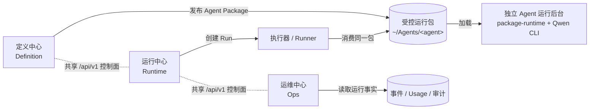
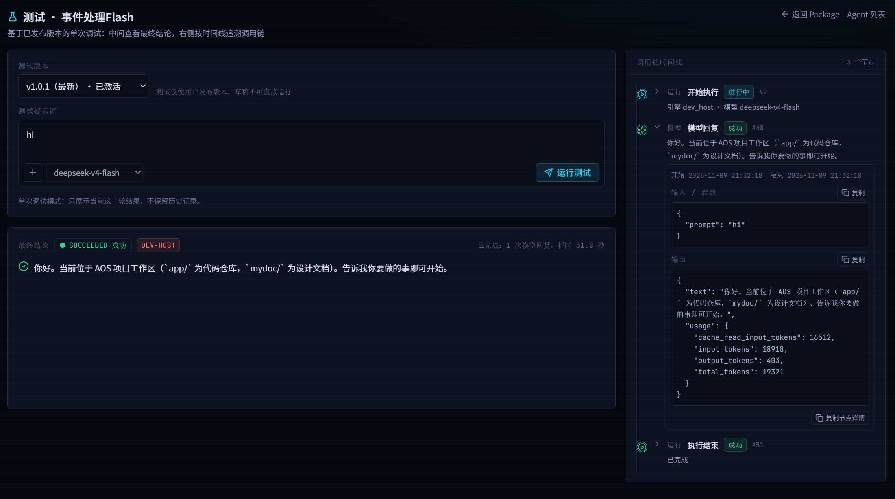
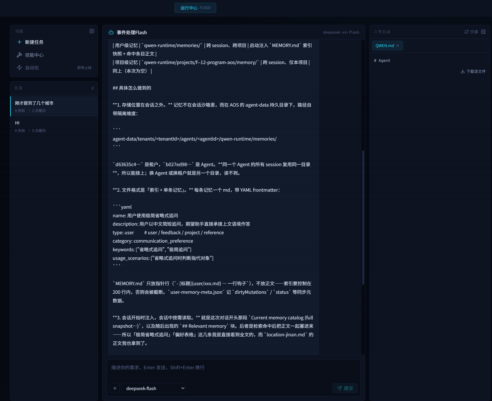
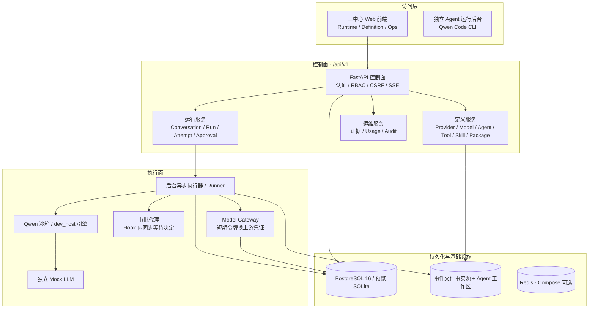
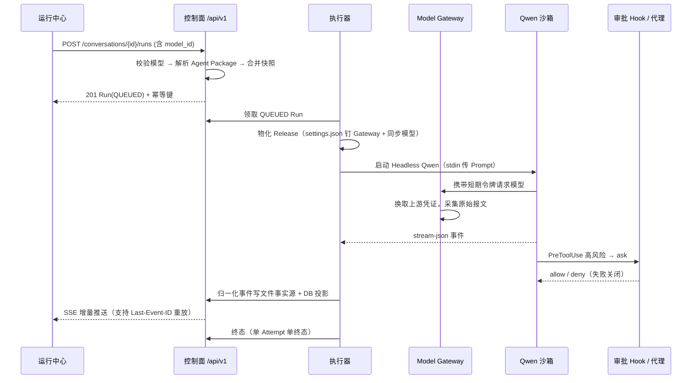

# AOS（Agent Operation System）系统介绍

> 来源：zhenggsh/AOS `mydoc/AOS_intro.md`（文档版本 V1.0，编制日期 2026-11-09）
> 适用读者：产品、架构、后端、前端、平台工程、安全与测试人员
> 上位文档：《AOS（Agent Operation System）企业级智能体平台设计——基于 Qwen Code CLI》V1.2、《AOS MVP 系统生成实施规范》V1.0
> 收录说明：按 IksmHub 知识条目收录，章节顺序与上游一致。三段 mermaid 源码按上游保留。配图沿用本目录 `files/`（与上游 `mydoc/files/` 同一套截图），正文两处图片使用从本文件可解析的相对路径。§1.4 写明不交付的能力标为未实现、不在 MVP。上游 §3.2「执行引擎（execution_engine）」后没有展开，此处不补写。不补充上游未写的功能，也不把建设目标写成已交付能力。
> 配图：`files/定义中心-测试.png`、`files/运行中心-运行.png` 为正文引用。`files/定义中心-模型.png` 为同目录相关截图，正文未引用，不单列成一节。

本文用于整体介绍 AOS 系统：先说明建设背景与目标，再逐模块说明四个组成部分的职责与边界，最后给出系统架构、目录结构、技术栈和核心数据结构。

---

## 1. 设计背景

### 1.1 业务背景

企业引入大模型能力时，常见的问题不是「模型不可用」，而是缺少一套能把模型、工具、数据、权限和审计统一管起来的运行底座：

- **接入碎片化**：不同团队各自直连上游模型，密钥散落、无法统一限流与计费。
- **执行不可控**：智能体直接跑在开发机或宿主进程里，文件系统、网络、Shell 权限没有边界，高风险操作缺少人工确认环节。
- **过程不可见**：一轮对话的模型调用、工具调用、失败与用量没有结构化记录，出问题难以回溯。
- **交付不可迁移**：智能体定义与运行环境耦合，换环境就无法复现，无法脱离 Web 独立运行。

### 1.2 设计立场

AOS（Agent Operation System）以 **Qwen Code CLI 0.26.4** 作为企业智能体执行底座，构建一套**企业多租户的智能体运营平台**。核心设计立场：

1. **设计与运行分离**：设计模块专注于智能体能力开发的集成，可进行有限的测试；运行模块负责智能体执行的管控、沙箱、审批、记忆和迭代等；
2. **独立的后台运行**：后台智能体不依赖于Web运行，可实现快速的移植、后台能力定制与封装、实现企业级的智能体运行管理。
3. **监控运营中心**：使用同一的后台监控智能体运行状态、资源用量、异常事件等，提供统一的界面与接口。

> 第 1 条里的「记忆」是立场用词。§1.4 写明企业长期记忆不交付，该项未实现、不在 MVP。第 3 条「使用同一的后台」按上游原文保留。

### 1.3 建设目标

| 目标 | 说明 |
| --- | --- |
| 统一模型接入 | 租户管理员在 Web 配置多个 OpenAI 兼容模型端点、模型与凭证，并对智能体授权使用 |
| 工作区隔离 | 每个智能体独立、持久、可版本化的运行目录，租户之间不可互访 |
| 多模式编排 | 实现多种模式的智能体编排，包括顺序、并行、条件、循环、ReAct、Plan-Execute 等模式。其中 Plan-Execute 见 §1.4，未实现、不在 MVP；顺序、并行、条件、循环、ReAct 只记为建设目标，不记为已交付能力 |
| 工具集成 | 集成各种形式的外部能力，包括公开的API，MCP接口，业务自定义接口等 |
| 能力开放 | 智能能力通过接口对外提供，实现开放的对外赋能 |
| 独立运行包 | 每个 Agent 输出为完整目录＋文件，不依赖 Web 进程即可交互执行 |

### 1.4 首版边界

AOS MVP 聚焦基础闭环的完整实现。下列能力**不交付，未实现，不在 MVP**：多 Agent 自动编排、Plan-Execute、Reflexive Agent、RAG、企业长期记忆、Workflow、跨 Runner 高可用、Responses API，以及 Anthropic／Gemini 原生协议。数据模型保留 `pattern`、`protocol` 等扩展字段，但 API 拒绝非 MVP 值，这些字段不显示为已可用功能。

---

## 2. 主要模块

AOS 由四个模块组成：**定义中心、运行中心、运维中心**为可独立构建、独立启动的 Web 系统；**独立 Agent 运行后台**为无 Web 依赖的目录＋文件型运行包。



> 三个 Web 中心的「可单独启动」是**部署与故障域解耦**，不是复制三份数据或三套权限：它们共享版本化 API、统一 IAM 和对象模型。

### 2.1 定义中心（Definition）

**职责**：环境与工具配置、Agent 开发模式、Agent 定义、开发测试、结果回放与运行包发布。

| 能力 | 说明 |
| --- | --- |
| Provider／模型管理 | 维护「怎么连」（Provider 连接与鉴权）与「是什么、能干什么」（Model 身份、能力、默认生成参数）两级归属；凭证仅密文入库 |
| 工具注册 | REST、MCP（stdio／HTTP／SSE）工具注册、版本、试运行与文件化调用留痕 |
| Skill 管理 | 上传、校验、版本、绑定、原子同步与漂移检测 |
| Agent 定义 | 草稿编辑、配置版本、绑定模型／工具／Skill、生成参数「模型默认 ⊕ Agent 覆盖」 |
| 开发测试 | 在定义中心内直接发起测试会话，查看脱敏原始报文与结构化调用链 |
| 发布 | 版本化发布为不可变 Agent Package，支持激活与回滚 |

**边界**：不直接执行正式 Run，不向草稿暴露生产凭证。



### 2.2 运行中心（Runtime）

**职责**：面向最终用户的 Agent 与会话运行，采用「单 Agent 专属工作台」布局（左侧功能与任务区、中间对话主区、右侧本地目录与工具区，两侧栏均可收缩）。

| 能力 | 说明 |
| --- | --- |
| Agent 中心 | 列出当前租户有权访问、包状态为 `READY`/`ACTIVE` 的 Agent；选择 Agent 发起或继续会话 |
| 对话运行 | 每轮创建 Run，SSE 增量推送文本与工具状态，支持取消与显式重试 |
| 会话恢复 | 通过显式 `session_id` 映射恢复上下文，不使用「最近会话」代替 |
| 临时切换模型 | 会话内可临时选择本次 Run 使用的模型，写入本次 Run 快照，**不改动已发布 Package** |
| 调用链回放 | 执行中实时展示过程摘要与调用链；已完成的回复双击「ASSISTANT」标题可恢复查看调用历史详情 |
| 审批 | 高风险操作转为人工审批，运行中心引导跳转审批中心并在通过后「继续执行」 |
| 工作目录 | 只读浏览智能体工作区文件，支持文本原位预览与下载 |

**边界**：不展示默认完整开发报文，不直接扫描未授权目录。

### 2.3 运维中心（Ops）

**职责**：以运行事实为依据，做整体控制台、运行证据、用量统计与审计。

| 能力 | 说明 |
| --- | --- |
| 概览 | 运行总量、成功率、活跃 Run、审批与用量关键指标 |
| 运行证据 | 按 Run 下钻查看事件时间线、调用记录与关联文件证据 |
| 用量统计 | Web 调用次数、Token、状态、时延；Mock 用量单独展示 |
| 审计日志 | 记录 `user`/`runner`/`gateway`/`system` 等主体对资源的授权与执行结果 |

**边界**：只读，不改变运行结果，不绕过文件访问权限，不可查看密钥明文。




### 2.4 独立 Agent 运行后台（package-runtime）

**职责**：加载单个 Agent 包，交互接收 Prompt，调用 Qwen Code 与本地 Skill／工具。

- **形态**：目录＋文件＋本地启动入口（`bin/agent.sh` 与纯标准库 CLI `bin/aos_agent.py`），**不依赖三个 Web 中心、平台数据库或消息队列**。
- **可移植性**：包内包含定义、项目指令、非敏感配置、工具描述、协议适配器、Skill、测试与版本元数据；**不携带**明文密钥、其他租户数据、模型权重与宿主机沙箱策略。
- **可扩展性**：支持提供命令行接口，实现能力的扩展与业务的定制。

---

## 3. 系统架构

### 3.1 分层架构

AOS 采用控制面／执行面分离的四层架构：



### 3.2 单进程多角色

控制面与执行面在开发／预览环境可合并到单个 FastAPI 进程中，由 `AOS_SERVICE_ROLE` 决定进程角色：

| 角色 | 默认端口 | 职责 |
| --- | ---: | --- |
| `api` | 8000 | 控制面 `/api/v1`；预览时内嵌 `/mock` |
| `gateway` | 18080 | 模型网关：以短期令牌换取真实上游凭证，采集原始报文 |
| `approval` | 18081 | 审批代理：在 Hook 内等待并返回明确的允许／拒绝 |
| `mock` | 18082 | 独立 Mock LLM（OpenAI 兼容，用于无 Qwen/Docker 环境验证） |

四个模块的启动方式（所有命令在 `app/` 目录下执行；前三个 Web 中心共用同一后端 `api` 角色，需先启动后端 :8000）：

```bash
# ── 定义中心 / 运行中心 / 运维中心（三中心 Web 前端）──
# 开发模式：单一 Vite 开发服务器同时提供三个入口（:3000，/api 代理到 :8000）
#   运行中心  http://localhost:3000/index.html
#   定义中心  http://localhost:3000/definition.html
#   运维中心  http://localhost:3000/ops.html
npm install && npm run dev

# 生产模式：按中心分别构建静态产物，由 nginx 托管（compose 中为 8081/8082/8083）
npm run build:definition     # 产物 dist-definition/
npm run build:runtime        # 产物 dist-runtime/
npm run build:ops            # 产物 dist-ops/

# ── 独立 Agent 运行后台（package-runtime，无 Web 依赖）──
# 前提：已通过定义中心发布 Agent Package；在 Agent 包根目录内执行
bin/agent.sh --version                   # 查看版本
bin/agent.sh doctor                      # 环境与包完整性自检
bin/agent.sh run --stdin --output jsonl  # 单轮执行（自动化推荐 --stdin）
bin/agent.sh chat                        # 交互会话（需要 TTY）
bin/agent.sh sessions list               # 查看会话
```

独立后台的模型接入为本地模式：`direct_upstream`（`AOS_MODEL_BASE_URL` + `AOS_MODEL_API_KEY`，非平台治理）或 `managed_gateway`（`AOS_GATEWAY_URL` + `AOS_MODEL_API_KEY`，本地受控凭证）。

执行引擎（`execution_engine`）：

### 3.3 一次运行的完整链路



### 3.4 关键运行机制

| 机制 | 说明 |
| --- | --- |
| Run 状态机 | 活跃态 `QUEUED / STARTING / RUNNING / WAITING_APPROVAL / CANCELLING`；终态 `SUCCEEDED / FAILED / TIMED_OUT / CANCELLED / BLOCKED / UNCERTAIN` |
| 事件事实源 | 事件先落文件（append-only）+ 复算校验，再投影 DB；序号在同一 Run 内单调且不分叉 |
| SSE 重放 | 支持 `Last-Event-ID`，序号不匹配返回 409 强制重新对齐 |
| 幂等 | 写接口支持 `Idempotency-Key`，同键同请求哈希返回既有结果，不同哈希拒绝 |
| 取消 | 标记 `CANCELLING` → 执行点检查 → `run.cancelled`，不回滚已产生的副作用 |
| 重试 | 有副作用的任务不自动重放；仅 `FAILED / TIMED_OUT / BLOCKED` 支持显式重试 |
| 对账 | 启动时扫描非终态 Run，无活跃执行权则标记 `UNCERTAIN`，须先对账 |
| 令牌 | 短期模型／Hook 令牌只存 SHA-256(pepper+token)，绑定 Attempt/Provider/Model，运行时 `settings.json` 的 `baseUrl` 强制钉到 Gateway |
| 跨进程协调 | 生产 PostgreSQL 行锁；SQLite 预览用写事务，保证事件序号不分叉 |

---

## 4. 目录结构

工作区根为 `f:\12-PROGRAM\AOS`，实际代码仓库在 `app/` 子目录；`mydoc/` 存放设计文档。**所有构建、测试命令均在 `app/` 目录下执行。**

```text
f:\12-PROGRAM\AOS
├── AGENTS.md                     项目说明（面向 AI 编码代理）
├── mydoc/                        设计文档
│   ├── AOS_MVP_系统生成实施规范.md      权威契约文档
│   ├── 基于_Qwen_Code_CLI_的智能体平台设计.md  总体设计（上位文档）
│   ├── 智能体底层技术栈分析对比.md
│   └── AOS_intro.md              本文
└── app/                          代码仓库
    ├── index.html / definition.html / ops.html  三入口多页应用
    ├── backend/                  FastAPI 后端
    │   ├── app/
    │   │   ├── main.py           应用装配、路由挂载、启动对账
    │   │   ├── config.py         Settings（AOS_* 环境变量）
    │   │   ├── db.py             Peewee 连接、DB_LOCK、写事务
    │   │   ├── models.py         Peewee 数据模型（核心 DDL 子集）
    │   │   ├── security.py       会话／CSRF／凭证加密／短期令牌
    │   │   ├── events.py         EventStore（文件事实源 + DB 投影）
    │   │   ├── executor.py       后台 asyncio Run 执行器
    │   │   ├── qwen.py           Qwen Headless 适配（argv/env/退出码映射）
    │   │   ├── mock_llm.py       OpenAI 兼容 Mock LLM
    │   │   ├── run_summary.py    调用链/过程摘要构建（build_trace）
    │   │   ├── errors.py         统一错误码与处理
    │   │   ├── seed.py / seed_dev.py  种子数据
    │   │   ├── routers/          auth agents runs providers tools skills
    │   │   │                     gateway approvals approval_proxy
    │   │   │                     mock_service ops
    │   │   ├── runner/           独立 Runner 主循环
    │   │   └── ops/              doctor / drain / restore_check
    │   ├── migrations/           Alembic 迁移（0001 基线、0002 二级模型配置）
    │   └── tests/                unittest（test_mvp、dev_host、安全等）
    ├── src/                      三中心 React 控制台
    │   ├── pages/define/         Agents Providers Tools Skills Packages TestConsole
    │   ├── pages/run/            Agents AgentWorkbench Conversations Runs Approvals
    │   ├── pages/ops/            Overview Runs Usage Audit
    │   ├── components/ui/        shadcn/ui 基础组件
    │   ├── components/{layout,mc,run}/
    │   └── lib/                  api / auth / format / generation / utils
    ├── package-runtime/          独立 Agent 运行后台
    │   ├── bin/aos_agent.py      纯标准库 CLI
    │   ├── bin/agent.sh          本地启动入口
    │   ├── schemas/agent.schema.json   Agent Schema（Draft 2020-12）
    │   ├── adapters/rest_mcp_server.cjs REST→stdio MCP 适配器
    │   ├── examples/weather-agent/     示例运行包
    │   └── tests/                CLI 退出码、Schema digest、MCP 适配器
    ├── sandbox/                  Qwen 沙箱
    │   ├── Dockerfile
    │   ├── hooks/                System Hook（pre/post tool use，fail-closed）
    │   ├── probe/                Hook 资格探针
    │   └── settings/             settings.json 模板
    ├── acceptance/               run_acceptance.py（PASS/FAIL/SKIP 如实报告）
    ├── deploy/                   前端 Dockerfile 与 nginx.conf
    ├── scripts/                  e2e_preview.py（真实 HTTP 闭环）
    ├── Dockerfile                平台动态预览镜像
    ├── docker-compose.yml        生产基线
    └── Makefile                  全部运维入口
```

---

## 5. 技术栈

### 5.1 版本锁定

| 组件 | 锁定值 | 说明 |
| --- | --- | --- |
| Qwen Code CLI | `0.26.4` | 禁止 `latest`/preview/nightly；配置渲染器与事件解析器按版本适配 |
| Node.js | `20+`（前端）／`22.x`（沙箱） | Qwen 0.26.4 要求 `>=22.0.0` |
| Python | `3.12.x` | 后端与独立 CLI |
| PostgreSQL | `16.x` | 主数据、执行队列、授权与统计投影 |
| Redis | `7.x` | 协调锁、限流和 Pub/Sub，不是事实源 |
| 沙箱镜像 | `ghcr.io/qwenlm/qwen-code:0.26.4` | 以 `sha256:` digest 锁定；不使用禁用 Hook/MCP/Skill 的 `tools.executionSandbox` 模式 |
| 部署 | Linux x86_64 + Docker Compose | MVP 单控制面节点、单 Runner 节点、共享持久卷 |

### 5.2 后端

- **Python 3.12 + FastAPI**：控制面、认证、RBAC、CSRF、REST、SSE、审批 API。
- **Peewee**：业务持久层（`models.py`）。
- **Alembic / SQLAlchemy**：仅用于迁移（SQLAlchemy 仅作 Alembic 运行库，业务层用 Peewee）。
- **httpx**：网关与上游调用；**标准库 `unittest`** 为唯一测试框架（无 pytest 依赖）。
- 数据库在预览/测试默认 SQLite（`./data/aos-preview.db`，非生产方案），生产为 PostgreSQL 16。

### 5.3 前端

- **React 19 + TypeScript + Vite 7**：三入口多页应用，由 `VITE_CENTER` 选择构建目标（`runtime` / `definition` / `ops`）。
- **Tailwind CSS 3 + shadcn/ui**（Radix UI）：`src/components/ui/` 为源码，保持既有风格。
- **react-router 7**：路由；**react-hook-form + zod**：表单与校验。
- `@` 别名指向 `src/`；npm scripts：`dev`、`build`、`build:definition`、`build:runtime`、`build:ops`、`check`（`tsc -b`）、`lint`、`preview`。

### 5.4 独立 CLI 与沙箱

- **独立 CLI**（`package-runtime/bin/aos_agent.py`）：纯 Python 3.12 **零第三方依赖**；诊断写 stderr 不污染 JSONL；退出码遵循规范 6.4。
- **MCP 适配器**：Node.js CommonJS（`.cjs`），把 REST 工具暴露为 stdio MCP。
- **System Hook**：Node.js（`.cjs`），`PreToolUse` 失败关闭；PostTool 记录证据。

### 5.5 常用命令

```bash
cd app                                   # 所有命令在 app/ 下执行
npm install && python3 -m pip install -r backend/requirements.txt
python3 -m uvicorn app.main:app --app-dir backend --reload --port 8000   # 后端
npm run dev                              # 前端 :3000

npm run check && npm run build           # 前端类型检查 + 构建
cd backend && python3 -m unittest discover -s tests -v   # 后端测试
python3 -m unittest discover -s package-runtime/tests -v # CLI/适配器测试
node sandbox/probe/hook_behavior_probe.cjs               # Hook 探针
python3 acceptance/run_acceptance.py                     # P0 验收

# Compose / Makefile
make configure / build / up / test / acceptance / backup / doctor / down
```

> 演示账号：`admin` / `AOS-demo-2026!`（仅本地开发，生产必须替换）。
> 真实 Qwen、Docker、PostgreSQL、备份恢复用例必须在目标 Linux 环境执行；本机 Mock 测试通过不代表外部资格验收完成。

---

## 6. 数据结构

### 6.1 存储策略

- **可移植约束**：UUID 以 36 字符字符串存储；JSON 以文本存储（自定义 `JSONField`）；枚举由应用层保证 CHECK 语义；时间统一存 naive UTC，输出转 RFC 3339。
- **双载体分工**：Agent 包、测试记录、工具日志与运行证据以**文件**为可迁移载体；**数据库**用于企业索引、权限、统计和检索。独立后台只依赖前者。
- **事实源原则**：运行事件先写 append-only 文件事实源，再投影到 `run_event`；DB 不替代 Qwen 私有会话存储。

### 6.2 核心表一览（24 张）

| 分层 | 表 | 关键字段与说明 |
| --- | --- | --- |
| 租户与身份 | `tenant` | `slug`、`name`、`status` |
| | `app_user` | `username`、`password_hash`、`oidc_issuer`/`oidc_subject`（预留 SSO） |
| | `tenant_membership` | 复合主键 `(tenant, user)`，`roles`（JSON 数组） |
| | `auth_session` | `token_hash`、`csrf_hash`、`expires_at`、`ip_hash`（HttpOnly 会话） |
| 模型接入 | `provider` | 「怎么连」：`kind`、`base_url`、`auth_type`、`default_headers`、`proxy`、`timeout_ms`、`max_retries`、`default_wire_api` |
| | `provider_credential` | 上游密钥**仅存密文**（`ciphertext`），另有 `encryption_key_id`、`key_fingerprint`、`env_key`；读接口永不回显 |
| | `model` | 「是什么」：`model_id`、`display_name`、`protocol`、`wire_api`、`capabilities`、`context_window`、`sampling`（默认生成参数）、`pricing` |
| 定义 | `tool_definition` | 版本化：`tool_id`、`version`、`type`（rest/mcp_stdio/mcp_http/mcp_sse）、`risk`（L0–L3）、`definition_digest` |
| | `skill` / `skill_version` | Skill 与版本：`archive_digest`、`validation_status`、`validation_report` |
| | `agent` | 草稿与指针：`draft_config`、`config_version`、`current_package_version/digest`、`status`、`resource_version` |
| | `agent_package` | 不可变包：`package_version`、`package_digest`、`state`、`release_path`、`config_snapshot`（冻结快照） |
| 运行 | `conversation` | 会话：`agent`、`owner_user`、`title`、`origin` |
| | `conversation_qwen_session` | 会话↔Qwen 映射：`qwen_session_id`、`bound_run`、`cli_version` |
| | `run` | 运行：`state`、`config_snapshot`、`execution_engine`、`is_mock`、`side_effects`、`current_attempt_no` |
| | `run_attempt` | 尝试：`attempt_no`、`state`、`runner_id`、`qwen_exit_code`、`mapped_exit_code`、`retry_of_attempt` |
| | `run_event` | 统一事件：`sequence`、`event_id`、`event_type`、`occurred_at`、`payload`、`terminal`、`envelope` |
| | `approval` | 审批：`tool_use_id`、`risk`、`state`、`canonical_input_hash`、`expires_at`、`consumed_at`（原子消费一次） |
| | `model_token` | 短期令牌：只存 `token_hash`，`purpose`（model/hook），绑定 `attempt`/`provider`/`model_db` |
| 运维 | `audit_log` | 审计：`actor_type`、`action`、`resource_type/id`、`request_id`、`outcome` |
| | `tool_call_log` | 工具调用留痕：`tool_call_id`、`status`、`origin`、`canonical_input_hash`、`evidence_path` |
| | `tool_test_call` | 定义中心试运行记录：`tool_definition_id`、`input`、`status` |
| | `usage_ledger` | 用量：`input_tokens`、`output_tokens`、`cached_tokens`、`cost_microunits`、`gateway_request_id` |
| | `idempotency_record` | 幂等：`(tenant, actor_key, route_key, idempotency_key)` 唯一，`request_hash`、`response_body` |

### 6.3 核心对象层级

```text
平台
└── 租户 Tenant
    ├── 用户 User / 角色 Roles
    ├── Provider / Credential / Model
    └── Agent
        ├── 工作区 Workspace
        ├── 版本 AgentConfigVersion / AgentPackage（不可变快照）
        ├── 工具绑定 ToolBinding / SkillBinding
        └── 会话 Conversation
            └── 运行 Run
                ├── 尝试 RunAttempt
                ├── 事件 RunEvent
                ├── 审批 Approval
                └── 用量 UsageLedger
```

所有业务对象均带 `tenant_id`；跨租户共享内容使用独立 `platform` 作用域，经显式授权发布给租户。

### 6.4 角色（RBAC）

`tenant_admin`（租户管理员）、`agent_developer`（智能体开发者）、`agent_publisher`（发布者）、`agent_user`（普通使用者）、`approver`（审批人）、`ops_viewer`（运维只读）、`auditor`（审计员）。

### 6.5 生成参数：模型默认 ⊕ Agent 覆盖

生成参数采用两层级合并，来源标记区分 `inherit`（继承模型默认或系统内置默认）与 `override`（Agent 覆盖）：

| 参数 | 允许范围 | 系统内置默认 |
| --- | --- | --- |
| `temperature` | 0.0 – 2.0 | 0.2 |
| `top_p` | (0, 1.0] | 0.95 |
| `max_tokens` | 1 – 131072 | 4096 |
| `timeout_ms` | 1000 – 600000 | 120000 |
| `max_retries` | 0 – 3 | 1 |

模型未声明项回退系统内置默认；Agent 覆盖项优先。发布时计算「生效值 + 来源标记」写入 `package.config_snapshot`（`generation_effective` / `generation_sources`），实现行为冻结与摘要追踪。

---

## 7. 安全红线（摘要）

- API Key 不进入 Release、前端、Qwen 配置或普通日志；**密钥接口不得回显**。
- Prompt 通过 stdin 传递；**不修改 Qwen 私有 JSONL**。
- 审批 Hook **失败关闭**；审批决定由绑定的 Hook/执行器**原子消费一次**。
- 有副作用的任务**不自动重放**；`UNCERTAIN` 状态必须先对账。
- 不得通过 `yolo` 模式、关闭沙箱或无沙箱宿主进程绕过执行安全；唯一例外是规范 7.8 的 `dev_host` 开发引擎（仅联调，非验收路径，生产严禁）。
- 生产要求：`AOS_QWEN_REQUIRED=true`、`AOS_MOCK_LLM_ENABLED=false`、沙箱镜像以 `sha256:` digest 锁定、`AOS_HOST_DATA_ROOT` 为宿主机绝对路径并同路径挂入 Runner。
- 跨进程 Run 写入由 PostgreSQL 行锁协调（SQLite 预览用写事务），事件序号不得分叉。
