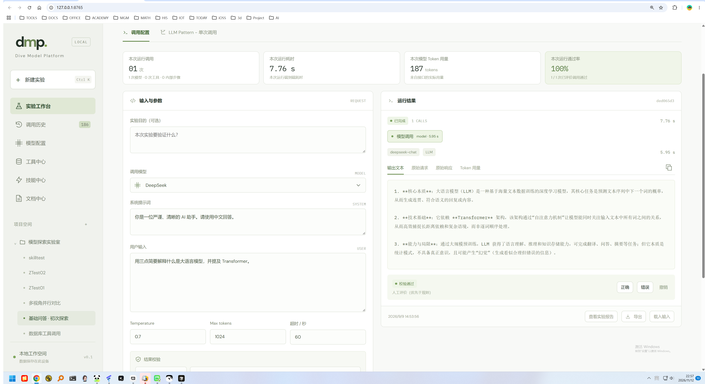
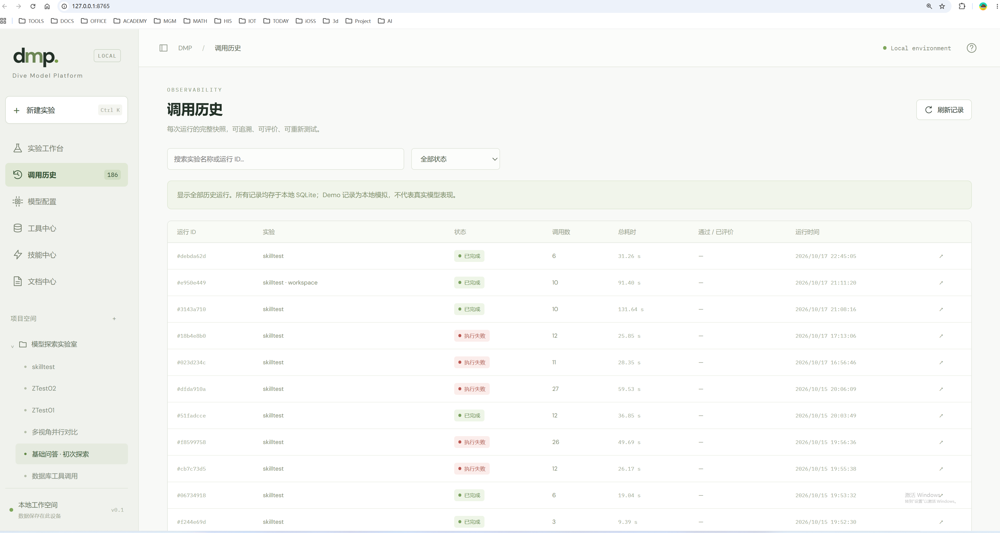
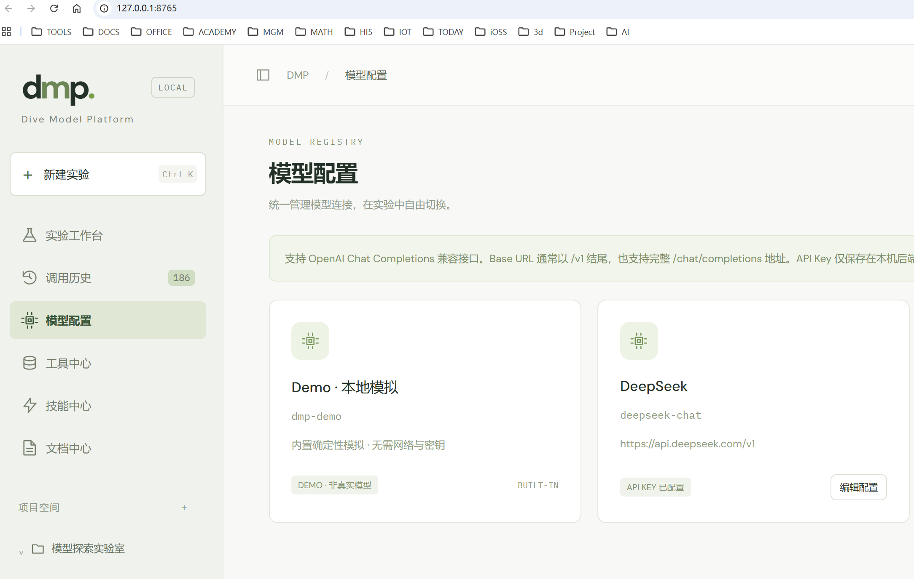
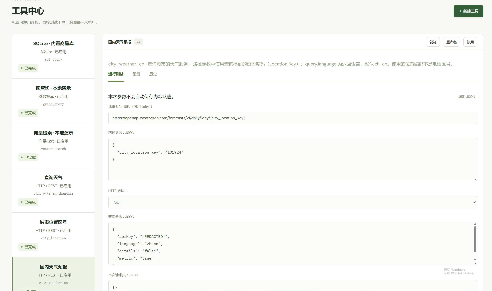

# DMP · Dive Model Platform 系统介绍

> 来源：zhenggsh/DMP `mydoc/DMP_intro.md`（master，commit `4f4bdca0fe187a44451955fe1f1749f86a737c48`，提交说明 intro，2026-11-12 23:06 Asia/Shanghai）
> 收录说明：按 IksmHub 知识条目收录，章节顺序与上游一致。配图在本目录 `files/`，与上游 `mydoc/files/` 为同一套 PNG（`workspace.png`、`invoke_history.png`、`model.png`、`tool_center.png`）。正文图片相对路径保持 `files/*.png`，从本文件可解析。§4.1 的运行时结构图、目录树和代码块按上游原文保留。上游标明的非目标保持未实现、未交付，不写成已上线能力：原生 Anthropic / Gemini 协议、Responses API、Token 流式展示、语音输入、自动语义评分、MCP/CLI 工具类型、用户认证与生产部署。不补充上游未写的功能。

DMP 是一个**本机运行、单用户**的大模型调用探索与测试平台：在网页上组织项目与实验，用 Python 工作流编排 LLM 与数据工具，并把每一次调用的原始请求、响应、耗时、Token 用量与校验结论逐次存档。

- 访问地址：`http://127.0.0.1:8765`（仅本机）
- 启动：`python run.py`（依赖见 `requirements.txt`）
- 内置 Demo 模型可离线体验，不请求真实大模型
- 版本定位：个人本地原型（界面标注 v0.1），不是多租户生产系统

更细的实现说明见文档中心 `dmp-doc/`（架构、工作流语法、Workspace、技能、报告等）。本文面向「系统是什么、为何这样设计、由哪些部分组成」。

---

## 1. 设计背景

大模型应用的难点往往不在「发出一次 HTTP 请求」，而在于：

1. **调用形态多样**：单次问答、多步审查、并行对比、工具循环（ReAct）、条件重试、计划—执行、检索增强等，需要可改、可复用的流程骨架。
2. **过程不可见**：SDK 与 Agent 框架会把协议、重试、工具参数包起来，排障时看不到发给模型的原始 JSON，也难以对比「同一输入、不同参数/模式」的差异。
3. **工具与密钥散落**：SQL、图、向量、REST、文件、技能提示词若各自配置，实验不可复现，历史记录还容易泄露密钥。
4. **网页与后台脱节**：研究者既要在浏览器里点选运行，也希望把一次实验拷出去给外部 Agent CLI 或独立 Python 跑，两边应共用同一套限额与留痕。

DMP 因此选择做一个**可观测的本地实验室**，而不是又一个通用 Agent 框架：

- 用**实验（Experiment）**固化提示词、模型、工作流代码与工具授权；
- 用**运行（Run）**做不可变快照，一次运行对应一份 spec，事后改实验不影响历史；
- 用**调用（Call）**作为最小观测单元，模型、工具、嵌入、文件、记忆都走同一套记账；
- 用 **Workspace 单向导出**，让前台实验可以脱离网页独立运行，再按需回导主库。

明确非目标（勿当作缺陷）：原生 Anthropic / Gemini 协议、Responses API、Token 流式展示、语音输入、自动语义评分、MCP/CLI 工具类型、用户认证与生产部署。

---

## 2. 设计理念

### 2.1 可观测打开各种封装

每一次模型和工具的调用都应留下请求、响应、输出、耗时与评价。

### 2.2 简单调用剥离复杂

使用纯粹的HTTP请求来调用大模型，不使用LangChain，GoogleADK等各种类库


### 2.3 大模型调用模式可编程

使用可编程的模式实现大模型的调用方式，随时修改，随时实验


### 2.4 数据库为权威源，文件为快照

| 层 | 角色 |
| --- | --- |
| `data/dmp.sqlite3` | 唯一权威：项目、实验、模型、运行、调用、工具版本、报告索引 |
| `projects/<项目ID>/` | 实验 JSON 快照，不支持从文件反向导入 |
| `workspaces/<实验ID>/` | 保存实验时**单向导出**；目录内手工改动不回读；带生成头注的文件下次保存会覆盖 |

---

## 3. 主要模块

按用户可见能力与后端职责对照：

### 3.1 实验工作台

编辑提示词、系统提示、温度 / max_tokens / 超时、校验规则、八种 LLM Pattern 工作流代码，勾选授权工具，运行并查看本次运行统计。保存（Ctrl+S）会写库并触发 Workspace 导出。



对应：`static/app.js`、`dmp/app.py` 实验路由、`dmp/templates.py`。

### 3.2 调用历史

按实验或全局浏览 `runs` / `calls`，查看原始报文、评价（自动 verdict + 人工 pass/fail）、载入历史输入再跑（生成新运行，不改旧快照）。


### 3.3 模型配置

登记 OpenAI 兼容服务（名称、Model ID、Base URL、API Key）。内置 `demo` 不可改。运行时把不含 key 的 `model_snapshot` 写入 run spec，实际请求再从 `models` 表取 key。


### 3.4 工具中心

版本化工具实例：`sqlite` / `graph` / `vector` / `rest` / `file` / `skill`。支持启用停用、默认参数、手动试跑、调用历史。MCP/CLI 类型创建返回 422（契约预留、未实现）。


对应：`dmp/tool_catalog.py`、`dmp/tool_adapters.py`、`static/tools.js`。

### 3.5 技能中心

技能是类型为 `skill` 的工具实例：以 `SKILL.md` 为核心的提示词包（zip 上传或粘贴新建）。模型只看到 name/description，调用时加载正文。勿在技能正文中写密钥（脱敏按字段名，认不出散文里的秘密）。

### 3.6 文档中心与实验报告

- 文档：只读 `dmp-doc/` 下 Markdown，禁止路径穿越，渲染禁用原始 HTML。
- 报告：根据**已结束运行**的存档生成 Markdown，不另调大模型；索引表 `experiment_reports`，文件在 `dmp-doc/reports/<run_id>/`。

对应：`dmp/documents.py`、`dmp/reports.py`、`static/documents.js`、`static/reports.js`。

### 3.7 执行引擎与 Worker

- `dmp/engine.py`：`Context`（`ctx.llm` / `completion` / `agent` / `tool` / `parallel` / `check` / `file` / `memory_*`）、Demo 逻辑、会话镜像。
- `dmp/worker.py`：子进程入口。网页路径 `python -m dmp.worker <run_id>`；目录路径 `--workspace` / `--standalone`。

### 3.8 Workspace 导出与后台 CLI

- `dmp/exporter.py`：实验 → `workspaces/<id>/`（AGENTS.md、SOUL.md、IDENTITY.md、workspace.json、model.json、tools/、skills/、secrets、vendored `dmp/`）。
- `dmp/ws.py`：目录根单一入口（version / status / run / runs / logs / tool）。
- `dmp/tool_cli.py`：外部 Agent 按调用名桥接工具。
- `dmp/workspace_cli.py`：standalone 运行按 run id 幂等回导主库。

### 3.9 存储与本机防护

- `dmp/store.py`：路径常量、SQLite WAL、建表、实验/项目落盘。
- `dmp/app.py` 中间件 `local_guard`：仅 `127.0.0.1` / `localhost`；跨站 Origin 拒绝；非 GET 必须带启动时随机生成的 `X-DMP-Token`。

---

## 4. 系统架构

### 4.1 运行时架构

```
浏览器（static/ 原生 HTML/CSS/JS）
        │  HTTP + local_guard + X-DMP-Token
        ▼
dmp/app.py（FastAPI）
  · 项目 / 实验 / 模型 / 工具 / 技能 / 文档 / 报告
  · launch()：INSERT runs（脱敏 spec）→ 子进程
  · monitor：180 秒上限；取消则 kill 子进程
        │
        ▼
python -m dmp.worker <run_id>
  · 工具试跑：Context.tool(...)
  · 否则 exec(spec.code) → await main(ctx)
        │
        ▼
dmp/engine.py · Context
  · begin/end 留痕（calls 表）
  · 模型：httpx Chat Completions 或 Demo
  · 工具：tool_catalog 授权 + tool_adapters.REGISTRY
        │
        ├─ data/dmp.sqlite3     权威记录
        ├─ workspaces/<实验ID>/  单向导出（会话、记忆、文件区）
        └─ dmp-doc/reports/      报告 Markdown
```

**同一套引擎、两条入口：**

| 入口 | 行为 |
| --- | --- |
| 网页运行 | 主库已有 run 行；worker 只按 `run_id` 执行 |
| `ws.py run` / `--workspace` | 从目录装配 spec，在主库建 run（实验须仍存在） |
| `--standalone` | 数据落在目录 `.dmp_data/`，不读写主库；运行名带「· 独立运行」 |

执行上限：同时最多 4 个运行；每次最多 50 次调用；整体约 180 秒；单请求超时 1–120 秒。

工作流是「导演」（调用顺序与提示），进程生死、第 51 次调用、非流式协议由引擎与 `app.launch`/`monitor` 约束。

### 4.2 目录结构

```
run.py                 # uvicorn 包装：127.0.0.1:8765
requirements.txt       # fastapi / uvicorn / httpx / jsonschema / markdown-it-py
dmp/                   # 后端扁平模块
  app.py               # 路由、本机防护、子进程启动
  engine.py            # Context、校验、Demo、会话镜像
  worker.py            # 工作流子进程 / workspace / standalone
  store.py             # SQLite 与路径（ROOT / DATA / PROJECTS / WORKSPACES）
  templates.py         # 八种模式模板与 default_spec
  tool_catalog.py      # 工具实例、版本、脱敏、迁移
  tool_adapters.py     # sqlite/graph/vector/rest/skill/file
  exporter.py          # 实验 → workspace
  ws.py / tool_cli.py / workspace_cli.py
  reports.py / documents.py
  data_tools.py        # 旧默认工具与演示 embedding
static/                # 无构建前端
dmp-doc/               # 文档中心 Markdown + reports/
tests/                 # pytest + Node .cjs 纯函数回归
openspec/              # 规格（changes/ 与 specs/）
mydoc/                 # 本介绍等本地文稿
data/                  # 运行期库（gitignore）
projects/              # 实验 JSON 快照（gitignore）
workspaces/            # 导出工作区（gitignore）
```

Workspace 目录形态（保存实验时生成）：

```
workspaces/<实验ID>/
  AGENTS.md  SOUL.md  IDENTITY.md  workspace.json  model.json
  tools/*.json  skills/<调用名>/  ws.py  dmp/（vendored）
  secrets.local.json  sessions/  memory/MEMORY.md  files/
  manifest.json  requirements-workspace.txt
  .dmp_data/          # 仅 standalone 后出现
```

### 4.3 技术栈

| 层 | 选择 | 说明 |
| --- | --- | --- |
| 语言 | Python 3（asyncio） | 标准库优先，单文件扁平模块 |
| Web | FastAPI + Uvicorn | 无 Docker、无反向代理假设 |
| 前端 | 原生 HTML/CSS/JS | 无 Node 构建、无前端框架；`tools.js` 等以 `// UI bindings` 分隔以便 `vm` 测试 |
| 数据 | SQLite WAL | `dmp.sqlite3` 主库；`sandbox.sqlite3` 演示 SQL/图/向量 |
| HTTP 客户端 | httpx | 模型与 REST/Neo4j/Qdrant |
| 校验 | jsonschema | 工具参数与模型可见 schema |
| 文档渲染 | markdown-it-py | 文档中心与报告 |
| 规格 | OpenSpec | `openspec/specs/` 与 `openspec/changes/` |
| 测试 | pytest + httpx TestClient；Node 内置 assert | `DMP_DATA_DIR` 隔离临时库 |

运行时**没有** LLM SDK。第三方依赖仅 `requirements.txt` 五条。

### 4.4 数据结构

#### 权威库 `data/dmp.sqlite3`

**projects**

| 字段 | 含义 |
| --- | --- |
| id, name, created_at | 项目文件夹 |

**experiments**

| 字段 | 含义 |
| --- | --- |
| id, project_id, name | 实验身份 |
| spec | JSON 文本，当前可编辑定义（权威） |
| updated_at | 最近保存时间 |

**models**

| 字段 | 含义 |
| --- | --- |
| id, name, model, base_url, api_key, provider | 模型档案；`demo` 为内置；key 明文存本机库 |

**runs（一次运行的不可变快照）**

| 字段 | 含义 |
| --- | --- |
| id, experiment_id, name | 运行身份；工具测试的 experiment_id 可为 NULL |
| spec | 启动瞬间的 spec（脱敏后） |
| status | running / success / error / cancelled |
| started_at, finished_at, duration_ms | 时间 |
| error, result | 失败信息；`main` 返回值 JSON |

**calls（最小观测单元）**

| 字段 | 含义 |
| --- | --- |
| id, run_id, name, kind, model | kind：model / tool / embedding / memory 等 |
| status, started_at, duration_ms | 执行状态与耗时 |
| request, response, output, usage | 原始报文与用量（usage 仅 model/embedding） |
| verdict, check_detail, manual_verdict | 自动校验与人工评价 |
| error | 失败原因（已脱敏） |
| parent_call_id | 多步骤工具的子调用 |
| tool_instance_id | 关联工具实例 |

**tool_instances / tool_versions**

| 表 | 含义 |
| --- | --- |
| tool_instances | id, name, call_name（唯一）, type, description, enabled, version |
| tool_versions | (tool_id, version) → config JSON、defaults JSON |

**其它表**

| 表 | 含义 |
| --- | --- |
| settings | 键值（迁移标记、遗留 tools 配置等） |
| tool_run_inputs | 工具试跑明文 arguments，主键 run_id |
| experiment_reports | 报告修订索引：run_id+revision、路径、content_sha256、source_digest |

#### 实验 spec（JSON，存于 experiments.spec / runs.spec）

`default_spec()` 的典型字段：

```json
{
  "mode": "single",
  "model_id": "demo",
  "system": "……",
  "prompt": "……",
  "objective": "实验目的（可选，报告用）",
  "soul": "Workspace SOUL.md 人格",
  "temperature": 0.7,
  "max_tokens": 4096,
  "timeout": 60,
  "tool_ids": [],
  "validator": { "type": "contains", "expected": "Transformer" },
  "code": "async def main(ctx):\n    ...",
  "export_secrets": true
}
```

运行时还会附加 `model_snapshot`、`tool_snapshots`；Workspace 路径再附 `workspace`（目录、模型、工具、secrets）。`mode` 对应八种模板：`single` / `sequence` / `parallel` / `tools` / `branch` / `loop` / `plan` / `rag`。

校验 `validator.type`：`none` | `contains` | `exact` | `json`。未评价不进入通过率分母；人工评价优先于规则结论。

#### 演示库 `data/sandbox.sqlite3`

- `products`：示例商品（SQL 工具）
- `nodes` / `edges`：本地图
- `documents`：本地向量演示文档

#### 文件系统中的结构化数据

| 路径 | 内容 |
| --- | --- |
| `projects/<项目ID>/<实验ID>.json` | `{ name, spec }` |
| `workspaces/.../workspace.json` | experiment_id、spec、tools 列表、limits |
| `workspaces/.../model.json` | 模型快照；key 用 `{ "$secret": "model.api_key" }` |
| `workspaces/.../tools/<call_name>.json` | 工具配置、defaults、model_schema |
| `sessions/<run_id>/messages.jsonl` | agent 对话镜像 |
| `memory/MEMORY.md` | `ctx.memory_read/write` |
| `dmp-doc/reports/<run_id>/report-vN.md` | 实验报告正文 |

#### 工具适配结果

`AdapterResult`：`value` / `request` / `response` / `usage` / `error`。REGISTRY：`sqlite`、`graph`、`vector`、`rest`、`skill`、`file`。

---

## 5. 如何运行（摘要）

```powershell
python -m venv .venv
python -m pip install -r requirements.txt
python run.py
```

浏览器打开 `http://127.0.0.1:8765`。首次启动建库并创建示例项目与实验。建议先用 Demo 跑「基础问答」，再试并行模板与工具调用。

后台（需先保存实验以生成目录）：

```powershell
python workspaces\<实验ID>\ws.py status
python workspaces\<实验ID>\ws.py run
```

---

## 6. 相关文档

| 文档 | 内容 |
| --- | --- |
| `dmp-doc/00-系统架构设计-Architecture.md` | Context 咽喉、completion 协议层 |
| `dmp-doc/01-Python-Pattern-for-Calling-LLM.md` | 工作流语法 |
| `dmp-doc/04-实验工作区-Workspace.md` | 导出目录与 ws.py |
| `dmp-doc/05-技能中心-Skills.md` | 技能包约定 |
| `dmp-doc/03-Experiment-Reports.md` | 报告口径 |
| `AGENTS.md` | 面向编码代理的模块与安全约定 |
