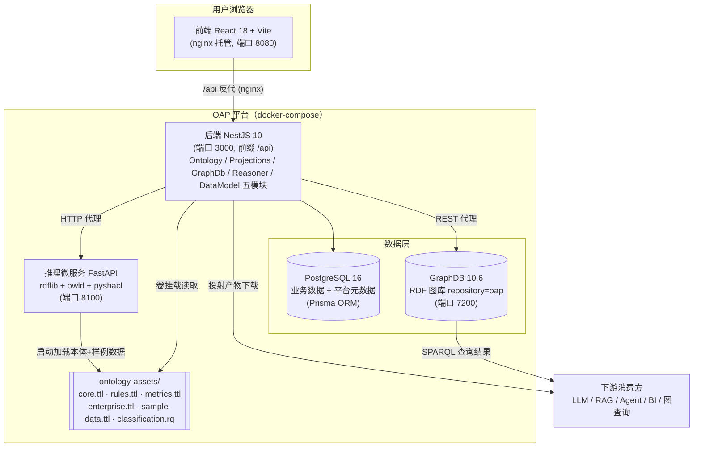
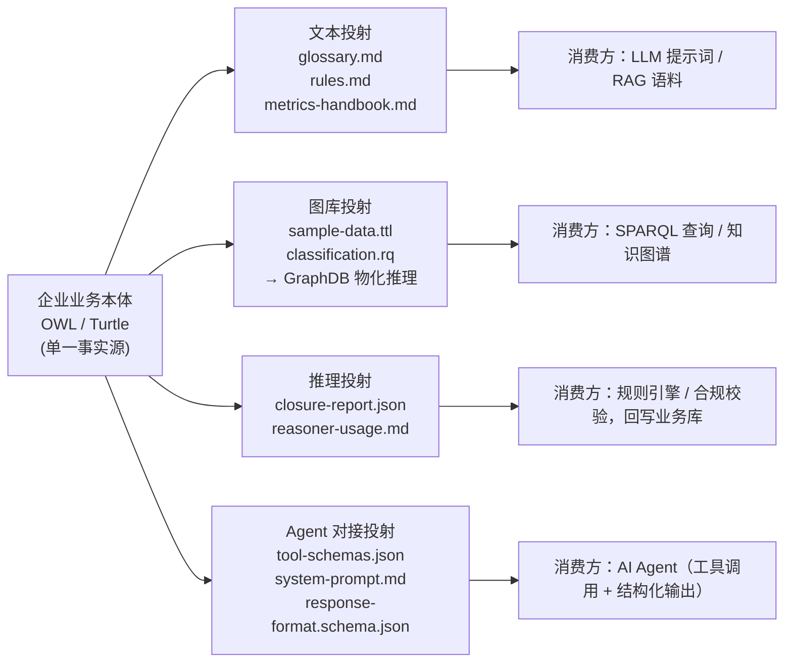
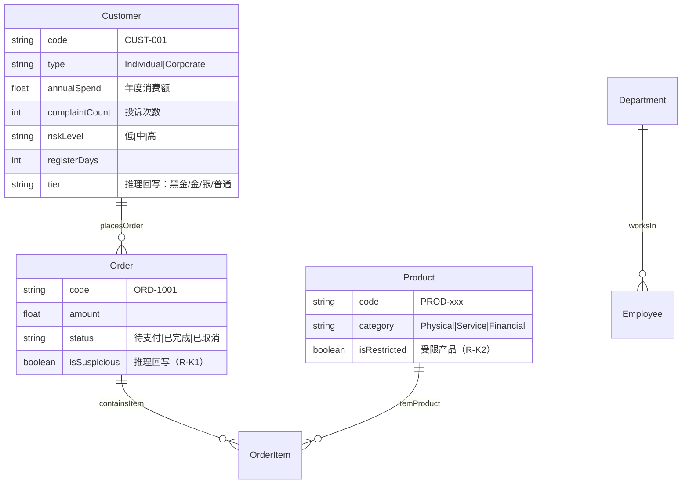
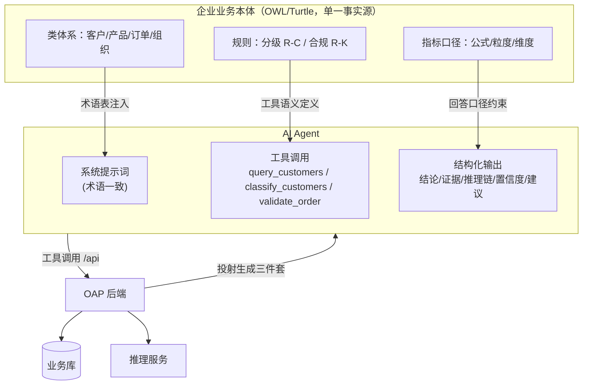

# OAP（Ontology AI Platform）系统介绍

> 来源：zhenggsh/OAP `mydoc/OAP_intro.md`（master，commit `cbe405a9dff4a10f7c26808ae2856c07a5e17ed2`，提交说明「intro min modify」，2026-11-15 17:31 Asia/Shanghai）
> 收录说明：按 IksmHub 知识条目收录，章节顺序与上游一致。四段 mermaid 源码按上游原文保留。上游正文未引用图片，`mydoc/` 下也没有配图文件，故本目录不设 `files/`。不补充上游未写的功能。上游没有单列未实现清单，此处不另造未交付项。

> OAP 是一个"企业业务本体 → 四类投射（文本 / 图库 / 推理 / Agent 对接）"的可视化工程平台。
> 本文档从设计背景、设计理念、主要模块、系统架构、本体论体系以及本体与智能体的关系六个方面对 OAP 进行整体介绍。

---

## 一、设计背景

企业在推进数据智能化（BI 语义层、知识图谱、规则引擎、AI Agent）的过程中，普遍面临一个结构性问题：**业务知识的定义散落在各处**——数据仓库的指标口径在 Excel 里、业务规则在代码里、领域概念在文档里、给大模型的提示词在 prompt 里。每一处都各说各话，导致：

- 同名指标口径不一致（"销售额"到底是含税还是未含税？）；
- 规则逻辑散落代码，业务人员无法审阅，改规则要改代码；
- 大模型/Agent 对企业业务"无感知"，回答靠幻觉，无法解释推理依据；
- 图谱、推理、报表各自建模，重复建设且互相矛盾。

OAP 的设计出发点是：**先建立一套机器可读的"企业业务本体"（Ontology），作为单一事实源（Single Source of Truth），再由本体一键投射（Project）到所有下游消费形态**。本体定义一次，处处消费——文本语料、图库、推理引擎、Agent 工具，全部由同一份 OWL/Turtle 本体派生，天然保证口径一致。

## 二、设计理念

1. **本体即契约（Ontology as Contract）**
   本体不是文档，而是平台全部能力的事实源。类、属性、规则、指标口径都以 OWL/Turtle 形式声明，人与机器（解析器、推理机、大模型）读同一份文件。

2. **一次建模，四类投射（Model Once, Project Everywhere）**
   同一份本体通过"投射"机制生成四类产物：给 LLM/RAG 用的 Markdown 文本、给图数据库用的 RDF 图库资产、给规则引擎用的推理产物、给 Agent 工程用的对接三件套。投射是**纯函数化生成**（`generate(type, sources, ctx) → Artifact[]`），可重复、可刷新、可下载、可版本化。

3. **业务底座解耦**
    可基于不同的业务底座进行本体设计（如营业系统，网管系统），本体设计可作为独立的输出物品导出；

4. **推理与规则显式化、可验证**
   客户分层（黑金/金/银）、可疑订单标记等规则不在代码里硬编码，而是以 OWL 类框架 + SPARQL CONSTRUCT 规则显式声明，由推理引擎执行并**回写业务库**；同时用 SHACL 做合规校验，规则可查询、可审计、可解释。


## 三、主要模块

OAP 由前端、后端、推理微服务、本体资产四大部分构成，后端内部再划分为五个业务模块：

| 模块 | 位置 | 职责 |
|---|---|---|
| **本体管理模块** OntologyModule | `backend/src/ontology/` | 本体文件的浏览、Turtle 在线编辑、语法校验（n3 解析，错误定位到行）、版本历史、结构摘要解析（类/对象属性/数据属性/规则） |
| **投射中心模块** ProjectionsModule | `backend/src/projections/` | 四类投射的同步生成流水线（generators/ 纯函数）、产物落库、刷新、删除、下载 |
| **图库代理模块** GraphDbModule | `backend/src/graphdb/` | GraphDB REST 代理：仓库创建/清空、Turtle 上传、SPARQL SELECT/UPDATE 执行、预置查询 |
| **推理代理模块** ReasonerModule | `backend/src/reasoner/` | Python 推理微服务的 HTTP 代理：健康检查、推理运行、SHACL 校验 |
| **数据模型模块** DataModelModule | `backend/src/datamodel/` | 业务数据（客户/产品/订单/组织）REST 分页查询；推理结果回写（tier / isSuspicious） |
| **推理微服务** ReasonerEngine | `reasoner/` | rdflib + owlrl 做 OWL-RL 前向闭包推理，SPARQL 判定客户分级与可疑订单，pyshacl 合规校验 |
| **前端应用** | `frontend/` | 总览 / 本体编辑器（Monaco）/ 数据浏览 / 四个投射向导 / 产物中心 |

## 四、系统架构

### 4.1 系统架构图



### 4.2 平台数据流



### 4.3 目录结构（Monorepo）

```
oap/                              # 仓库根
├── docker-compose.yml            # 五服务编排（postgres/graphdb/reasoner/backend/frontend）
├── .env.example                  # 环境变量样例
├── README.md                     # 项目总 README
├── ontology-assets/              # 只读本体资产
│   ├── core.ttl                  # 核心层：类/属性/属性链公理（客户/产品/订单/组织）
│   ├── rules.ttl                 # 规则层：客户分级类框架 + 合规分类框架
│   ├── metrics.ttl               # 指标口径层：BI 语义层（指标/维度/公式/粒度）
│   ├── enterprise.ttl            # 顶层入口：owl:imports 组合上述三个模块
│   ├── sample-data.ttl           # 图库样例数据
│   └── classification.rq         # SPARQL CONSTRUCT 规则集（R-C1~R-C3、R-K1、R-K2）
├── backend/                      # NestJS 后端
│   ├── prisma/
│   │   ├── schema.prisma         # 业务数据模型 + 平台元数据模型
│   │   └── seed.ts               # 样例数据（与 sample-data.ttl 对齐）
│   ├── src/
│   │   ├── main.ts / app.module.ts
│   │   ├── prisma/               # Prisma 模块与服务
│   │   ├── ontology/             # 本体管理（controller/service，n3 解析校验）
│   │   ├── projections/          # 投射中心（controller/service + generators/）
│   │   ├── graphdb/              # GraphDB REST 代理
│   │   ├── reasoner/             # 推理服务 HTTP 代理
│   │   └── datamodel/            # 业务数据 REST + 推理结果回写
│   └── test/                     # Jest 单元测试 + e2e
├── reasoner/                     # Python 推理微服务
│   ├── app/
│   │   ├── main.py               # FastAPI 入口
│   │   ├── engine.py             # ReasonerEngine（闭包推理 + SPARQL 判定 + SHACL）
│   │   └── schemas.py            # pydantic 模型
│   └── tests/test_engine.py      # pytest
├── frontend/                     # React 前端
│   ├── src/
│   │   ├── api/                  # client.ts 封装 + TanStack Query hooks
│   │   ├── components/           # Layout / Stepper / StatusBadge / CodeView ...
│   │   └── pages/                # Dashboard / Ontology / Data /
│   │                           # projections/{Text,Graph,Reasoner,Agent} / Artifacts
│   └── src/__tests__/            # Vitest 测试
└── docs/                         # 工程文档
```

### 4.4 技术栈

| 分层 | 技术选型 |
|---|---|
| 前端 | React 18 + TypeScript + Vite + Vitest + React Router + TanStack Query + Tailwind CSS + Monaco Editor |
| 后端 | NestJS 10 + TypeScript + Jest + Prisma 5 + n3（Turtle 解析） |
| 推理服务 | Python 3.11 + FastAPI + rdflib + owlrl + pyshacl |
| 关系数据库 | PostgreSQL 16（Prisma ORM） |
| 图数据库 | Ontotext GraphDB 10.6（free edition，docker-compose 内置） |
| 编排部署 | docker-compose（postgres / graphdb / reasoner / backend / frontend 五服务） |

### 4.5 数据结构

平台数据分两层：PostgreSQL 承载**业务数据**与**平台元数据**，GraphDB 承载**RDF 图数据**。

**业务数据模型（与本体类一一对应）**



**平台元数据模型**

| 表 | 关键字段 | 用途 |
|---|---|---|
| `OntologyFile` | name / content / version / updatedAt | 本体文件当前版本全文与版本号 |
| `OntologyFileVersion` | fileId / version / content / savedAt | 本体编辑历史，可回看任意历史版本 |
| `Projection` | type / name / status / config | 投射任务：`type ∈ text\|graph\|reasoner\|agent`；`status ∈ pending\|generated\|applied\|failed`；config 存 JSON 生成参数 |
| `ProjectionArtifact` | projectionId / filename / content / mediaType | 投射产物：`mediaType ∈ text/markdown\|text/turtle\|application/json\|application/sparql-query` |

**RDF 图数据（GraphDB，repository = `oap`）**：加载 `enterprise.ttl` 全量本体 + `sample-data.ttl` 样例实例，经 `classification.rq` 的 CONSTRUCT 规则物化推理结果（客户分层类、可疑订单类等）。

## 五、本体论介绍

OAP 的企业业务本体以 OWL/Turtle 编写，命名空间 `ent: http://example.com/enterprise#`，按职责分四个模块文件 + 样例数据 + 规则集：

| 文件 | 层级 | 内容 |
|---|---|---|
| `core.ttl` | 核心层 | 客户/产品/订单/组织四大概念域的类体系（含互斥约束 `owl:disjointWith`）、对象属性、数据属性，以及属性链公理 `owl:propertyChainAxiom`（如「客户→下单→订单项→产品」自动推导**购买过**关系，无需 ETL） |
| `rules.ttl` | 规则层 | 客户分层类框架（黑金/金/银，互斥）与合规分类框架（可疑订单、受限产品）；数值条件规则由 SPARQL 承载，两者通过类 IRI 咬合 |
| `metrics.ttl` | 指标口径层 | BI 语义层：`ent:Metric`（指标：口径/公式/粒度/数据来源）与 `ent:Dimension`（维度：时间/地域/产品线/客户层级/部门），**口径即数据** |
| `enterprise.ttl` | 顶层入口 | `owl:imports` 组合上述三模块，推理服务与图库加载此文件即得全量本体 |
| `sample-data.ttl` | 样例数据 | 3 客户 / 3 产品 / 3 订单（含订单项）的 RDF 实例，与 PostgreSQL seed 完全对齐 |
| `classification.rq` | 规则集 | SPARQL CONSTRUCT：R-C1 黑金（年消费≥50万且投诉=0）、R-C2 金卡（10万~50万）、R-C3 银卡（1万~10万）、R-K1 可疑订单（金额≥20万且注册<30天）、R-K2 受限产品销售 |

在此本体之上，投射中心生成四类映射文件，分别对接四类消费形态：

### 5.1 文本映射文件（文本投射，type = text）

把 OWL 本体转写成人类可读、可直接注入提示词或作为 RAG 语料的 Markdown 三件套：

| 产物 | 内容 |
|---|---|
| `glossary.md` | 术语表：类表 + 属性表 + 规则表，含 `rdfs:label` / `rdfs:comment` 中文释义 |
| `rules.md` | 规则手册：把 rules.ttl 中的 OWL 约束与阈值转写为自然语言规则条目（R-C1~R-C3、R-K1、R-K2，固定模板 + 解析出的阈值） |
| `metrics-handbook.md` | 指标口径手册：指标名 / 公式 / 粒度 / 数据源对照表 |

**用途**：直接注入 LLM 系统提示词，或切块入库作为 RAG 语料，保证大模型使用与企业一致的业务术语。

### 5.2 图库映射文件（图库投射，type = graph）

把本体与样例数据加载进 GraphDB，执行 CONSTRUCT 规则完成物化推理：

| 产物 | 内容 |
|---|---|
| `sample-data.ttl` | 图库样例数据（复制自 ontology-assets） |
| `classification.rq` | SPARQL CONSTRUCT 规则集（复制自 ontology-assets） |
| `graphdb-compose.yml` | GraphDB 单服务 compose 片段，供独立导出部署 |

生成后**自动应用**：确保 GraphDB 仓库 `oap` 存在 → 清空 → 上传样例数据 → 逐条执行 CONSTRUCT 规则物化推理结果；全部成功则状态置为 `applied`（GraphDB 不可达则降级为 `generated` 并附提示）。平台另内置三条预置 SPARQL 查询（q1 客户分级结果、q2 可疑订单、q3 客户-产品购买链）用于验证。

### 5.3 推理映射文件（推理投射，type = reasoner）

对接内置 Python 推理微服务（rdflib + owlrl + pyshacl）：

| 产物 | 内容 |
|---|---|
| `closure-report.json` | 推理报告：`{assertedTriples, closureTriples, derivedClasses:[{customer, tier}], suspiciousOrders:[...], durationMs}` —— 数据来自推理服务真实响应（OWL-RL 前向闭包 + SPARQL 判定），**禁止伪造** |
| `reasoner-usage.md` | 推理服务 API 使用说明文档（固定模板） |

推理结果可经 `POST /api/datamodel/sync-reasoner` **回写业务库**（`Customer.tier`、`Order.isSuspicious`），实现"规则在本体里定义、结果在业务库里生效"。另支持 pyshacl 合规校验（OrderShape / RestrictedSaleShape / SuspiciousFlowShape）。

### 5.4 Agent 对接文件（Agent 对接投射，type = agent）

生成交付给 Agent 工程的三件套，让智能体"读懂本体、会调工具、按格式回答"：

| 产物 | 内容 |
|---|---|
| `tool-schemas.json` | OpenAI function-calling 格式的 3 个工具：`query_customers`（客户查询）、`classify_customers`（客户分级）、`validate_order`（订单合规校验），description 引用本体术语 |
| `system-prompt.md` | Agent 系统提示词样例：嵌入本体术语表摘要 + 工具使用纪律 |
| `response-format.schema.json` | 结构化输出 JSON Schema —— 诊断结论五段式：结论 / 证据 / 推理链 / 置信度 / 建议 |

**用途**：把企业本体"装进"智能体——工具的定义、提示词的措辞、输出的格式全部由同一份本体派生，Agent 的业务口径与平台严格一致。

## 六、本体论与智能体的关系

本体与智能体之间是"**知识源 → 行为约束**"的关系，OAP 通过三类机制把这种关系工程化：



1. **本体给 Agent 提供"业务世界观"**（认知层）：术语表与规则手册注入系统提示词后，Agent 使用的是企业统一定义的概念、指标口径与规则阈值，而非模型预训练的泛化知识，从根本上减少幻觉与口径漂移。

2. **本体约束 Agent 的"手脚"**（工具层）：`tool-schemas.json` 中每个工具的名称、参数、描述都直接来自本体的类与属性定义——Agent 能问什么、能改什么，边界由本体划定；工具后端连接 OAP 的真实 REST API 与推理服务，执行结果可信、可审计。

3. **本体规范 Agent 的"表达"**（输出层）：`response-format.schema.json` 要求 Agent 输出"结论 / 证据 / 推理链 / 置信度 / 建议"五段式结构，其中"证据"与"推理链"迫使 Agent 把回答挂接到本体概念与规则上，使智能体的决策**可解释、可追溯**。

4. **双向闭环**：Agent 通过工具调用 OAP 后端，可触发推理并把分级/合规结果回写业务库；本体的任何修订（编辑器保存 → 版本+1）都可经投射刷新同步到 Agent 侧三件套，实现"本体一改，全链路一致"。

简言之：**没有本体的智能体只有通用智能，有了本体的智能体才具备企业专属的业务判断力**；OAP 正是把"建本体"和"接智能体"之间的翻译工程，做成了平台化的投射流水线。
