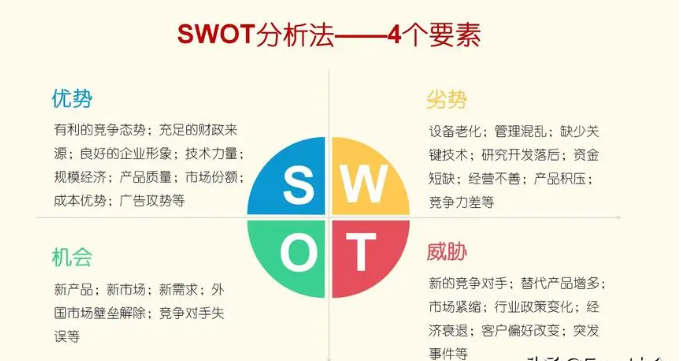
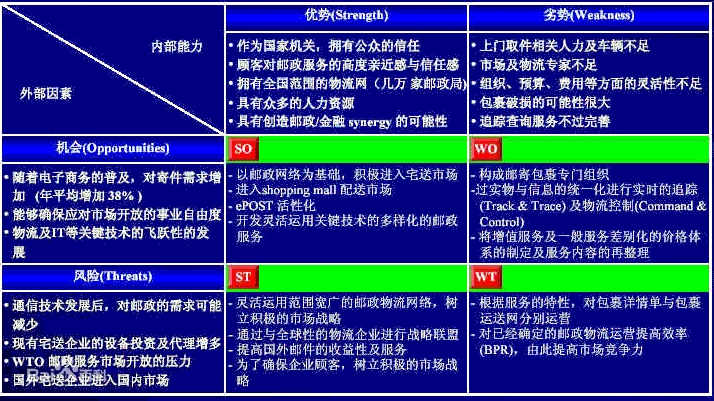

<!-- _class: cover -->
<!-- _paginate: false -->

IKSM · 知识转化

<h1>工作方法论</h1>

把经验变成方法 · 把方法变成习惯

为知笔记分享 · 2026/10 更新 · IksmHub marp v1.0.0

---

00课程地图

十四个部分串成一条主线：<em>先有问题、再有方法</em>——从<em class="g">价值观</em>打底，到<em>沟通 / 时间 / 任务</em>三大实战方法，再到<em class="p">跳出圈圈</em>与<em class="o">能量管理</em>收尾。

  
<h4>01 课程互动</h4>
一线真实困惑，每个问题对应一套方法

  
<h4>02 价值观</h4>
决定做与不做的最底层逻辑

  
<h4>03 方法库</h4>
象限 / 描述 / 计划 / 风险等 8 件武器

  
<h4>04 沟通能力</h4>
沟通能力 &gt; 业务能力

  
<h4>05~07 描述与表达</h4>
问题描述法 · 需求描述法 · 三兄弟法

  
<h4>08 时间管理</h4>
第二象限工作法

  
<h4>09 任务管理</h4>
接收 · 分解 · 追踪 · 赶工

  
<h4>10 跳出圈圈</h4>
退出舒适地带，抢做超值任务

  
<h4>11~14 风险·能量·书单·后记</h4>
SWOT · 正负磁场 · 斯多葛控制二分法

<b>学习方法：</b>没有正确答案，要找到适合自己的方法；深入思考了，才能更好地听明白。

---

01课程互动 · 从困惑到方法

这些"天天遇到"的问题，答案都藏在后面的章节里——<em>先自己想一想</em>，再<em class="g">点击看对应的方法</em>。

  

    

时间该怎么管理？要先做哪些事？

<b>第 2 象限工作法</b>——把 80% 的时间投给「重要不紧急」的事。

    

天天这么忙，没空做、未来没头怎么办？

<b>要事第一，跳出圈圈</b>——先识别重要的事并落地，避免下一步更忙。

    

"给他说了啊，他应该明白了"，等着行吗？

不行——<b>沟通需要反馈</b>，不回复≠同意。

    

领导最近没找我、没挑战，怎么主动找他？

<b>主动沟通，创造机会沟通</b>——例会、周报、总结会都是机会。

    

"系统又卡了，家人们谁懂啊"——问题在哪？

现象不明确——要用<b>问题描述法</b>把现象 1、2、3 列清楚。

  

  

    

他会拍 MP，我要向他学习吗？学什么？

学——<b>学会汇报</b>，研发出活 + 会汇报才是完整闭环。

    

沟通来沟通去，又带回客户新需求？

<b>重要沟通做好沟通预案</b>——先想清楚目的和观点再上阵。

    

客户要加两个按钮做汇总——怎么体会？

这是<b>业务需求</b>，要转换成系统的<b>功能需求</b>（需求描述法）。

    

领导上次说的需求又变了，快做完了怎么办？

<b>学会反馈任务，要评审</b>——确认控制点：2% / 50% / 90%。

    

追那个美女/帅哥，怎么定策略？

<b>SWOT 分析法</b>——分析优劣势，再定 SO/WO/ST/WT 策略。

  

<b>互动反馈：</b>写正能量/负能量词的练习 → 让自己成为正能量的磁场源，远离一切负能量。

---

02价值观 · 最底层的逻辑

价值观就是碰到事情时，决定"<em>做与不做、怎么做</em>"的最底层逻辑——它看不见，却决定了<em class="r">每一次选择</em>。

  

    

      <h4>什么是价值观</h4>
      
不是口号，是遇事时的第一反应：这个忙帮不帮？这个活接不接？这句话说不说？

    

    

      <h4>国家价值观（示范）</h4>
      

        富强民主文明和谐
        自由平等公正法治
        爱国敬业诚信友善
      

      
国家目标 · 社会取向 · 公民准则，三个层面层层落地。

    

  

  

    

      <h4>各公司的价值观</h4>
      <ul class="tight">
        <li><b>LC：</b>创新、诚信、协作、担当、稳健、高效</li>
        <li><b>HW：</b>对打 Z 有利，对客户有利</li>
        <li><b>字节范 / 阿里味：</b>各自成体系</li>
        <li><b>某 XXX：</b>对领导负责（反面教材）</li>
      </ul>
    

    

价值观到底"有啥用"？

价值观啥用啊——它是<strong>选择的操作系统</strong>：同一道题，价值观不同，解法完全不同。

  

<b>态度：</b>不想给别人输出价值观——人教人，教不会；事教人，一次就够。

---

02价值观 · 方向性建议

不灌输、只建议——三条方向都指向同一件事：<em class="o">把个人成长放进时代的大盘子里</em>。

  

    <h4>爱国</h4>
    
不是抽象口号，是看清自己站在哪块土壤上。

  

  

    <h4>抓住国家崛起的机会</h4>
    
时代红利是最强杠杆，顺势而为比单打独斗重要。

  

  

    <h4>努力了的都是自己的</h4>
    
平台会换、项目会停，长在自己身上的能力谁也拿不走。

  

<b>记住：</b>人教人，教不会；事教人，一次就够——方向给到，路自己走。

---

03方法库 · 八件武器

遇到事先想"<em>有没有现成方法</em>"——这 8 件武器覆盖<em>时间 / 描述 / 计划 / 风险</em>四大战场，后面的章节逐一展开。

  

    
<h4>① 象限工作法</h4>
重要 × 紧急，先做第 II 象限

    
<h4>② 问题描述法</h4>
现象 / 影响 / 分析三段式

    
<h4>③ 需求描述法</h4>
背景 / 场景 / 功能三段式

    
<h4>④ 计划制定法</h4>
WBS 分解 + 依赖编排

  

  

    
<h4>⑤ 故障跟踪法</h4>
日报推进，目标 + WBS 落地

    
<h4>⑥ 风险分析法</h4>
SWOT 定策略

    
<h4>⑦ 控制二分法</h4>
能控制的做好，不能控制的不抱怨

    
<h4>⑧ 三兄弟方法</h4>
总分结构：标题 + 123

  

<b>使用原则：</b>方法不是背下来，而是在"遇到问题的那一秒"想起来用。

---

04沟通能力 · 沟通模型

<em class="r">沟通能力 &gt; 业务能力</em>——出活是本分，让别人<em>看见</em>你的活、<em>听懂</em>你的话，才是闭环。

  

    
  

  

    

      <h4>用好制度给的机会</h4>
      
例会 · 周报 · 总结会 · 座谈会 · 党会 · 领导找你时的每一次沟通

    

    

      <h4>主动创造机会</h4>
      
<b style="color:#69f0ae">主动汇报：</b>各部门领导都可以直接去找，不官僚

      
<b style="color:#69f0ae">主动总结：</b>转正 / 年终 / 大项目 / 知识总结

    

  

<b>历史镜鉴：</b>秦昭襄王在位 56 年，老妈管了 41 年——不主动创造沟通机会，就只能等机会来找你。

---

04沟通能力 · 误区与沟通预案

两个致命误区，人人都踩过；五个预案问题，<em>重要沟通前</em>必问——<em class="o">点击反例看正确姿势</em>。

  

    

      <h4>两大误区</h4>
      
❶ 认为别人已经听明白了

      
❷ 默认不回复就是同意了

    

    

为什么"说了≠听明白了"？

沟通是<strong>编码→传输→解码</strong>，任何一环都会失真——所以要<b>任务反讲</b>、要确认反馈。

    

对方没回复，我该怎么办？

追问确认，而不是默默等待——<b>沟通需要闭环</b>，没有反馈的沟通等于没发生。

  

  

    

      <h4>沟通预案五问</h4>
      <ul class="tight">
        <li><b>目的：</b>本次沟通要达到什么？</li>
        <li><b>机会：</b>与谁、什么时间谈？</li>
        <li><b>观点：</b>要表达几个观点才够？</li>
        <li><b>反馈：</b>对方可能怎么反馈？我期望什么反馈？</li>
        <li><b>遗留：</b>哪些可能谈不拢，可遗留处理？</li>
      </ul>
    

  

<b>适用场景：</b>找领导汇报、客户沟通、跨部门协调——只要"重要"，就先做预案。

---

05问题描述法 · Question 还是 Problem？

Question 要<em>回答</em>，Problem 要<em class="g">解决</em>——问题描述不清楚，别人帮不上忙，甚至会被<em class="r">瞎指挥</em>。

  

    

      
<h4>Question</h4>
与 Answer 成对 要加问号，要被回答

      
<h4>Problem / Issue</h4>
与 Solution 成对 要解决，要寻求方案

    

    

      <h4>为什么描述如此重要</h4>
      
描述不清楚 → 别人帮不上忙，甚至被瞎指挥；描述清楚 → 很多情况下，自己就能解决。

    

  

  

    

反例 1："系统卡住了，怎么处理啊？"

现象不明确——怎么卡了？卡住是什么意思？<b>不同的人有不同的理解</b>。

    

反例 2："WEB 容器没分开，HA 用不了了"

HA 用不了的现象是什么？"WEB 容器"是<b>个人分析还是客户建议</b>？是不是权威方案？

  

<b>心法：</b>自己是对问题的第一发现人和描述人——<b style="color:#9fb4ff">描述上你是权威的，分析上可能有局限</b>，两者分开说。

---

05问题描述法 · 三段式模板

现象、影响、分析<em>各就各位</em>，不要绕着讲——模板要点<em class="g">点击展开</em>。

  

    <h4>【问题现象】</h4>
    

点击展开要点

现象是被你<b>感知</b>到的：屏幕截屏、日志内容、操作过程；要 1、2、3 列全；必要时补充物理与环境部署情况。

  

  

    <h4>【问题影响】</h4>
    

点击展开要点

对别人产生了什么影响——如<b>某某业务不能工作了</b>。影响决定了问题的优先级。

  

  

    <h4>【我的分析】</h4>
    

点击展开要点

先把现象和影响<b>独立说清楚</b>，再展开可能的分析；用自己的能力做某些层次、某些路径上的分析。

  

<b>顺序不能乱：</b>现象 → 影响 → 分析。混在一起讲，听的人就会怀疑你的现象是不是真的。

---

06需求描述法 · 从业务到功能

客户说的是<em class="o">业务需求</em>，我们要把它翻译成系统能实现的<em class="g">功能需求</em>——<em>背景、场景、功能</em>三步走。

  

    

      
<h4>业务需求</h4>
客户提出的，是"想要什么结果"

      
<h4>功能需求</h4>
我们转换的，是"系统怎么实现"

    

    

反例："在这里加个按钮，点击计算 XXX 汇总"

客户直接给出了<b>功能方案</b>——先问业务动机，再判断这个按钮是不是最优解。

    

反例："要一个项目管理功能 / 需要 BI、BigData"

一句话需求——<b>背景场景全缺失</b>，无法评估、无法排期。

  

  

    
<h4>【需求背景】</h4>
客户为什么提？动机和出发点？想解决什么业务问题？

    
<h4>【需求场景】</h4>
谁，在什么时候，通过什么操作，达到什么目的？

    
<h4>【功能要求】</h4>
前两步说清后，再谈功能、性能、操作方式的要求。

  

<b>铁律：</b>前两步没说清，绝不展开第三步——否则就是把客户的方案当成了客户的需求。

---

07三兄弟法（总分法）

标题 + 123，不仅是<em>沟通规范</em>，更是<em class="p">分析能力和设计能力</em>——发邮件、写文档、口头汇报，都要遵守。

  

    

      
<h4>❶ 表达什么</h4>
标题命名好了吗？一句话说清主题

      
<h4>❷ 是否兄弟</h4>
1、2、3 是并列关系吗？厚此薄彼了吗？

      
<h4>❸ 是否分解</h4>
1、2、3 合起来覆盖了标题吗？

    

    

      <h4>标准句式</h4>
      
标题 XXX，详情如下：1 … 2 … 3 …

    

  

  

    

反例：设计时厚此薄彼

某功能三种情况：利旧 / 升级 / 新建——前两个流程几乎一致，第三个完全不同。<b>客户需求永远不会错，错的是我们的设计。</b>

    

"男人、女人、老人"错在哪？

不是兄弟——有交叉、不并列。分解维度要<b>统一且互斥</b>。

  

<b>应用场景：</b>描述一个问题、分析一个问题、审视一个设计是否合理。

---

08时间管理 · 第二象限工作法

把 <em class="g">80% 的时间</em>投给「重要不紧急」——井井有条的秘诀不是忙，而是<em>在事情变紧急之前</em>就把它做掉。

  

    

      

紧急

不紧急

      
重要

      
<h4>Ⅰ 重要且紧急</h4>
救火队员必须做：公司发的邮件、不得不做——立马就做

      
<h4>Ⅱ 重要不紧急 ★</h4>
每天 80% 时间投这里；有充足时间深思熟虑，保证质量效率

      
不重要

      
<h4>Ⅲ 紧急不重要</h4>
对别人重要：支撑到位即可，短平快，别多占自己时间

      
<h4>Ⅳ 不紧急不重要</h4>
不做计划考虑

    

  

  

    
<h4>关键动作</h4>
尽快识别重要事情并落地，避免下一步更忙。

    
<h4>危险信号</h4>
把 Ⅱ 拖成 Ⅰ ——重要的事情紧急做，质量存疑。

    

"因为我很忙"的两种用法？

❌ 因为忙，所以那些事情顾不过来；✅ 因为忙，所以<b>更要尽快识别重要的事并落地</b>。

  

<b>来源呼应：</b>课程互动第一问"时间该怎么管理"，答案就是这一页。

---

09任务管理 · 接收任务三问

接活之前先问三句话——<em>防返工、防受伤</em>，答案<em class="g">点击揭示</em>。

  

    <h4>任务清楚吗？</h4>
    

点击看自检标准

能用<b>三句话</b>讲清楚吗？能说明白场景吗——<b>谁，什么时间，用什么功能，达成什么目的</b>。

  

  

    <h4>控制点做好了吗？</h4>
    

点击看控制点

<b>2% / 50% / 90%</b> 三个点要反讲确认——避免快做完了才发现理解错了。

  

  

    <h4>谁授权？谁评审？</h4>
    

点击看原因

避免做<b>拍脑袋的研发</b>——返工后自己很受伤。

  

<b>呼应：</b>领导需求中途变更的那个互动问题，根源就是少了 2% / 50% / 90% 的反讲确认。

---

09任务管理 · 分解与追踪

计划总目标 → N 个<em>可测量</em>的小目标 → 小小目标；计划<em class="o">就是用来更新的</em>，更新计划就是保终点。

  

    

      <h4>WBS 分解三原则</h4>
      <ul class="tight">
        <li>大小目标都必须<b>可测量</b>、有明确完成标准</li>
        <li>小目标之间是<b>并列兄弟</b>关系（不能是男人/女人/老人）</li>
        <li>问自己：完成 N 个小目标 = 完成大目标吗？</li>
      </ul>
    

    

      <h4>依赖与工具</h4>
      <ul class="tight">
        <li><b>逻辑依赖：</b>先设计再研发；<b>资源依赖：</b>同一负责人</li>
        <li><b>MS Project：</b>只有 1 个手动起点（开工会）、全部自动任务、只调时长和依赖，不调起止时间</li>
      </ul>
    

  

  

    

      <h4>追踪四原则</h4>
      <ul class="tight">
        <li>计划就是用来更新的</li>
        <li><b>不能存在过去时间点的任务</b></li>
        <li>只调时长和依赖，不手工调起止</li>
        <li>影响里程碑 → 立即采取措施</li>
      </ul>
    

    

      <h4>粒度建议</h4>
      
两周内 → 分解到<b>两三天粒度</b>；两周后 → 粗粒度，渐进明细。

    

  

<b>起点与终点：</b>开工会是总起点；安排好 WBS 和依赖后，<b style="color:#9fb4ff">紧盯终点</b>。

---

09任务管理 · 赶工万能 6 条

进度告急时的<em class="r">六张牌</em>——可以单出，也可以组合出，核心都是<em>保住关键里程碑</em>。

  

    
<h4>① 赶工</h4>
增加投入，压缩关键路径时长

    
<h4>② 并行</h4>
串行改并行，能同时干的同时干

    
<h4>③ 减范围</h4>
与干系人确认，砍掉非关键内容

  

  

    
<h4>④ 好资源</h4>
加人、加设备，好钢用在刀刃上

    
<h4>⑤ 好方法</h4>
换更高效的工具、流程和打法

    
<h4>⑥ 提高质量</h4>
减少返工，一次做对就是最快的路

  

<b>任务暂停纪律：</b>可以停，但必须先把"盒子"打开——按问题描述法说清楚、排序后，才能停；不能让盲盒留在工作台上。

---

10跳出圈圈

圈子无好坏，但<em class="p">厚度</em>有差异——要么不断增加圈子的厚度，要么<em>跳出更高的圈子</em>。

  

    

      <h4>圈子模型</h4>
      

        
放羊娃：放羊 → 赚钱 → 找媳妇 → 生娃 → 放羊

        
农民的圈子

        
码农的圈子

        
管理者的圈子

      

      
圈子无好坏，各有价值——不要妄自菲薄，圈内过程同样精彩（工匠的故事）。

    

  

  

    

      <h4>办法一 · 退出舒适地带</h4>
      
进入学习地带：主动挑战难度、摆脱路径依赖、不断充电。

    

    

      <h4>办法二 · 抢做超值任务</h4>
      
看领导、"样板"同事在做什么，做好接收超值任务的准备，站上新平台。

    

    

"给多少钱干多少事"对吗？

→ <b>永远要超值做事</b>。技能很快贬值，主动挑战能力之外的工作，是不断升值、增收的底层逻辑。

  

<b>呼应：</b>"没空做、未来没头"的互动问题——答案就是跳出圈圈。

---

11风险 / 机会管理 · SWOT 分析

先看清自己<em>（S/W）</em>和大盘<em>（O/T）</em>，再谈策略——分析图与<em class="o">策略图</em>配合使用。

  

    
  

  

    
<h4>S · 优势 Strength</h4>
内部能力：我强在哪？

    
<h4>W · 劣势 Weakness</h4>
内部能力：我缺什么？

    
<h4>O · 机会 Opportunity</h4>
外部因素：风往哪吹？

    
<h4>T · 威胁 Threat</h4>
外部因素：雷在哪埋着？

  

<b>扩展：</b>"五看三定"——看行业、看市场、看客户、看竞争、看自己，再定战略（见下页策略思路）。

---

11风险 / 机会管理 · SWOT 定策略

SO 大干快上、WO 补短板抢机会、ST 以优避险、WT 做好预案——<em class="g">点击卡片看行动要点</em>。

  

    
  

  

    

<b style="color:#69f0ae">SO</b>｜有优势 + 有机会

<b>大干快上</b>——把优势全部押到机会上。

    

<b style="color:#00e5ff">WO</b>｜有机会 + 有劣势

<b>尽快补足劣势，抢抓机会</b>——窗口期不等人。

    

<b style="color:#ffb020">ST</b>｜有优势 + 有风险

<b>利用优势避免风险发生</b>——把优势变成护城河。

    

<b style="color:#ff5470">WT</b>｜有劣势 + 有风险

<b>做好预案，最小化风险影响</b>——先活下来，再等转机。

  

<b>呼应：</b>"追美女/帅哥定策略"的互动问题——SWOT 就是答案；策略图见 assets/五看三定.png。

---

12能量 · 磁场与控制二分法

正能量有<em class="g">磁场</em>，负能量的磁场<em class="r">更大</em>——斯多葛告诉我们：管好<em>能控制的</em>，放下不能控制的。

  

    <h4>正能量 · 有磁场</h4>
    <ul class="tight">
      <li>解决事情的</li>
      <li>鼓舞自己的</li>
      <li>鼓励别人的</li>
    </ul>
    
→ 让自己成为正能量的磁场源

  

  

    <h4>负能量 · 远离</h4>
    
对事情的解决<strong>没有建设性作用</strong>。

    
负能量磁场更大——远离社会上负能量的人和事。

  

  

    <h4>斯多葛控制二分法</h4>
    
<b style="color:#69f0ae">能控制的</b> → 做的做好

    
<b style="color:#ff9db1">不能控制的</b> → 做最坏的打算，不抱怨，不影响心情

  

<b>呼应：</b>写正能量/负能量词的互动练习 → 认清哪些词在给自己充电、哪些在耗电。

---

13推荐书籍与资源

三扇门——<em>领导课</em>立心法、<em>不抱怨</em>修心态、<em>产品老曾</em>给榜样，把本课的方法<em class="o">接上电源</em>。

  

    <h4>《周一清晨的领导课》</h4>
    <ul class="tight">
      <li>要事第一</li>
      <li>开车的角色转变</li>
      <li>离开舒适地带，到达学习地带</li>
    </ul>
  

  

    <h4>《不抱怨的人生》</h4>
    <ul class="tight">
      <li>抱怨一次，就把手环换到另一只手上</li>
      <li>用物理动作打断抱怨回路</li>
    </ul>
  

  

    <h4>B 站 · 产品老曾</h4>
    <ul class="tight">
      <li>逻辑清晰，表达清晰</li>
      <li>有高度，正能量</li>
      <li>有方法，能实践</li>
    </ul>
  

<b>提醒：</b>辨别榜样形象——有些形象不好，会影响大家对"努力奋斗"的榜样的认知。

---

14后记 · 别把方法论带回家

工作方法论<em class="o">目标导向</em>，家庭方法论<em class="g">不生气导向</em>——同一个你，两套操作系统，<em>切换要果断</em>。

  

    

      <h4>工作方法论</h4>
      
没有对错，<b style="color:#ffb020">目标导向</b>。

    

    

      <h4>家庭方法论</h4>
      
也没有对错，<b style="color:#69f0ae">不生气导向</b>。

    

  

  

    

和父母相处要注意什么？

不要觉得自己懂得多就给父母改习惯——<b>用自己的能力帮父母就好</b>。

    

和对象、和孩子相处呢？

和对象：没有谁对谁错；和孩子：<b>言传身教比说教强</b>。

  

<b>结语：</b>方法已在手，路在脚下——把经验变成方法，把方法变成习惯。谢谢！

