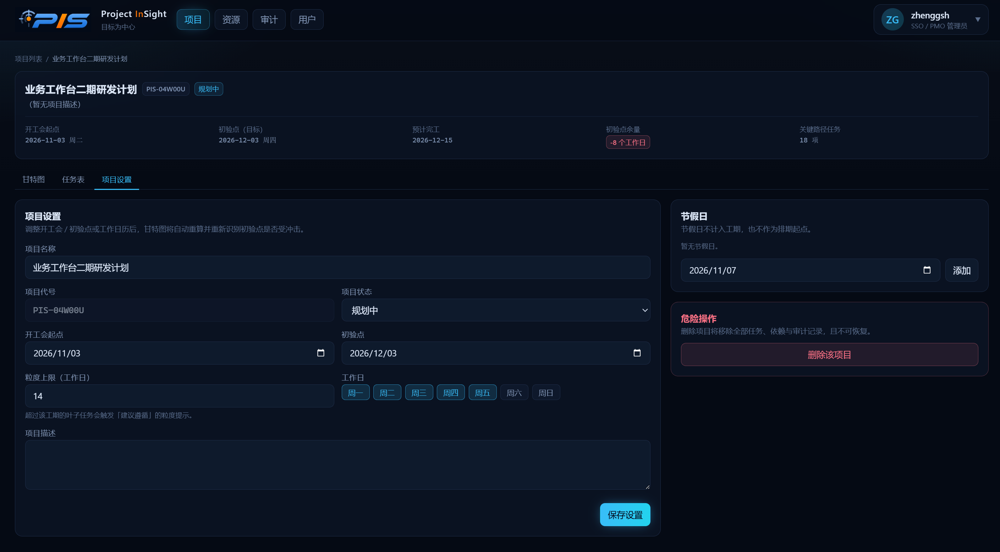
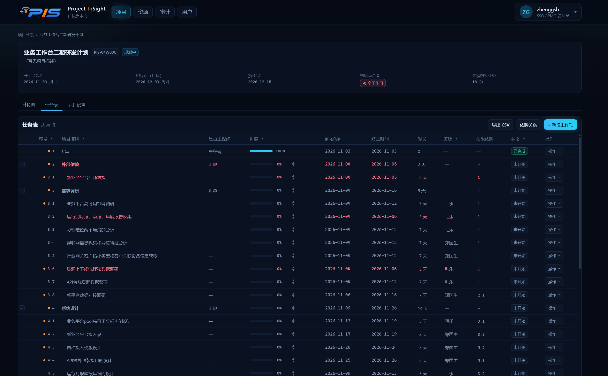
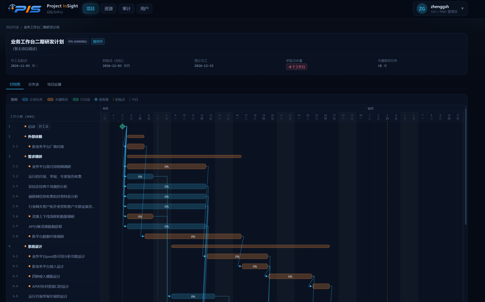
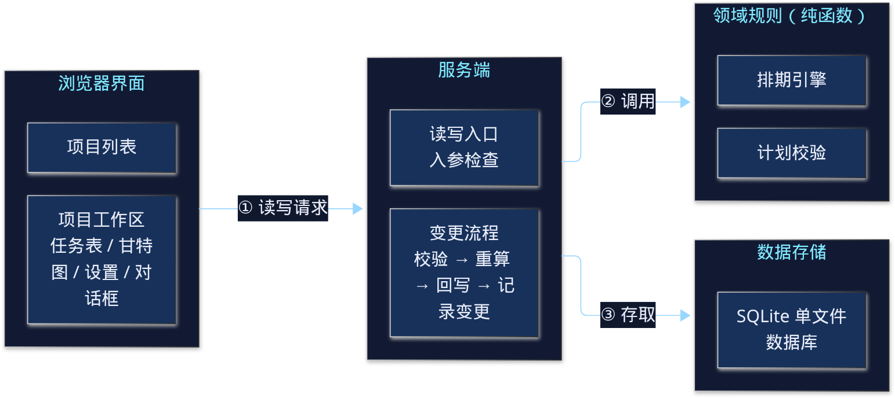
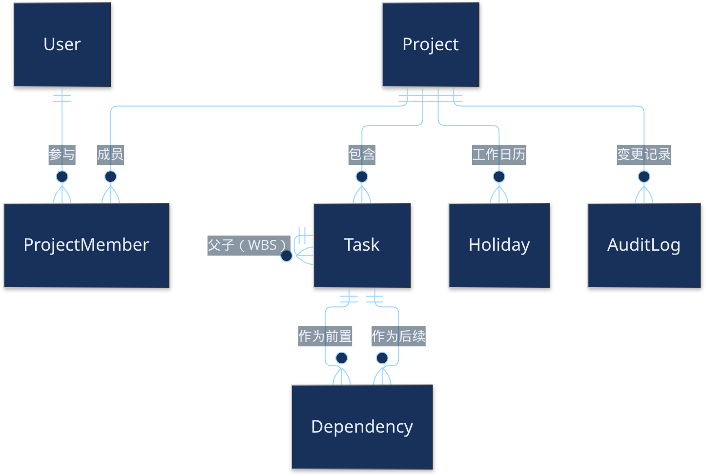

<!-- _class: cover -->
<!-- _paginate: false -->

02

IKSM · 知识转化

v1.0.0

<h1>PIS</h1>

PROJECT&nbsp;&nbsp;INSIGHT

简单、高效、可扩展 · 计划制定与追踪

iksm / 02-PIS-Project依据 PIS · mydoc/PIS_intro.mdMarp → HTML Slide

---

00这是什么

PIS 是面向小团队的<em>项目计划制定与追踪</em> Web 应用。它基于实用的项目管理经验，把计划做成<em class="g">简单、高效、可扩展</em>的协作工具。

  

    <h4>现成工具对不上</h4>
    
Project 太繁重。

    
Excel 处理不了依赖。

    
两者都不能用 Web 做团队协作。

  

  

    <h4>所以自己做</h4>
    
为了制定某个项目的计划，直接用 Trae 做一版 Web 工具。

    
目的是实践最有用的项目管理经验。

  

  

    <h4>这次多了两块</h4>
    
功能里写了团队管理和成员看板。

    
架构改成四层，并配了流程图和数据关系图。

    
下一步收成三条。

  

<b>边界：</b>只讲 mydoc/PIS_intro.md 写到的内容。团队看板在下一步里仍要增加，本讲标成未实现。

---

00内容地图

顺序跟上游：<em>为什么做</em>，<em class="g">计划怎么管</em>，<em>现在的功能与配图</em>，<em class="p">四层架构和数据关系</em>，以及<em class="o">还没做的三件事</em>。

  

    
<h4>01 设计背景</h4>
Project 与 Excel 都不合适，改用 Web。

    
<h4>02 计划管理经验</h4>
WBS、起点终点与依赖、追踪、赶工六条。

    
<h4>03 主要功能</h4>
项目列表、任务表、甘特图各占一页大图。

  

  

    
<h4>04 架构与数据</h4>
四层流程图、目录、技术栈、ER 关系图。

    
<h4>05 下一步</h4>
团队管理、项目文档、项目审计。都还没做。

    
<h4>未实现</h4>
登录、成员看板、zod 入口、基线与扫描报告、任务分配表。

  

<b>溯源：</b>iksm/02-PIS-Project/PIS_intro.md ← zhenggsh/PIS mydoc/PIS_intro.md。配图来自上游 mydoc/files/。

---

01设计背景

原始需求只有一句：<em>实现项目计划的制定和追踪</em>。工具选错，依赖和协作都做不起来。

  

    
<h4>Project</h4>
太繁重，不适合小团队把一份计划跑起来。

    
<h4>Excel</h4>
无法处理依赖。前后任务一变，表就跟不上。

    
<h4>两者共同的缺口</h4>
都不能通过 Web 做团队协作。

  

  

    

      <h4>因此</h4>
      
为了制定某个项目的计划，直接使用 Trae 开发 Web 版。

      
它是项目计划的制定与追踪工具，用来实践最有用的项目管理经验。

    

  

<b>位置：</b>设计背景只说明动机。拆任务、盯终点、赶工，放到下一节。

---

02计划经验 · 先回答四件事

计划管理的范畴很大。这里只展开<em>最基本、最实用</em>的方法，而且放在产品功能<em class="g">之前</em>。

  
<h4 style="margin:0 0 4px;">① 怎么拆</h4>
如何把总体目标拆成多个小目标，并确保拆解合理？

  
<h4 style="margin:0 0 4px;">② 怎么排得可执行</h4>
如何让拆解后的任务可执行，并让依赖关系合适？

  
<h4 style="margin:0 0 4px;">③ 怎么追</h4>
执行中如何追踪、调整，并识别计划风险？

  
<h4 style="margin:0 0 4px;">④ 延期怎么办</h4>
目标可能延期时，应该如何处理？

<b>对应输出：</b>WBS 与顺序 → 静态计划 → 不断调整的计划 → 赶工强化后的计划。

---

02计划经验 · WBS 分解

总目标拆成 N 个小目标。每一级都要<em>可测量</em>，同一级必须是<em class="g">并列的兄弟</em>，并且问一句：小目标加起来，大目标完整了没有？

  

    

      <h4>四条拆法</h4>
      <ul class="tight">
        <li>大目标和小目标都要有明确完成标准</li>
        <li>同级必须并列。避免「男人、女人、老人」这种不并列</li>
        <li>完成 N 个小目标，要能覆盖大目标；小目标再往下拆</li>
        <li><b>渐进明细：</b>两周内拆到两三天；两周后可以先粗后细</li>
      </ul>
    

  

  

    

      <h4>输出物</h4>
      
工作分解 WBS，以及基本的顺序。

      
到这里，工作范围和事项拆解就识别出来了。

    

  

<b>下一张才排依赖：</b>WBS 解决「做什么」，起点、终点和依赖解决「按什么顺序做」。

---

02计划经验 · 起点、终点、依赖

开工会是依赖的<em>总起点</em>。WBS 和依赖排完后，紧盯<em class="o">终点</em>。依赖只有两类：逻辑，和资源。

  
<h4>起点</h4>
一般用「开工会」。

它也是整张依赖网的总起点。

  
<h4>终点</h4>
任务的完成时间。

安排好 WBS 和依赖后，务必紧盯它。

  
<h4>逻辑依赖</h4>
先做什么，后做什么。

例如先设计，再研发。

  
<h4>资源依赖</h4>
同一份资源排不开。

例如同一个负责人。

<b>输出物：计划的静态版。</b>任务分解、起点、终点和依赖都设好之后，就可以开始追踪。

---

02计划经验 · 计划就是用来更新的

两种更新都必须做：<em>变化</em>带来的，和<em class="g">渐进明细</em>带来的。最终目标不能随便改；过去时间点上的任务，逻辑不成立。

  

    
<h4>变化带来的更新</h4>
人员、需求、条件、资源变了，要及时刷新，并看对目标的影响。

    
<h4>渐进明细带来的更新</h4>
两周后原先看不清、时间范围大。随着时间推移，拆到更细、更准的时间点。

    
<h4>通报节奏</h4>
一周至少调整两次。目标、进展和执行风险至少周报；关键期日报。

  

  

    

      <h4>变更原则</h4>
      <ul class="tight">
        <li>更新，就是为了保住终点</li>
        <li>最终目标不能改；要改必须向上沟通并获批准</li>
        <li>不能最后一天才发现完不成，必须提前识别</li>
        <li>不能存在过去时间点的任务</li>
        <li>只能调<b>时长和依赖</b>，不能手改开始和终止时间</li>
        <li>一旦影响总进度或关键里程碑，就要采取措施</li>
      </ul>
    

  

<b>输出物：不断调整的计划。</b>手改起止日期不在允许的调整手段里。

---

02计划经验 · 赶工六条

变更之后目标可能延期。时间不能变、质量不能变时，下面六条是上游给出的<em class="o">赶工措施</em>。

  
<h4>1 · 延迟工时</h4>
把每天和周末的时间也用上。

  
<h4>2 · 任务并行</h4>
多项任务同时进行，切开关键路径任务。

  
<h4>3 · 减范围</h4>
时间不变，质量不变，能变的只有范围。

  
<h4>4 · 资源设备</h4>
用好资源和设备。

  
<h4>5 · 专家</h4>
用专家力量。

  
<h4>6 · 好方法</h4>
提高质量，减少返工。

<b>输出物：赶工强化后的计划。</b>这是经验，不是产品里的一个按钮。

---

<!-- _class: shot -->

03项目列表

列表可新建、删除项目。新建时填写<em>名称、可选代号、描述、开工会、初验点</em>。

  

---

03任务分解

任务只有三种：<em>汇总 / 工作项 / 里程碑</em>。结构一变，WBS 按显示顺序重算；缩进时把依赖<em class="g">转接</em>到新子任务。

  

    

      
<h4>SUMMARY</h4>
汇总。新增时自动带一个空的子任务。

      
<h4>TASK</h4>
工作项。行内改时长、资源、进度。

      
<h4>MILESTONE</h4>
里程碑。甘特上用菱形。

    

    

      <h4>任务表能做的</h4>
      
行内改名称、时长、资源（自由文本）、前级依赖、进度。可上移、下移、缩进、升级，或在下方插入同级。

    

  

  

    

      <h4>缩进时转接依赖</h4>
      
上一兄弟若还不是汇总，先提升为 SUMMARY，再把原来挂在它身上的依赖边转到新子任务。

    

    

      <h4>依赖要连成一条路</h4>
      
按逻辑依赖和资源依赖设置前后关系，使任务形成从开头到终点的完整路径。

    

  

<b>下一页是任务表原图。</b>资源仍是自由文本。成员分配不在当前功能里。

---

<!-- _class: shot -->

03WBS 任务表

项目工作区里的任务表，支持<em>行内编辑</em>。名称、时长、资源、前级依赖和进度都在这张表上改。

  

---

03跟踪、调整，以及甘特图

调整走<em>时长和依赖</em>，不直接改起止。改完自动重算相关任务，并尽量保证<em class="o">关键任务不被延迟</em>。

  

    

      <h4>颜色先报风险</h4>
      
已延期、即将延期、有进展、已完成，用不同颜色标识。延期要提前看见。

    

    

      <h4>粗计划要变细</h4>
      
随着时间推移，把以前的粗粒度计划拆成更细的任务。

    

    

      <h4>改完就重算</h4>
      
不直接改开始和结束时间。每次调整后，重算相关依赖任务的起止。

    

  

  

    

      <h4>甘特图上有什么</h4>
      <ul class="tight">
        <li>左 WBS，右按日时间轴</li>
        <li>周末与节假日用底色区分</li>
        <li>条形 = 任务；关键路径、已完成不同色，条内按进度填充</li>
        <li>菱形 = 里程碑</li>
        <li>SVG 折线 = 依赖</li>
        <li>虚线标出开工会、初验点、今日</li>
      </ul>
    

  

<b>下一页是甘特原图。</b>自研渲染，不是外挂控件。

---

<!-- _class: shot -->

03甘特图

左侧是 <em>WBS</em>，右侧是按日时间轴和<em class="g">依赖箭头</em>。条形、菱形、虚线分别对应任务、里程碑和开工会 / 初验点 / 今日。

  

---

03团队管理 · 目标形态，尚未做成

主要功能里写了成员和看板。§4.4 说 v1 <em class="r">未启用登录</em>，成员只是预留；下一步第 1 条仍是<em class="o">增加团队管理</em>。所以记为未实现。

  

    

      <h4>成员管理 · 未实现</h4>
      
项目下的成员和组织：添加、删除、修改成员信息。

    

    

      <h4>看板布局 · 未实现</h4>
      
按团队或成员做工作台。

      
左侧 30%：已完成任务。

      
右侧 70%：待办任务。

    

  

  

    

      <h4>为什么还不算已有</h4>
      <ul class="tight">
        <li>数据模型里 User、ProjectMember 只是预留</li>
        <li>v1 未启用登录</li>
        <li>下一步明确还要「增加团队管理」</li>
        <li>下一页只说明待办区打算怎么分，不是现成界面</li>
      </ul>
    

  

<b>不要把它当成已经能用的页面。</b>下面的四象限是上游写出的目标分法。

---

03成员看板 · 待办四象限（未实现）

待办区按四象限放（上游原文写作「四现象法」）。左上必须做完，右上不能拖成紧急，左下是被驱动的，右下只是关注。

  

    

      <h4>第一象限 · 左上</h4>
      
重要且紧急。已经延期，以及 1 天内即将延期。这里必须完成。

    

    

      <h4>第二象限 · 右上</h4>
      
重要不紧急。未到延期的设计、预演。可以从容做完，不能拖成左上。

    

  

  

    

      <h4>第三象限 · 左下</h4>
      
紧急不重要。作为第 2 责任人、即将延期的工作。被驱动着完成。

    

    

      <h4>第四象限 · 右下</h4>
      
不重要不紧急。其他工作，关注即可。

    

  

<b>未实现。</b>左侧 30% 的「已完成任务」不进这四个象限。

---

<!-- _class: shot -->

04系统架构

四层与三条连线和上游 flowchart 相同：<em>界面 → 服务端</em>，再分到<em class="p">领域规则</em>和<em class="g">SQLite</em>。胶片改成从左到右，避免竖图缩得看不清。

  

---

04四层各自做什么，读写怎么走

界面只展示和收集输入。<em>服务端是唯一读写入口</em>。排期和校验是<em class="p">纯函数</em>，可以单独测试。日期以当次重算结果为准。

  

    
<h4>浏览器界面</h4>
项目列表，以及工作区里的任务表、甘特图、设置、对话框。不直接访问数据库。

    
<h4>服务端</h4>
检查入参，串联「校验 → 重算 → 回写 → 记录变更」。

    
<h4>领域规则 / 数据</h4>
排期引擎、计划校验。SQLite 单文件，存项目、任务、依赖、节假日和变更记录。

  

  

    

      <h4>读 · 打开项目</h4>
      
取数 → 用规则再算一遍排期 → 组装视图。页面上的日期是当次算出的。

    

    

      <h4>写 · 改计划</h4>
      
先检查入参，再校验并重算。通过后才落库、记一条变更、通知界面刷新。

    

    

      <h4>校验不通过</h4>
      
阻止写入并回滚，把原因返回界面。若只是「建议遵循」，要用户确认后再交一次。

    

  

<b>目录和分层对齐：</b>app 页面、components 界面、server 读写、lib 规则、prisma 数据模型。

---

04目录与技术栈

一门语言贯穿前后端。<em class="p">计划规则写成纯函数</em>，用 Vitest 锁住。zod 已在依赖里，<em class="o">还没接到入口</em>。

  

    

      <h4>目录</h4>
      <ul class="tight">
        <li><b>src/app</b> 路由和页面装配，不含业务规则</li>
        <li><b>src/components</b> 列表、工作区、通用小件</li>
        <li><b>src/server</b> 唯一读写入口</li>
        <li><b>src/lib</b> 排期与校验，测试用同一份</li>
        <li><b>prisma</b> 一个 schema。SQLite 单文件，同步建表</li>
        <li><b>docs / mydoc / public</b> 设计文档、本说明与配图、静态资源</li>
      </ul>
    

  

  

    
<h4>框架</h4>
Next.js 前后端一体。React + TypeScript 描述 WBS 和依赖。Tailwind 统一任务表、甘特和对话框。

    
<h4>数据与测试</h4>
Prisma + SQLite，适合小团队自托管。Vitest 覆盖排期与校验。

    
<h4>zod · 尚未接到入口</h4>
打算一处定义、前后端复用。当前校验仍写在各个操作入口里。

  

<b>不另报版本号。</b>上游这次只说明每项技术做什么，没有写具体版本。

---

<!-- _class: shot -->

04数据架构

围绕 <em>项目 → 任务树 → 依赖</em>。节假日、成员、变更记录挂在项目上；User 通过 ProjectMember 参与项目。

  

---

04对象里有什么，什么还没落地

任务起止、是否关键、总余量由<em class="g">排期引擎写入</em>。依赖 v1 <em>只用 FS</em>。登录、基线、扫描报告、任务分配表是<em class="r">未实现</em>。

  

    

      <h4>已经建模的</h4>
      <ul class="tight">
        <li><b>Project</b> 名称代号、状态、开工会、初验点、工作日历、叶子工期上限</li>
        <li><b>Task</b> 汇总 / 工作项 / 里程碑；父子组成 WBS</li>
        <li><b>Dependency</b> 前置、后续、FS、滞后天数；同一组唯一</li>
        <li><b>Holiday</b> 按日期跳过非工作日</li>
        <li><b>AuditLog</b> 每次写操作留一条快照</li>
      </ul>
    

  

  

    

      <h4>预留，未启用</h4>
      
User、ProjectMember 记录谁以什么角色参与。v1 未启用登录。

    

    

      <h4>设计有，v1 没落地</h4>
      
基线快照、计划质量扫描报告、任务分配表。

    

    

      <h4>删除会带走什么</h4>
      
删项目会级联删除任务、依赖、节假日和变更记录。任务树以开工会为根。

    

  

<b>人工填报的字段：</b>资源、进度、进展描述。计划起止不是手填进这些派生字段的。

---

05下一步 · 只这三件

上游把下一步收成三条，三条都还没做。团队管理写在功能章里，<em class="r">落地状态仍看这一条</em>。

  

    <h4>1 · 增加团队管理（未实现）</h4>
    
管理团队、用户和看板。对应前面的成员管理、组织，以及 30/70 的四象限工作台。

  

  

    <h4>2 · 增加项目文档管理（未实现）</h4>
    
项目各阶段关联的文档，加上版本控制和评审过程。

  

  

    <h4>3 · 项目审计管理（未实现）</h4>
    
项目进展核算、资源成本核算等。

  

<b>不要沿用旧清单。</b>这次没有再列登录改造细则、乐观锁、导出格式或外部模型。

---

06收束

先把计划方法说清楚，再落到产品：<em>开工会</em>是起点，调整只动时长和依赖，甘特图把结果画出来。

  

    <h4>已经写进产品的</h4>
    
项目列表，WBS 与行内编辑，从开头走到终点的依赖，颜色标识延期，自研甘特。配图各占一页。

  

  

    <h4>架构就四层</h4>
    
界面、服务端、纯函数规则、SQLite。打开项目会重算；写入失败会回滚。

  

  

    <h4>未实现</h4>
    
团队与看板、登录、zod 入口、基线、扫描报告、任务分配、项目文档、项目审计。

  

<b>溯源：</b>iksm/02-PIS-Project/PIS_intro.md ← zhenggsh/PIS mydoc/PIS_intro.md。版本仍是 v1.0.0，就地刷新，不另开版本目录。

