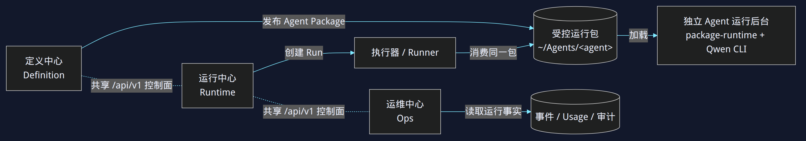
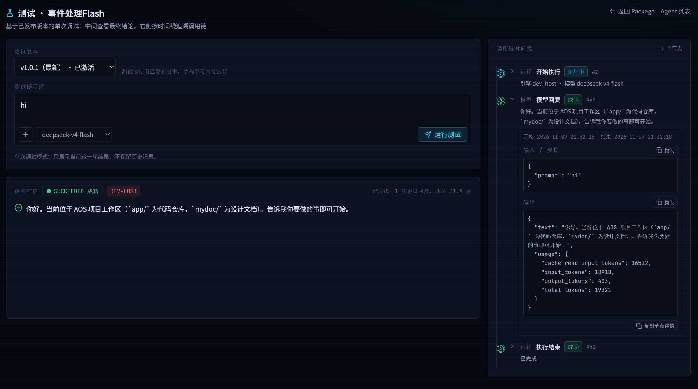
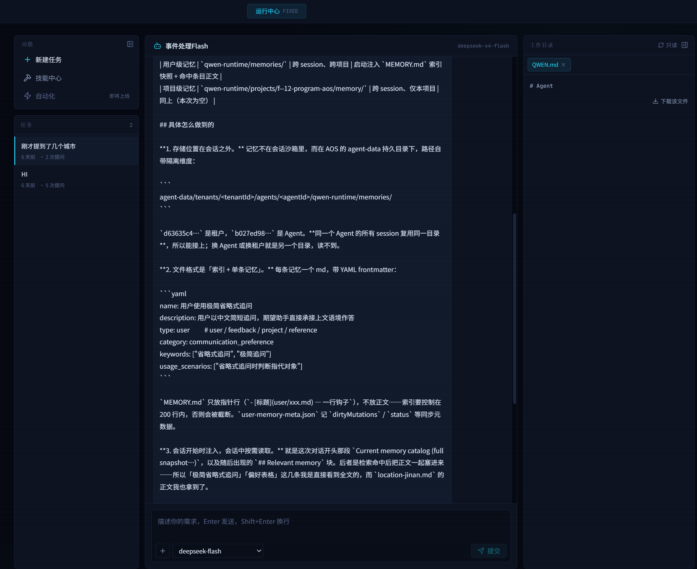
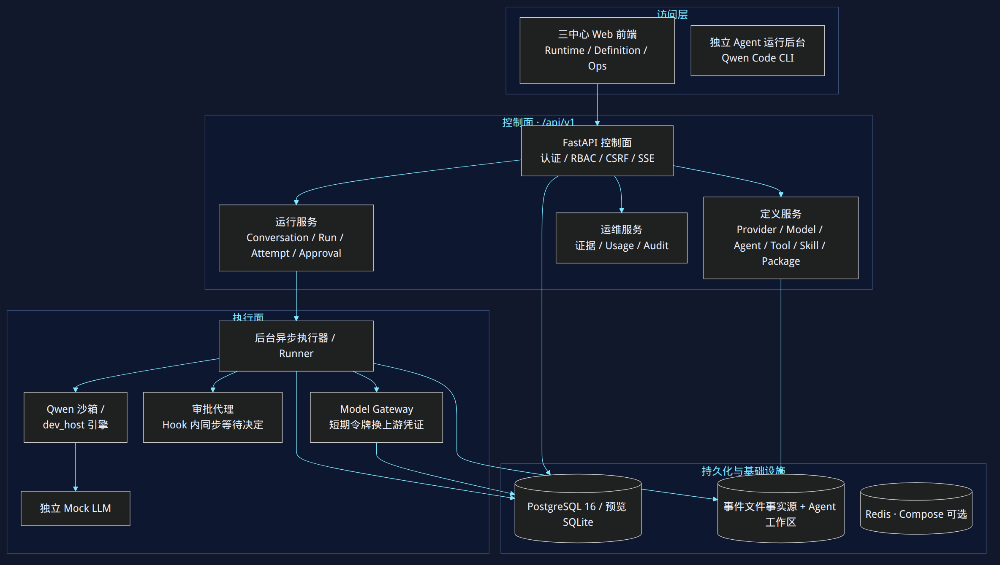
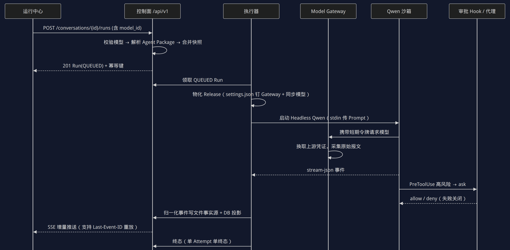

<!-- _class: cover -->
<!-- _paginate: false -->

03

IKSM · 知识转化

v1.1.0

<h1>AOS</h1>

AGENT&nbsp;&nbsp;OPERATION&nbsp;&nbsp;SYSTEM

企业多租户的智能体运营平台

iksm / 03-AOS-Project依据 AOS · mydoc/AOS_intro.mdMarp → HTML Slide

---

00这是什么

AOS 用 <em>Qwen Code CLI 0.26.4</em> 做执行底座，做的是企业多租户的智能体运营平台。缺的不是「模型不可用」，是一套把模型、工具、数据、权限和审计收在一起的<em class="g">运行底座</em>。

  

    <h4>接入碎片化</h4>
    
各团队直连上游模型。

    
密钥散落，限流和计费统一不了。

  

  

    <h4>执行不可控</h4>
    
智能体跑在开发机或宿主进程里。

    
文件、网络、Shell 没有边界，高风险操作缺少人工确认。

  

  

    <h4>过程不可见</h4>
    
一轮对话里的模型调用、工具调用、失败和用量没有结构化记录。

  

  

    <h4>交付不可迁移</h4>
    
定义和运行环境耦在一起。

    
换环境无法复现，也离不开 Web。

  

<b>只讲 mydoc/AOS_intro.md。</b>四个缺口都写在 §1.1。后面的模块是把这四件事收口，不另加能力。

---

00内容地图

顺序跟上游：<em>为什么做、首版不做什么</em>，<em class="g">四个模块</em>，<em class="p">四层架构、启动方式和一次运行</em>，然后是目录、技术栈、数据摘要和<em class="r">安全红线</em>。

  

    
<h4>01 背景与边界</h4>
三条立场、六项目标。不交付的能力标成未实现。

    
<h4>02 四个模块</h4>
定义、运行、运维，加一份无 Web 的运行包。两张界面各占一页。

    
<h4>03 架构与链路</h4>
分层图、四种进程角色、启动方式，以及一次运行的时序图。

  

  

    
<h4>04 目录与技术栈</h4>
命令都在 app/ 下。版本按上游锁定，不另报。

    
<h4>05 数据摘要</h4>
文件与库分工，24 张表按层点名，生成参数两级合并。

    
<h4>未实现</h4>
编排、RAG、长期记忆、Workflow、跨 Runner 高可用，以及非 MVP 协议。

  

<b>溯源：</b>iksm/03-AOS-Project/AOS_intro.md ← zhenggsh/AOS mydoc/AOS_intro.md（V1.0，2026-11-09）。

---

01三条设计立场

执行底座仍是 <em>Qwen Code CLI 0.26.4</em>。立场收成三条：设计与运行分开，后台能脱离 Web，运维看运行状态、用量和异常。

  

    <h4>1 · 设计与运行分离</h4>
    
设计模块做智能体能力开发的集成，只能做有限测试。

    
运行模块负责执行的管控、沙箱、审批、记忆和迭代。

  

  

    <h4>2 · 独立的后台运行</h4>
    
后台智能体不依赖 Web。

    
为的是移植、后台能力定制与封装，以及企业级运行管理。

  

  

    <h4>3 · 监控运营中心</h4>
    
上游原文是「使用同一的后台」看运行状态、资源用量和异常事件。

    
界面和接口是统一的。

  

<b>「记忆」只是立场用词。</b>企业长期记忆在 §1.4，未实现、不在 MVP。禁止 latest、preview、nightly。

---

01建设目标

六项目标按上游现行原文。多模式编排里写了 <em class="r">Plan-Execute</em>，该项不交付。顺序、并行、条件、循环、ReAct 只记为目标。

  
<h4>统一模型接入</h4>
租户管理员在 Web 配多个 OpenAI 兼容端点、模型和凭证，再授权给智能体。

  
<h4>工作区隔离</h4>
每个智能体一份独立、持久、可版本化的运行目录。租户之间不可互访。

  
<h4>多模式编排</h4>
目标列出顺序、并行、条件、循环、ReAct、Plan-Execute。Plan-Execute 未实现。其余不记成已交付。

  
<h4>工具集成</h4>
目标包括公开 API、MCP 接口和业务自定义接口。定义中心写了 REST 与 MCP 的注册。

  
<h4>能力开放</h4>
智能能力通过接口对外提供。上游没有再写单独的开放产品形态，这里不补。

  
<h4>独立运行包</h4>
每个 Agent 是完整目录加文件。不依赖 Web 进程就能交互执行。

<b>目标不是上线清单。</b>§1.4 的不交付项全部标成未实现。流式 Run 和显式 session_id 写在运行中心，不写在这六项目标里。

---

01首版不交付

MVP 只做基础闭环。下面这些是<em class="r">不交付、未实现、不在 MVP</em>。模型里留了扩展字段，也不等于功能已经可用。

  
<h4>多 Agent 自动编排</h4>
未实现

  
<h4>Plan-Execute</h4>
未实现

  
<h4>Reflexive Agent</h4>
未实现

  
<h4>RAG</h4>
未实现

  
<h4>企业长期记忆</h4>
未实现

  
<h4>Workflow</h4>
未实现

  
<h4>跨 Runner 高可用</h4>
未实现

  
<h4>Responses API</h4>
未实现

  
<h4>Anthropic／Gemini 原生协议</h4>
未实现。pattern、protocol 若不是 MVP 值，API 直接拒绝。

<b>不要把扩展字段讲成已上线。</b>SSO 的 oidc 字段同样只是预留。

---

<!-- _class: shot -->

02四模块怎么连

节点和连线与上游 <em>flowchart LR</em> 相同。实线是发布、加载、创建 Run、消费同一包、读取事实；虚线是三个 Web 中心<em class="g">共享 /api/v1</em>。

  

---

02四个模块，一套控制面

定义、运行、运维可以<em>单独构建、单独启动</em>。这是故障域分开，<em class="o">不是</em>三份数据或三套权限。独立后台连 Web 都不依赖。

  
<h4>定义中心</h4>
配环境、写 Agent、做开发测试，发布不可变的 Agent Package。

不跑正式 Run，不把生产凭证给草稿。

  
<h4>运行中心</h4>
给最终用户的专属工作台。创建 Run，消费已经发布的包。

不展示默认完整开发报文，不扫未授权目录。

  
<h4>运维中心</h4>
看运行事实：概览、证据、用量、审计。

只读。不改结果，不看密钥明文。

  
<h4>独立运行后台</h4>
目录加文件加本地入口。加载单个包，自己调 Qwen 和本地 Skill／工具。

不依赖三个 Web、平台库或消息队列。

<b>共享的是：</b>版本化 API、统一 IAM、同一套对象模型。包在 ~/Agents/&lt;agent&gt;。

---

02定义中心

管「怎么连」和「是什么」。发布物是<em>不可变的 Agent Package</em>，可以激活，也可以回滚。凭证<em class="o">只以密文入库</em>。

  

    

      
<h4>Provider／模型</h4>
连接与鉴权，以及身份、能力、默认生成参数。两级归属。

      
<h4>工具注册</h4>
REST、MCP（stdio／HTTP／SSE）。有版本、试运行和文件化留痕。

      
<h4>Skill</h4>
上传、校验、版本、绑定、原子同步、漂移检测。

      
<h4>Agent 定义</h4>
草稿、配置版本、绑定模型／工具／Skill。生成参数是模型默认 ⊕ Agent 覆盖。

      
<h4>开发测试</h4>
中心里直接开会话。看脱敏原始报文和结构化调用链。

      
<h4>发布</h4>
版本化成不可变包。支持激活与回滚。

    

  

  

    

      <h4>边界</h4>
      
不直接执行正式 Run。

      
不向草稿暴露生产凭证。

      
下一页是定义中心里的测试画面，不是模型管理页。

    

  

<b>模型管理截图</b>在知识目录 files/定义中心-模型.png，上游正文没有引用，本套胶片不单独开页。

---

<!-- _class: shot -->

02定义中心 · 开发测试

对<em>已发布版本</em>做单次调试。中间是最终结论，右侧按时间看脱敏调用链。测试只用已发布版本，<em class="o">草稿不能直接跑</em>。

  

---

02运行中心

单 Agent 工作台：左功能与任务，中对话，右本地目录与工具，两侧栏都能收。临时换模型只写<em class="g">本次 Run 快照</em>，不改已发布的包。

  

    
<h4>Agent 中心</h4>
只列当前租户有权访问、包状态为 READY 或 ACTIVE 的 Agent。

    
<h4>对话运行</h4>
每轮一个 Run。SSE 推文本和工具状态。可以取消，也可以显式重试。

    
<h4>会话恢复</h4>
用显式 session_id 映射。不用「最近会话」代替。

    
<h4>调用链</h4>
执行中看过程摘要。已完成的回复双击 ASSISTANT 标题，可回看调用历史。

  

  

    
<h4>审批</h4>
高风险操作转人工。运行中心跳到审批中心，通过后再「继续执行」。

    
<h4>工作目录</h4>
只读浏览。文本可以原位预览，也可以下载。

    
<h4>边界</h4>
不展示默认完整开发报文。不直接扫描未授权目录。

  

<b>下一页是运行中心原图。</b>上游把这张 `运行中心-运行.png` 放在运维中心一节，画面标题是运行中心。

---

<!-- _class: shot -->

02运行中心 · 专属工作台

左侧任务，中间对话，右侧<em>只读</em>工作目录。底部选择本次 Run 的模型，不回写已发布 Package。

  

---

02运维中心

依据是运行事实，不是再操作一遍智能体。Mock 用量<em class="o">单独展示</em>。审计主体包括 user、runner、gateway、system。

  
<h4>概览</h4>
运行总量、成功率、活跃 Run、审批和用量。

  
<h4>运行证据</h4>
按 Run 下钻。看事件时间线、调用记录和关联文件证据。

  
<h4>用量统计</h4>
Web 调用次数、Token、状态、时延。Mock 用量分开。

  
<h4>审计日志</h4>
谁对什么资源做了授权，结果是什么。

<b>只读边界：</b>不改变运行结果，不绕过文件访问权限，不可查看密钥明文。这一节上游没有单独的运维截图。

---

02独立 Agent 运行后台

一份目录就能跑。入口是 <em>bin/agent.sh</em> 和纯标准库的 <em class="g">bin/aos_agent.py</em>。命令行用来扩展能力，也用来做业务定制。

  

    
<h4>形态</h4>
目录加文件，加本地启动入口。不依赖三个 Web 中心、平台数据库或消息队列。

    
<h4>可移植</h4>
包里有定义、项目指令、非敏感配置、工具描述、协议适配器、Skill、测试和版本元数据。

    
<h4>可扩展</h4>
支持命令行接口，用来扩展能力、定制业务。

  

  

    

      <h4>包里不带这些</h4>
      <ul class="tight">
        <li>明文密钥</li>
        <li>其他租户的数据</li>
        <li>模型权重</li>
        <li>宿主机沙箱策略</li>
      </ul>
    

  

<b>Schema 和 MCP 适配器写在目录与技术栈。</b>这一节的职责条目里没有单列它们。Prompt 走 stdin 写在安全红线。

---

<!-- _class: shot -->

03四层架构

自上而下仍是上游 <em>flowchart TB</em>：访问层、控制面 /api/v1、执行面、持久化。独立 CLI 画在访问层，<em class="o">图上没有从它连出的箭头</em>。

  

---

03连线只到这些地方

Web 进 FastAPI，再分到定义、运行、运维。Run 交给执行器。执行器写文件事实源和库，并走到网关、审批和沙箱。沙箱下面才是 Mock。

  

    <h4>访问层</h4>
    
三中心 Web：Runtime / Definition / Ops。

    
独立后台和 Qwen Code CLI 画在同一层，上游图没有给它出边。

  

  

    <h4>控制面</h4>
    
认证、RBAC、CSRF、SSE。

    
定义服务管 Provider、Model、Agent、Tool、Skill、Package。

    
运行服务管会话、Run、Attempt、审批。运维服务管证据、用量、审计。

  

  

    <h4>执行面</h4>
    
后台执行器 / Runner。

    
Model Gateway 用短期令牌换上游凭证。

    
审批代理在 Hook 里同步等决定。沙箱或 dev_host 引擎之下有独立 Mock LLM。

  

  

    <h4>持久化</h4>
    
PostgreSQL 16，预览可以用 SQLite。

    
事件文件是事实源，旁边是 Agent 工作区。

    
Redis 只在 Compose 里可选，不是事实源。

  

<b>库不是唯一记录。</b>定义服务和执行器都写文件；API、执行器、网关写 PostgreSQL。

---

03一个进程里的四种角色

开发／预览可以把控制面和执行面放进同一个 FastAPI，用 <em>AOS_SERVICE_ROLE</em> 区分。四个角色的端口仍按上游这张表。

  
<h4>api · 8000</h4>
控制面 /api/v1。预览时内嵌 /mock。

三中心 Web 共用这个后端，要先把它拉起来。

  
<h4>gateway · 18080</h4>
短期令牌换真实上游凭证，并采集原始报文。

  
<h4>approval · 18081</h4>
在 Hook 内等待，返回明确的允许或拒绝。

  
<h4>mock · 18082</h4>
独立 Mock LLM，OpenAI 兼容。没有 Qwen 或 Docker 时用来验证。

<b>执行引擎（execution_engine）上游没有续写。</b>沙箱镜像锁定和 dev_host 红线仍分别在版本页、安全页，不从这里补回三条引擎说明。

---

03四个模块怎么启动

前三个 Web 中心共用后端 <em>api :8000</em>。开发时一个 Vite <em class="g">:3000</em> 同时给出三个入口。独立后台不走这套 Web，模型接入是本地两种模式。

  

    
<h4>开发 · app/ 下</h4>
npm install &amp;&amp; npm run dev。运行中心 /index.html，定义中心 /definition.html，运维中心 /ops.html。/api 代理到 :8000。

    
<h4>生产构建</h4>
build:definition、build:runtime、build:ops，产物 dist-definition／dist-runtime／dist-ops。compose 里由 nginx 托管，端口 8081／8082／8083。

    
<h4>独立后台 · 包根目录</h4>
先由定义中心发布包。bin/agent.sh --version、doctor、run --stdin --output jsonl、chat（要 TTY）、sessions list。

  

  

    
<h4>direct_upstream</h4>
AOS_MODEL_BASE_URL + AOS_MODEL_API_KEY。上游写明这是非平台治理。

    
<h4>managed_gateway</h4>
AOS_GATEWAY_URL + AOS_MODEL_API_KEY。本地受控凭证。

    
<h4>执行引擎没有展开</h4>
execution_engine 后上游没有续写。不把沙箱、dev_host、Mock 补成这一节的三条说明。

  

<b>命令位置按上游两处写法保留。</b>段首说命令在 app/ 下执行；独立后台的注释写在 Agent 包根目录内执行。

---

<!-- _class: shot -->

03一次运行的完整链路

参与者与消息和上游 <em>sequenceDiagram</em> 一致：运行中心、控制面、执行器、Model Gateway、Qwen 沙箱、审批 Hook。高风险工具<em class="r">失败关闭</em>。

  

---

03这条链上固定的几步

控制面先校验模型、解析包、合并快照，再以 <em>QUEUED</em> 交出去。执行器物化 Release 时，把 settings.json 的 baseUrl <em class="o">钉死在 Gateway</em>。

  
<h4>1 · 创建</h4>
运行中心 POST /conversations/{id}/runs，带上 model_id。201 返回 QUEUED 和幂等键。

  
<h4>2 · 领取并启动</h4>
执行器领取 QUEUED Run，物化 Release，用 stdin 把 Prompt 交给 Headless Qwen。

  
<h4>3 · 模型与审批</h4>
沙箱拿短期令牌找 Gateway。Gateway 换上游凭证并采集原始报文。PreToolUse 遇到高风险就 ask，只接受 allow 或 deny。

  
<h4>4 · 推回前端</h4>
事件归一化后写文件事实源，再投影到库。SSE 增量推送，支持 Last-Event-ID 重放。一个 Attempt 只有一个终态。

<b>不改 Qwen 私有 JSONL。</b>平台事件是归一化之后的那一份。

---

03Run 状态与重试

活跃态和终态分开。有副作用的任务<em class="r">不自动重放</em>。取消只是停下来，<em class="o">不回滚已经发生的副作用</em>。

  

    
<h4>活跃态</h4>
QUEUED / STARTING / RUNNING / WAITING_APPROVAL / CANCELLING

    
<h4>终态</h4>
SUCCEEDED / FAILED / TIMED_OUT / CANCELLED / BLOCKED / UNCERTAIN

    
<h4>取消与重试</h4>
取消路径是 CANCELLING，再到 run.cancelled。显式重试只接受 FAILED、TIMED_OUT、BLOCKED。

  

  

    
<h4>UNCERTAIN 先对账</h4>
启动时扫非终态 Run。没有活跃执行权就标成 UNCERTAIN，必须先对账再处理。

    
<h4>序号不分叉</h4>
同一 Run 内事件序号单调。生产用 PostgreSQL 行锁；SQLite 预览用写事务。

    
<h4>幂等与 SSE</h4>
Idempotency-Key：同键同哈希返回既有结果，哈希不同就拒绝。Last-Event-ID 对不上返回 409，强制重新对齐。

  

<b>事实源顺序：</b>先写 append-only 文件并复算校验，再投影到数据库。

---

04目录里先认这几处

工作区根是 <em>f:\12-PROGRAM\AOS</em>，代码在 app/。构建和测试<em class="g">都在 app/ 下执行</em>。mydoc/ 放设计文档，包括本篇介绍。

  

    

      <h4>app/ 里和运行相关的</h4>
      <ul class="tight">
        <li><b>index / definition / ops.html</b> 三个入口</li>
        <li><b>backend/</b> FastAPI、Peewee 模型、执行器、Qwen 适配、路由</li>
        <li><b>src/pages</b> define、run、ops 三套 React 页面</li>
        <li><b>package-runtime/</b> 独立 CLI、Schema、MCP 适配器和示例包</li>
        <li><b>sandbox/</b> Dockerfile、System Hook、settings 模板</li>
        <li><b>acceptance/ · deploy/ · scripts/ · Makefile</b> 验收、前端镜像、e2e、运维入口</li>
      </ul>
    

  

  

    
<h4>迁移与测试</h4>
Alembic：0001 基线，0002 二级模型配置。测试只用标准库 unittest。

    
<h4>常用入口</h4>
后端 uvicorn 8000，前端 npm run dev 在 3000。验收走 acceptance/run_acceptance.py，结果如实报 PASS／FAIL／SKIP。

    
<h4>真实依赖</h4>
真实 Qwen、Docker、PostgreSQL、备份恢复，必须在目标 Linux 上跑。

  

<b>演示账号只用于本地开发，生产必须替换。</b>本页不展开口令。

---

04版本锁定

上游这次写了锁定值。Qwen 用 <em>0.26.4</em>，沙箱镜像用同一标签再加 <em class="o">sha256 digest</em>。不用禁用 Hook／MCP／Skill 的 tools.executionSandbox 模式。

  
<h4>Qwen Code CLI</h4>
0.26.4。配置渲染和事件解析按这个版本适配。

  
<h4>Node.js</h4>
前端 20+。沙箱 22.x。Qwen 0.26.4 要求 &gt;= 22.0.0。

  
<h4>Python</h4>
3.12.x。后端和独立 CLI 都用它。独立 CLI 零第三方依赖。

  
<h4>PostgreSQL 16 / Redis 7</h4>
库是主数据、队列、授权和统计投影。Redis 做锁、限流、Pub/Sub，不是事实源。

  
<h4>沙箱镜像</h4>
ghcr.io/qwenlm/qwen-code:0.26.4，digest 锁定。

  
<h4>部署</h4>
Linux x86_64 + Docker Compose。MVP 是单控制面节点、单 Runner、共享持久卷。

<b>预览库是 SQLite</b>（./data/aos-preview.db），上游写明这不是生产方案。

---

04后端、前端、Hook

业务层用 Peewee。SQLAlchemy 只给 Alembic 当运行库。前端是三入口多页，由 <em>VITE_CENTER</em> 选择 runtime、definition 或 ops。

  

    <h4>后端</h4>
    
Python 3.12 + FastAPI：认证、RBAC、CSRF、REST、SSE、审批。

    
httpx 负责网关和上游。错误码统一走 errors.py。

  

  

    <h4>前端</h4>
    
React 19 + TypeScript + Vite 7。

    
Tailwind CSS 3 + shadcn/ui。react-router 7。表单是 react-hook-form + zod。

    
@ 指向 src/。check 是 tsc -b。

  

  

    <h4>CLI 与 Hook</h4>
    
aos_agent.py 只靠标准库，诊断不进 JSONL。

    
MCP 适配器和 System Hook 都是 Node.js .cjs。

    
PreToolUse 失败关闭。PostTool 记证据。

  

<b>生产开关：</b>AOS_QWEN_REQUIRED=true，AOS_MOCK_LLM_ENABLED=false，AOS_HOST_DATA_ROOT 为宿主机绝对路径并同路径挂入 Runner。

---

05数据放在哪一层

能搬走的放<em>文件</em>，要检索和授权的放<em class="p">数据库</em>。运行事件先写文件，再投影 run_event。库不替代 Qwen 自己的会话存储。

  

    
<h4>可移植约定</h4>
UUID 用 36 字符。JSON 用文本字段。枚举由应用层保证。时间存 naive UTC，输出 RFC 3339。

    
<h4>谁用哪一份</h4>
Agent 包、测试记录、工具日志、运行证据以文件为可迁移载体。独立后台只依赖文件。库负责企业索引、权限、统计和检索。

    
<h4>对象挂在租户下</h4>
租户 → 用户与角色、Provider／凭证／模型、Agent。Agent 下有工作区、不可变包、工具和 Skill 绑定，再往下是会话、Run、Attempt、事件、审批和用量。

  

  

    

      <h4>隔离</h4>
      
业务对象都带 tenant_id。

      
跨租户要共享的内容放在独立的 platform 作用域，经显式授权再发布给租户。

      
短期模型令牌和 Hook 令牌只存 SHA-256(pepper+token)，绑到 Attempt、Provider、Model。

    

  

<b>凭证表只存密文。</b>另有 encryption_key_id、key_fingerprint、env_key。读接口不回显。

---

05二十四张表，按层记名字

这里只列上游给出的表名和它站在哪一层。字段细节留在知识条目，胶片不把每一列铺开。

  
<h4>租户与身份 · 模型接入</h4>
tenant、app_user、tenant_membership、auth_session。provider、provider_credential、model。

  
<h4>定义</h4>
tool_definition、skill、skill_version、agent、agent_package。包是冻结快照，带 package_version 和 package_digest。

  
<h4>运行</h4>
conversation、conversation_qwen_session、run、run_attempt、run_event、approval、model_token。

  
<h4>运维</h4>
audit_log、tool_call_log、tool_test_call、usage_ledger、idempotency_record。

<b>app_user 上的 oidc_issuer / oidc_subject 是预留 SSO</b>，不表示登录联邦已经交付。审批决定原子消费一次。

---

05角色，以及生成参数怎么合并

七个角色。生成参数两层：<em>inherit</em> 继承模型或系统默认，<em class="p">override</em> 是 Agent 覆盖。发布时把生效值和来源写进包，行为就此冻结。

  

    

      <h4>RBAC</h4>
      

        tenant_admin
        agent_developer
        agent_publisher
        agent_user
        approver
        ops_viewer
        auditor
      

      
租户管理员、智能体开发者、发布者、普通使用者、审批人、运维只读、审计员。

      
ops_viewer 对应运维中心的只读边界。

    

  

  

    

      <h4>系统内置默认</h4>
      <ul class="tight">
        <li><b>temperature</b> 0.0–2.0，默认 0.2</li>
        <li><b>top_p</b> (0, 1.0]，默认 0.95</li>
        <li><b>max_tokens</b> 1–131072，默认 4096</li>
        <li><b>timeout_ms</b> 1000–600000，默认 120000</li>
        <li><b>max_retries</b> 0–3，默认 1</li>
      </ul>
    

  

<b>写入位置：</b>package.config_snapshot 里的 generation_effective 和 generation_sources。模型没声明的项回退系统默认，Agent 覆盖优先。

---

06安全红线

密钥、Prompt、审批、重放、沙箱，这几条上游单独收成红线。唯一被点名的例外是 <em class="r">dev_host</em>，而且只限开发联调。

  
<h4>密钥</h4>
不进 Release、前端、Qwen 配置或普通日志。接口不得回显。

  
<h4>Prompt</h4>
走 stdin。不修改 Qwen 私有 JSONL。

  
<h4>审批</h4>
Hook 失败关闭。决定由绑定的 Hook 或执行器原子消费一次。

  
<h4>重放与对账</h4>
有副作用不自动重放。UNCERTAIN 必须先对账。

  
<h4>不许绕过沙箱</h4>
不用 yolo，不关沙箱，也不用无沙箱宿主进程顶替。dev_host 除外，生产严禁。

  
<h4>序号</h4>
跨进程写入由 PostgreSQL 行锁协调。事件序号不得分叉。

<b>生产还要求：</b>必须启用 Qwen、关闭 Mock LLM、沙箱镜像 digest 锁定、数据根目录按宿主机绝对路径挂进 Runner。

---

06收束

首版是一条闭环：定义出包，运行中心和独立后台吃同一份包，运维只读事实。没写进 MVP 的，仍然<em class="r">未实现</em>。

  

    <h4>闭环里有的</h4>
    
三中心加独立运行包。流式 Run、显式会话、分级审批、文件事实源、RBAC 和审计。

  

  

    <h4>图就这三张</h4>
    
四模块关系、四层架构、一次运行的时序。节点和连线按上游 mermaid，渲成图片放进胶片。

  

  

    <h4>未实现</h4>
    
多 Agent 编排、Plan-Execute、Reflexive、RAG、企业长期记忆、Workflow、跨 Runner 高可用、Responses API、Anthropic／Gemini 原生协议。建设目标里的 Plan-Execute 也在这份清单里。

  

<b>溯源：</b>iksm/03-AOS-Project/AOS_intro.md ← zhenggsh/AOS mydoc/AOS_intro.md。本版 v1.1.0。

