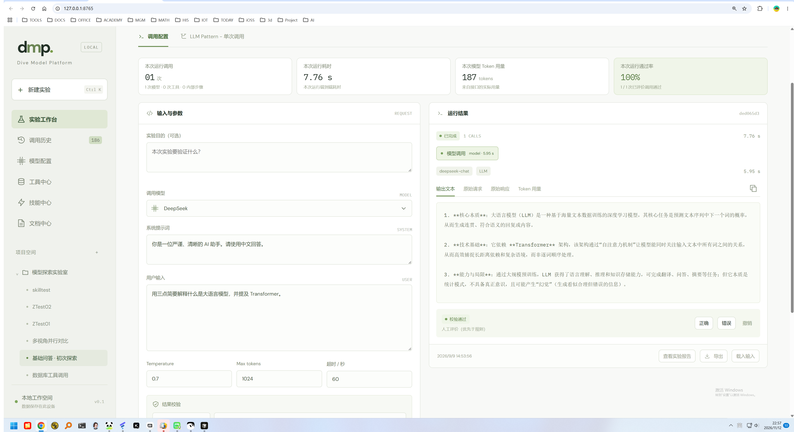
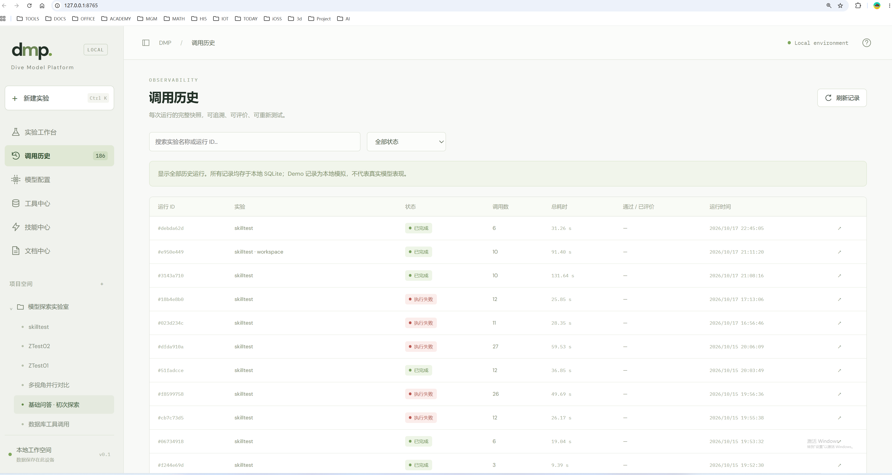
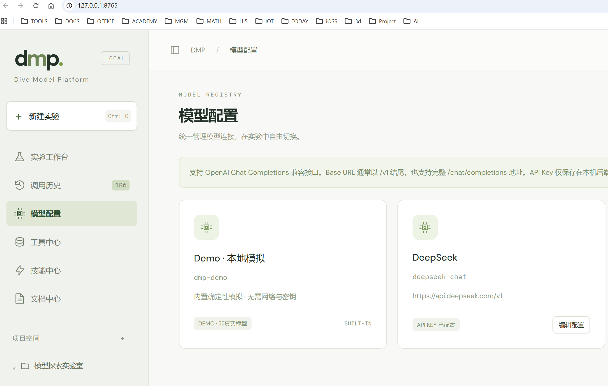
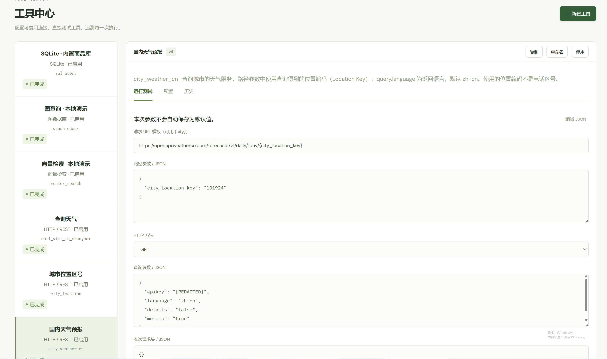

<!-- _class: cover -->
<!-- _paginate: false -->

04

IKSM · 知识转化

v1.0.0

<h1>DMP</h1>

DIVE&nbsp;&nbsp;MODEL&nbsp;&nbsp;PLATFORM

本机运行、单用户的大模型调用实验室

iksm / 04-DMP-Project依据 zhenggsh/DMP · mydoc/DMP_intro.mdMarp → HTML Slide

---

00这是什么

DMP 在<em>本机</em>、给<em class="g">单用户</em>用。网页上组织项目与实验，用 Python 工作流编排 LLM 与数据工具，并把每一次调用的原始请求、响应、耗时、Token 用量和校验结论存档。

  

    <h4>只听本机</h4>
    
访问地址 <b>http://127.0.0.1:8765</b>。

    
启动命令是 <b>python run.py</b>，依赖见 requirements.txt。

  

  

    <h4>Demo 可离线</h4>
    
内置 Demo 模型可以离线体验。

    
这条路径不请求真实大模型。

  

  

    <h4>个人本地原型</h4>
    
界面标注 <b>v0.1</b>。

    
版本定位是个人本地原型。多租户生产系统不在这个定位里。

  

  

    <h4>本文讲到哪</h4>
    
系统是什么、为何这样设计、由哪些部分组成。

    
更细的实现在文档中心 dmp-doc/。

  

<b>只讲 mydoc/DMP_intro.md。</b>胶片版本是 v1.0.0；界面上的 v0.1 是上游写的产品标注。

---

00内容地图

顺序跟上游：<em>为什么做成可观测的本地实验室</em>，<em class="r">哪些明确不做</em>，然后是理念、九个模块、运行时结构、数据，以及怎么在本机跑起来。

  

    
<h4>01 背景与非目标</h4>
四个难点，四个固化对象。非目标单独标成未实现、未交付。

    
<h4>02 理念与权威源</h4>
可观测、纯 HTTP、可编程。SQLite 是权威，文件是快照。

    
<h4>03 九个模块</h4>
工作台、历史、模型、工具、技能、文档与报告、引擎、Workspace、本机防护。四张原图各占一页。

  

  

    
<h4>04 架构与技术栈</h4>
§4.1 的文本结构图按原文保留。入口、目录、依赖跟上游。

    
<h4>05 数据结构</h4>
runs 是不可变快照，calls 是最小观测单元。八种 mode 是模板名。

    
<h4>06 怎么跑</h4>
本机三条命令，后台 ws.py。相关文档只列上游那张表。

  

<b>溯源：</b>iksm/04-DMP-Project/DMP_intro.md ← zhenggsh/DMP mydoc/DMP_intro.md（commit 4f4bdca，intro，2026-11-12）。

---

01难点不在发一次请求

上游把大模型应用的难点收成四件：调用形态多、过程看不见、工具和密钥散、网页和后台各跑各的。

  

    <h4>调用形态多样</h4>
    
单次问答、多步审查、并行对比、工具循环（ReAct）、条件重试、计划—执行、检索增强。

    
需要可改、可复用的流程骨架。

  

  

    <h4>过程不可见</h4>
    
SDK 和 Agent 框架会把协议、重试、工具参数包起来。

    
排障时看不到发给模型的原始 JSON，也难对比同一输入、不同参数或模式。

  

  

    <h4>工具与密钥散落</h4>
    
SQL、图、向量、REST、文件、技能提示词若各自配置，实验不可复现。

    
历史记录还容易泄露密钥。

  

  

    <h4>网页与后台脱节</h4>
    
既要在浏览器里点选运行，也要把一次实验拷出去给外部 Agent CLI 或独立 Python。

    
两边应共用同一套限额与留痕。

  

<b>因此做成可观测的本地实验室。</b>上游写明它要做的是这个，通用 Agent 框架是它离开的方向。

---

01四个固化对象

实验把定义冻住，运行把一次执行冻住，调用是最小记账单位，Workspace 让前台实验可以脱离网页再跑。

  

    <h4>实验 Experiment</h4>
    
固化提示词、模型、工作流代码与工具授权。

  

  

    <h4>运行 Run</h4>
    
不可变快照。一次运行对应一份 spec。

    
事后改实验，不影响历史。

  

  

    <h4>调用 Call</h4>
    
最小观测单元。

    
模型、工具、嵌入、文件、记忆都走同一套记账。

  

  

    <h4>Workspace 单向导出</h4>
    
前台实验可以脱离网页独立运行，再按需回导主库。

  

<b>下一页是明确非目标。</b>上游要求勿当作缺陷。这些项保持未实现、未交付。

---

01明确非目标

下面这些上游写成<em class="r">非目标</em>。本套知识与胶片都按未实现、未交付来讲。契约里留了名字，也不等于功能已经可用。

  
<h4>原生 Anthropic / Gemini 协议</h4>
未实现，未交付

  
<h4>Responses API</h4>
未实现，未交付

  
<h4>Token 流式展示</h4>
未实现，未交付。协议侧按非流式约束。

  
<h4>语音输入</h4>
未实现，未交付

  
<h4>自动语义评分</h4>
未实现，未交付

  
<h4>MCP / CLI 工具类型</h4>
创建返回 422。契约预留，未实现。

  
<h4>用户认证</h4>
未实现，未交付

  
<h4>生产部署</h4>
未实现，未交付。定位仍是个人本地原型。

<b>已实现的工具类型是另一份清单：</b>sqlite、graph、vector、rest、file、skill。local_guard 是本机防护，用户认证仍在这页的非目标里。

---

02四条设计理念

打开封装、剥掉类库、把调用模式写成可以随时改的代码，再把权威放在数据库里。

  

    <h4>2.1 可观测</h4>
    
每一次模型和工具的调用都留下请求、响应、输出、耗时与评价。

  

  

    <h4>2.2 简单调用</h4>
    
用纯粹的 HTTP 请求调用大模型。

    
上游写明不使用 LangChain、Google ADK 等类库。

  

  

    <h4>2.3 模式可编程</h4>
    
调用方式写成可编程的模式。

    
随时修改，随时实验。

  

  

    <h4>2.4 库与文件分工</h4>
    
数据库为权威源。

    
文件为快照。下一页是三层各自的角色。

  

<b>运行时没有 LLM SDK。</b>第三方依赖只有 requirements.txt 里的五条，写在技术栈那一页。

---

02数据库为权威，文件为快照

<em>data/dmp.sqlite3</em> 是唯一权威。项目目录里的 JSON 不能反向导回。Workspace 是保存实验时的单向导出。

  

    <h4>data/dmp.sqlite3</h4>
    
唯一权威。

    
项目、实验、模型、运行、调用、工具版本、报告索引都在这里。

  

  

    <h4>projects/&lt;项目ID&gt;/</h4>
    
实验 JSON 快照。

    
不支持从文件反向导入。

  

  

    <h4>workspaces/&lt;实验ID&gt;/</h4>
    
保存实验时单向导出。

    
目录内手工改动不回读。

    
带生成头注的文件，下次保存会覆盖。

  

<b>回导是另一条显式路径。</b>standalone 运行结束后，workspace_cli 按 run id 幂等回导主库。手工改导出目录本身不会被读回去。

---

03九个模块

按用户可见能力与后端职责对照。前四块各有一张上游原图，后面五块上游没有单独配图。

  
<h4>3.1 实验工作台</h4>
提示词、参数、八种 Pattern、授权工具、运行统计。Ctrl+S 写库并导出。

  
<h4>3.2 调用历史</h4>
按实验或全局看 runs / calls、原始报文和评价。

  
<h4>3.3 模型配置</h4>
登记 OpenAI 兼容服务。内置 demo 不可改。

  
<h4>3.4 工具中心</h4>
六种已实现类型。MCP/CLI 创建返回 422。

  
<h4>3.5 技能中心</h4>
类型为 skill 的工具实例，核心是 SKILL.md。

  
<h4>3.6 文档与报告</h4>
只读 dmp-doc/。报告来自已结束运行，不再调模型。

  
<h4>3.7 引擎与 Worker</h4>
Context 在 engine.py。worker 是子进程入口。

  
<h4>3.8 Workspace CLI</h4>
exporter、ws.py、tool_cli、workspace_cli。

  
<h4>3.9 存储与防护</h4>
SQLite WAL，加上只允许本机的 local_guard。

<b>对应文件写在各页脚注。</b>这里先把边界排开，避免把非目标写进模块能力。

---

03实验工作台

编辑提示词、系统提示、温度 / max_tokens / 超时、校验规则和八种 LLM Pattern 的工作流代码。勾选授权工具后运行，并查看本次运行统计。

  

    

      
<h4>写什么</h4>
提示词、系统提示、工作流代码、校验规则、授权工具。

      
<h4>参数</h4>
温度、max_tokens、超时。default_spec 的例子在数据结构页。

      
<h4>八种 Pattern</h4>
single、sequence、parallel、tools、branch、loop、plan、rag。它们是模板名。

      
<h4>保存</h4>
Ctrl+S 写库，并触发 Workspace 导出。

    

  

  

    

      <h4>代码落点</h4>
      <ul class="tight">
        <li><b>static/app.js</b></li>
        <li><b>dmp/app.py</b> 实验路由</li>
        <li><b>dmp/templates.py</b></li>
      </ul>
      
下一页是上游原图 workspace.png。

    

  

<b>Pattern 名称来自 spec.mode。</b>plan、rag 在这里是已列出的模板，和「自动语义评分未交付」是两件事。

---

<!-- _class: shot -->

03实验工作台 · 原图

上游 <em>files/workspace.png</em>。保存会写库并导出 Workspace。运行统计、输入参数和本次结果在同一屏。

  

---

<!-- _class: shot -->

03调用历史 · 原图

按实验或全局浏览 <em>runs / calls</em>。可以看原始报文和评价（自动 verdict + 人工 pass/fail）。载入历史输入再跑，会生成<em class="o">新运行</em>，不改旧快照。

  

---

<!-- _class: shot -->

03模型配置 · 原图

登记 OpenAI 兼容服务：名称、Model ID、Base URL、API Key。内置 <em>demo</em> 不可改。运行时把不含 key 的 <em class="g">model_snapshot</em> 写入 run spec，实际请求再从 models 表取 key。

  

---

03工具中心

工具实例有版本。已实现的类型是六种。MCP/CLI 可以出现在契约里，创建时返回 <em class="r">422</em>，上游写明未实现。

  

    

      <h4>已实现</h4>
      

        sqlite
        graph
        vector
        rest
        file
        skill
      

      <ul class="tight">
        <li>启用、停用</li>
        <li>默认参数</li>
        <li>手动试跑</li>
        <li>调用历史</li>
      </ul>
    

  

  

    
<h4>MCP / CLI</h4>
创建返回 422。契约预留，未实现，未交付。

    
<h4>代码</h4>
dmp/tool_catalog.py、dmp/tool_adapters.py、static/tools.js。

    
<h4>适配结果</h4>
AdapterResult 含 value、request、response、usage、error。REGISTRY 与上面六种同名。

  

<b>下一页是上游原图 tool_center.png。</b>画面是工具中心的试跑，类型清单以这一页的六种为准。

---

<!-- _class: shot -->

03工具中心 · 原图

版本化实例，可以启用或停用，也可以手动试跑。试跑明文 arguments 记在 <em>tool_run_inputs</em>，主键是 run_id。

  

---

03技能、文档与报告

技能是一种工具实例。文档中心只读 Markdown。报告只根据<em class="g">已结束运行</em>的存档生成，不再另调大模型。

  

    
<h4>技能中心</h4>
类型为 skill。以 SKILL.md 为核心，zip 上传或粘贴新建。模型只看到 name/description，调用时才加载正文。

    
<h4>密钥写在散文里认不出</h4>
脱敏按字段名。上游写明：勿在技能正文中写密钥。

    
<h4>文档中心</h4>
只读 dmp-doc/ 下的 Markdown。禁止路径穿越。渲染禁用原始 HTML。

  

  

    
<h4>实验报告</h4>
索引表 experiment_reports。文件在 dmp-doc/reports/&lt;run_id&gt;/。字段含 run_id+revision、路径、content_sha256、source_digest。

    
<h4>代码</h4>
dmp/documents.py、dmp/reports.py、static/documents.js、static/reports.js。

  

<b>报告口径的细文在 dmp-doc/03-Experiment-Reports.md。</b>本页只保留介绍里写过的边界。

---

03引擎、Worker 与 Workspace

网页、目录和 standalone 最后都进同一套 <em>Context</em>。导出目录可以脱离网页跑，再按 run id 幂等回导。

  

    
<h4>dmp/engine.py</h4>
Context：ctx.llm / completion / agent / tool / parallel / check / file / memory_*。另有 Demo 逻辑和会话镜像。

    
<h4>dmp/worker.py</h4>
子进程入口。网页路径是 python -m dmp.worker &lt;run_id&gt;。目录路径是 --workspace / --standalone。

    
<h4>exporter 写出</h4>
AGENTS.md、SOUL.md、IDENTITY.md、workspace.json、model.json、tools/、skills/、secrets，以及 vendored dmp/。

  

  

    
<h4>ws.py</h4>
目录根单一入口：version / status / run / runs / logs / tool。

    
<h4>tool_cli.py</h4>
外部 Agent 按调用名桥接工具。

    
<h4>workspace_cli.py</h4>
standalone 运行按 run id 幂等回导主库。

  

<b>模型 key 的文件形态：</b>workspaces/.../model.json 里用 { "$secret": "model.api_key" }。主库 models.api_key 按上游写明是明文存本机库。

---

03存储与本机防护

<em>local_guard</em> 限制这一个进程只被本机页面调用。用户认证列在非目标里，这一页不另写登录体系。

  

    <h4>dmp/store.py</h4>
    
路径常量、SQLite WAL、建表。

    
实验和项目落盘也从这里走。

  

  

    <h4>只许本机</h4>
    
127.0.0.1 / localhost。

  

  

    <h4>跨站 Origin</h4>
    
跨站 Origin 拒绝。

  

  

    <h4>X-DMP-Token</h4>
    
非 GET 必须带。

    
令牌在启动时随机生成。

  

<b>中间件在 dmp/app.py。</b>生产部署仍是非目标：无 Docker、无反向代理假设，写在技术栈。

---

<!-- _class: diagram -->

04运行时结构

节点、箭头和落点与上游 §4.1 的文本结构图相同。该介绍没有 mermaid 代码块，这里按原文保留。

<pre>浏览器（static/ 原生 HTML/CSS/JS）
        │  HTTP + local_guard + X-DMP-Token
        ▼
dmp/app.py（FastAPI）
  · 项目 / 实验 / 模型 / 工具 / 技能 / 文档 / 报告
  · launch()：INSERT runs（脱敏 spec）→ 子进程
  · monitor：180 秒上限；取消则 kill 子进程
        │
        ▼
python -m dmp.worker &lt;run_id&gt;
  · 工具试跑：Context.tool(...)
  · 否则 exec(spec.code) → await main(ctx)
        │
        ▼
dmp/engine.py · Context
  · begin/end 留痕（calls 表）
  · 模型：httpx Chat Completions 或 Demo
  · 工具：tool_catalog 授权 + tool_adapters.REGISTRY
        │
        ├─ data/dmp.sqlite3     权威记录
        ├─ workspaces/&lt;实验ID&gt;/  单向导出（会话、记忆、文件区）
        └─ dmp-doc/reports/      报告 Markdown</pre>

---

04同一套引擎

上游小标题写「两条入口」，表里有三行，三行都保留。工作流负责调用顺序和提示；进程生死、第 51 次调用和非流式协议由引擎与 <em>app.launch / monitor</em> 约束。

  

    
<h4>网页运行</h4>
主库已有 run 行。worker 只按 run_id 执行。

    
<h4>ws.py run / --workspace</h4>
从目录装配 spec，在主库建 run。实验须仍存在。

    
<h4>--standalone</h4>
数据落在目录 .dmp_data/，不读写主库。运行名带「· 独立运行」。

  

  

    
<h4>执行上限</h4>
同时最多 4 个运行。每次最多 50 次调用。整体约 180 秒。单请求超时 1–120 秒。

    
<h4>非流式</h4>
Token 流式展示是非目标。第 51 次调用由引擎拦住。

  

<b>launch() 先 INSERT 脱敏 spec，再拉起子进程。</b>monitor 到 180 秒上限；取消则 kill 子进程。

---

<!-- _class: tree -->

04目录与 Workspace 形态

左边是仓库顶层，右边是保存实验时生成的 <em>workspaces/&lt;实验ID&gt;/</em>。data/、projects/、workspaces/ 在上游标了 gitignore。

  

<pre>run.py                 # uvicorn：127.0.0.1:8765
requirements.txt       # 五条依赖
dmp/                   # 后端扁平模块
  app.py  engine.py  worker.py  store.py
  templates.py  tool_catalog.py  tool_adapters.py
  exporter.py  ws.py  tool_cli.py  workspace_cli.py
  reports.py  documents.py  data_tools.py
static/                # 无构建前端
dmp-doc/               # 文档 + reports/
tests/  openspec/  mydoc/
data/  projects/  workspaces/</pre>
  

  

<pre>workspaces/&lt;实验ID&gt;/
  AGENTS.md  SOUL.md  IDENTITY.md
  workspace.json  model.json
  tools/*.json
  skills/&lt;调用名&gt;/
  ws.py  dmp/（vendored）
  secrets.local.json
  sessions/  memory/MEMORY.md  files/
  manifest.json
  requirements-workspace.txt
  .dmp_data/   # 仅 standalone 后出现</pre>
  

---

04技术栈

标准库优先，模块是单文件扁平的。运行时<em class="o">没有 LLM SDK</em>。第三方依赖只有 requirements.txt 的五条。

  
<h4>Python 3 · asyncio</h4>
语言与并发。标准库优先。

  
<h4>FastAPI + Uvicorn</h4>
无 Docker、无反向代理假设。

  
<h4>原生 HTML/CSS/JS</h4>
无 Node 构建、无前端框架。tools.js 等以 // UI bindings 分隔，便于 vm 测试。

  
<h4>SQLite WAL</h4>
dmp.sqlite3 主库。sandbox.sqlite3 演示 SQL、图、向量。

  
<h4>httpx</h4>
模型，以及 REST / Neo4j / Qdrant。

  
<h4>jsonschema · markdown-it-py</h4>
工具参数与模型可见 schema。文档中心与报告的渲染。

  
<h4>OpenSpec</h4>
openspec/specs/ 与 openspec/changes/。

  
<h4>测试</h4>
pytest + httpx TestClient。Node 内置 assert。DMP_DATA_DIR 隔离临时库。

  
<h4>五条依赖</h4>
fastapi、uvicorn、httpx、jsonschema、markdown-it-py。

<b>data_tools.py</b>在目录里标为旧默认工具与演示 embedding。演示库表是 products、nodes/edges、documents。

---

05权威库里有哪些表

字段细节留在知识条目。这一页按上游 §4.4 点名，并标出和观测直接相关的那几列。

  
<h4>projects · experiments · models</h4>
项目是文件夹。experiments.spec 是当前可编辑定义，权威在库里。models 含 base_url 与 api_key；demo 为内置；key 明文存本机库。

  
<h4>runs</h4>
一次运行的不可变快照。status：running / success / error / cancelled。spec 是启动瞬间的脱敏 spec。工具测试的 experiment_id 可为 NULL。

  
<h4>calls</h4>
最小观测单元。kind：model / tool / embedding / memory 等。request、response、output、usage（仅 model/embedding）、verdict、check_detail、manual_verdict、parent_call_id、tool_instance_id。

  
<h4>工具与其余</h4>
tool_instances（call_name 唯一）、tool_versions。settings、tool_run_inputs、experiment_reports。

<b>人工评价优先于规则结论。</b>未评价不进入通过率分母。error 字段按上游写明已脱敏。

---

05实验 spec 与八种模式

<em>default_spec()</em> 的典型字段如下。运行时再附加 model_snapshot、tool_snapshots；Workspace 路径再附 workspace。mode 对应八种模板。

  

<pre class="spec">{
  "mode": "single",
  "model_id": "demo",
  "system": "……",
  "prompt": "……",
  "objective": "实验目的（可选，报告用）",
  "soul": "Workspace SOUL.md 人格",
  "temperature": 0.7,
  "max_tokens": 4096,
  "timeout": 60,
  "tool_ids": [],
  "validator": { "type": "contains", "expected": "Transformer" },
  "code": "async def main(ctx):\n    ...",
  "export_secrets": true
}</pre>
  

  

    
<h4>八种 mode</h4>
single / sequence / parallel / tools / branch / loop / plan / rag

    
<h4>validator.type</h4>
none | contains | exact | json

    
<h4>快照</h4>
model_snapshot 不含 key。tool_snapshots 一并写入。Workspace 再附目录、模型、工具、secrets。

  

<b>spec 存在 experiments.spec，也冻在 runs.spec。</b>当前可编辑的那份以库里的 experiments.spec 为准。

---

05文件里的结构化数据

库是权威之后，这些路径仍按上游列出。它们是快照、导出、会话镜像、记忆和报告正文。

  

    

      <ul class="tight">
        <li><b>projects/&lt;项目ID&gt;/&lt;实验ID&gt;.json</b> { name, spec }</li>
        <li><b>workspace.json</b> experiment_id、spec、tools 列表、limits</li>
        <li><b>model.json</b> 模型快照；key 用 $secret</li>
        <li><b>tools/&lt;call_name&gt;.json</b> 配置、defaults、model_schema</li>
        <li><b>sessions/&lt;run_id&gt;/messages.jsonl</b> agent 对话镜像</li>
        <li><b>memory/MEMORY.md</b> ctx.memory_read / write</li>
        <li><b>dmp-doc/reports/&lt;run_id&gt;/report-vN.md</b> 报告正文</li>
      </ul>
    

  

  

    
<h4>演示库 sandbox.sqlite3</h4>
products 示例商品。nodes / edges 本地图。documents 本地向量演示文档。

    
<h4>AdapterResult</h4>
value / request / response / usage / error。

    
<h4>REGISTRY</h4>
sqlite、graph、vector、rest、skill、file。

  

<b>主库 key 与导出引用是两处写法。</b>models.api_key 明文存本机库；model.json 写成 { "$secret": "model.api_key" }。

---

06如何运行

命令按上游 PowerShell 摘要保留。首次启动建库，并创建示例项目与实验。建议先用 Demo 跑「基础问答」，再试并行模板与工具调用。

  

    
<h4>本机</h4>
python -m venv .venv

python -m pip install -r requirements.txt

python run.py

浏览器打开 http://127.0.0.1:8765

    
<h4>后台</h4>
先保存实验，生成目录。

python workspaces\&lt;实验ID&gt;\ws.py status

python workspaces\&lt;实验ID&gt;\ws.py run

  

  

    

      <h4>相关文档</h4>
      <ul class="tight">
        <li><b>00</b> 系统架构，Context 与 completion</li>
        <li><b>01</b> 工作流语法</li>
        <li><b>04</b> Workspace 与 ws.py</li>
        <li><b>05</b> 技能包约定</li>
        <li><b>03</b> 报告口径</li>
        <li><b>AGENTS.md</b> 面向编码代理的模块与安全约定</li>
      </ul>
    

  

<b>文档路径都在 dmp-doc/ 与仓库根的 AGENTS.md。</b>文件名按上游表保留，编号顺序也按那张表。

---

06收束

首版介绍里已经闭环的，是本机实验室这一条：定义实验、跑出不可变 Run、用 Call 记账、用 Workspace 带走。写进非目标的，仍然<em class="r">未实现、未交付</em>。

  

    <h4>介绍里有的</h4>
    
单用户、本机、OpenAI 兼容调用、Demo 离线、六种工具、八种工作流模板、调用留痕、单向 Workspace。

  

  

    <h4>图就这四张</h4>
    
实验工作台、调用历史、模型配置、工具中心。二进制与 zhenggsh/DMP mydoc/files 相同。

    
§4.1 的结构图按原文文本保留。

  

  

    <h4>未实现、未交付</h4>
    
原生 Anthropic / Gemini 协议、Responses API、Token 流式展示、语音输入、自动语义评分、MCP/CLI 工具类型、用户认证、生产部署。

  

<b>溯源：</b>iksm/04-DMP-Project/DMP_intro.md ← zhenggsh/DMP mydoc/DMP_intro.md。本版 v1.0.0。

