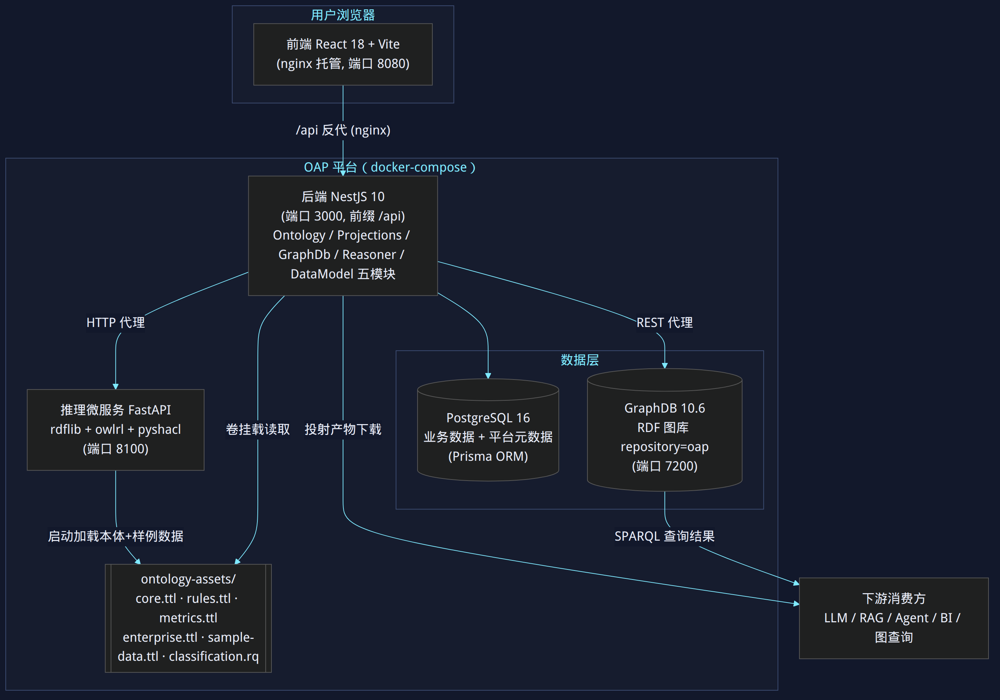
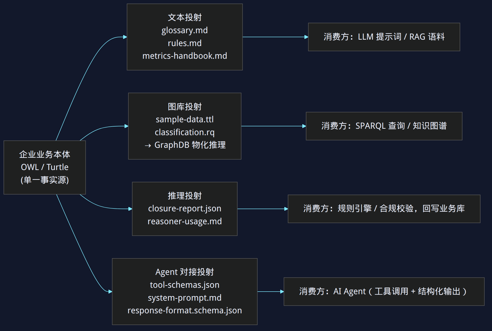
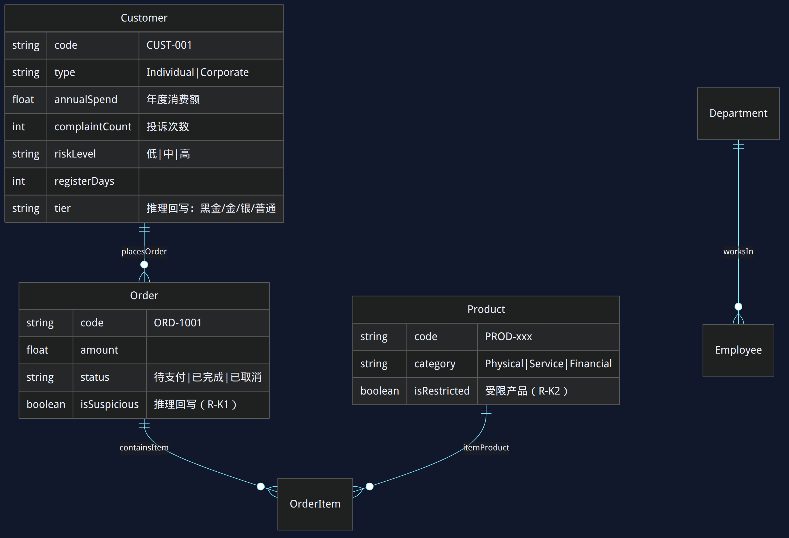
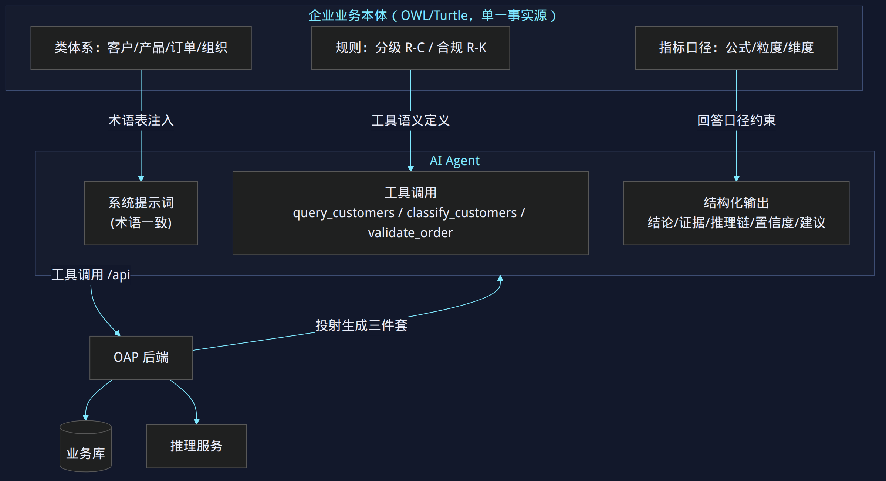

<!-- _class: cover -->
<!-- _paginate: false -->

05

IKSM · 知识转化

v1.0.0

<h1>OAP</h1>

ONTOLOGY&nbsp;&nbsp;AI&nbsp;&nbsp;PLATFORM

企业业务本体，一次建模，四类投射

iksm / 05-OAP-Project依据 zhenggsh/OAP · mydoc/OAP_intro.mdMarp → HTML Slide

---

00这是什么

OAP 把<em>企业业务本体</em>做成可视化工程平台。本体定义一次，再投射成<em class="g">文本 / 图库 / 推理 / Agent 对接</em>四类消费形态。

  

    <h4>可视化工程平台</h4>
    
上游开篇：企业业务本体 → 四类投射（文本 / 图库 / 推理 / Agent 对接）。

  

  

    <h4>一份本体</h4>
    
OWL/Turtle 是单一事实源。文本语料、图库、推理引擎、Agent 工具都从同一份本体派生。

  

  

    <h4>本文六块</h4>
    
设计背景、设计理念、主要模块、系统架构、本体论体系、本体与智能体的关系。

  

<b>只讲 mydoc/OAP_intro.md。</b>胶片版本是 v1.0.0。上游没有单列未实现清单，这里不另造未交付项。

---

00内容地图

顺序跟上游：先讲知识为什么散，再讲四条理念、模块、架构与数据，然后是本体文件和四类投射，最后是本体怎样约束智能体。

  

    
<h4>01 设计背景</h4>
口径、规则、概念、提示词各写一处。先建本体，再一键投射。

    
<h4>02 设计理念</h4>
本体即契约。一次建模，四类投射。业务底座解耦。规则可验证。

    
<h4>03 主要模块</h4>
前端、后端、推理微服务、本体资产。后端再分五个业务模块。

  

  

    
<h4>04 系统架构</h4>
架构图、数据流、目录、技术栈、业务数据与平台元数据。

    
<h4>05 本体论</h4>
六个文件。文本、图库、推理、Agent 对接四类映射。

    
<h4>06 与智能体</h4>
知识源约束行为。认知、工具、表达，以及回写闭环。

  

<b>溯源：</b>iksm/05-OAP-Project/OAP_intro.md ← zhenggsh/OAP mydoc/OAP_intro.md（commit cbe405a9，intro min modify，2026-11-15 17:31 Asia/Shanghai）。

---

01定义散落在各处

数据智能化同时碰到 BI 语义层、知识图谱、规则引擎和 AI Agent。结构性问题是<em class="o">业务知识的定义不在一处</em>。

  

    <h4>口径不一致</h4>
    
指标口径在 Excel 里。

    
同名指标会对不上，例如「销售额」含税还是未含税。

  

  

    <h4>规则在代码里</h4>
    
业务人员无法审阅。

    
改规则就要改代码。

  

  

    <h4>模型无感知</h4>
    
领域概念在文档里，提示词在 prompt 里。

    
大模型 / Agent 对企业业务无感知，回答靠幻觉，讲不出推理依据。

  

  

    <h4>重复建设</h4>
    
图谱、推理、报表各自建模。

    
重复，而且互相矛盾。

  

<b>每一处都各说各话。</b>这是设计背景，不是另外一张能力清单。

---

01先建本体，再四处消费

设计出发点：先建立一套机器可读的<em>企业业务本体</em>，作为单一事实源，再<em class="g">一键投射</em>到下游消费形态。

  

    

      <h4>Ontology → Project</h4>
      
本体定义一次，处处消费。

      
文本语料、图库、推理引擎、Agent 工具，全部由同一份 OWL/Turtle 派生。

      
口径一致是派生的结果，不是事后对齐。

    

  

  

    
<h4>单一事实源</h4>
机器可读。下游不再各写一份定义。

    
<h4>投射</h4>
Project 到所有下游消费形态。

  

<b>四类消费形态</b>在下一章展开：Markdown 文本、RDF 图库资产、推理产物、Agent 对接三件套。

---

02四条设计理念

上游当前是四条。第 3 条是<em>业务底座解耦</em>：营业系统、网管系统都可以作为底座，本体设计可以单独导出。

  

    

      <h4>1 · 本体即契约</h4>
      
本体不是文档，是平台全部能力的事实源。

      
类、属性、规则、指标口径都写成 OWL/Turtle。人、解析器、推理机、大模型读同一份文件。

    

    

      <h4>2 · 一次建模，四类投射</h4>
      
同一份本体生成四类产物。投射是纯函数：<b>generate(type, sources, ctx) → Artifact[]</b>。

      
可重复、可刷新、可下载、可版本化。

    

  

  

    

      <h4>3 · 业务底座解耦</h4>
      
可基于不同业务底座做本体设计，例如营业系统、网管系统。

      
本体设计可作为独立的输出物品导出。

    

    

      <h4>4 · 推理与规则显式化</h4>
      
黑金 / 金 / 银、可疑订单不写死在代码里。OWL 类框架 + SPARQL CONSTRUCT，推理后回写业务库。

      
SHACL 做合规校验。规则可查询、可审计、可解释。

    

  

<b>按上游现行原文。</b>不把介绍里没写的原则补进来。

---

03四大部分

OAP 由<em>前端、后端、推理微服务、本体资产</em>构成。后端内部再划成五个业务模块，下一页按位置对照。

  

    <h4>前端应用</h4>
    
<b>frontend/</b>

    
总览、本体编辑器（Monaco）、数据浏览、四个投射向导、产物中心。

  

  

    <h4>后端</h4>
    
NestJS。五个业务模块：本体、投射、图库代理、推理代理、数据模型。

  

  

    <h4>推理微服务</h4>
    
<b>reasoner/</b> ReasonerEngine。

    
rdflib + owlrl 做 OWL-RL 前向闭包。SPARQL 判定客户分级与可疑订单。pyshacl 做合规校验。

  

  

    <h4>本体资产</h4>
    
<b>ontology-assets/</b>

    
core、rules、metrics、enterprise、sample-data、classification.rq。

  

<b>推理微服务和后端里的推理代理不是同一个目录。</b>代理在 backend/src/reasoner/，引擎在 reasoner/。

---

03后端五个业务模块

路径都在 <em>backend/src/</em>。职责按上游模块表，不把表外的接口补成已有能力。

  
<h4>本体管理 · OntologyModule</h4>
ontology/。浏览、Turtle 在线编辑、n3 语法校验（错误定位到行）、版本历史、结构摘要（类 / 对象属性 / 数据属性 / 规则）。

  
<h4>投射中心 · ProjectionsModule</h4>
projections/。四类投射的同步生成流水线（generators/ 纯函数）、产物落库、刷新、删除、下载。

  
<h4>图库代理 · GraphDbModule</h4>
graphdb/。GraphDB REST 代理：仓库创建 / 清空、Turtle 上传、SPARQL SELECT / UPDATE、预置查询。

  
<h4>推理代理 · ReasonerModule</h4>
reasoner/。Python 推理微服务的 HTTP 代理：健康检查、推理运行、SHACL 校验。

  
<h4>数据模型 · DataModelModule</h4>
datamodel/。客户 / 产品 / 订单 / 组织的 REST 分页查询；推理结果回写 tier / isSuspicious。

<b>前端和 ReasonerEngine 在上一页。</b>这一页只列后端五个模块。

---

<!-- _class: shot -->

04系统架构

节点、分组和连线与上游 <em>flowchart TB</em> 相同。浏览器走 nginx 反代，后端连 PostgreSQL、GraphDB 和推理服务，两边都读 ontology-assets。

  

---

<!-- _class: shot -->

04平台数据流

同一份 OWL/Turtle 分出四条投射，再落到四类消费方。文件名与上游 <em>flowchart LR</em> 一致。

  

---

04从架构图上读到的端口

上一页的图画的是部署关系。端口、前缀和资产文件名按图中原文，方便和目录、技术栈对照。

  
<h4>前端 8080</h4>
React 18 + Vite，nginx 托管。/api 反代到后端。

  
<h4>后端 3000</h4>
NestJS 10，前缀 /api。五个模块：Ontology、Projections、GraphDb、Reasoner、DataModel。

  
<h4>PostgreSQL 16</h4>
业务数据 + 平台元数据。Prisma ORM。

  
<h4>GraphDB 10.6</h4>
RDF 图库，repository=oap，端口 7200。REST 代理。

  
<h4>推理 8100</h4>
FastAPI。rdflib + owlrl + pyshacl。HTTP 代理。

  
<h4>ontology-assets/</h4>
core、rules、metrics、enterprise、sample-data、classification.rq。推理启动加载；后端卷挂载读取。

<b>下游消费方</b>是 LLM / RAG / Agent / BI / 图查询。后端提供投射产物下载，GraphDB 提供 SPARQL 查询结果。

---

<!-- _class: tree -->

04目录结构

Monorepo。左边到后端，右边是推理服务、前端和 docs。文件名与上游代码块一致，注释较长的留在知识条目原文。

  

<pre>oap/
├── docker-compose.yml    # 五服务
├── .env.example
├── README.md
├── ontology-assets/
│   ├── core.ttl
│   ├── rules.ttl
│   ├── metrics.ttl
│   ├── enterprise.ttl
│   ├── sample-data.ttl
│   └── classification.rq
└── backend/
    ├── prisma/
    │   ├── schema.prisma
    │   └── seed.ts
    ├── src/
    │   ├── main.ts / app.module.ts
    │   ├── prisma/
    │   ├── ontology/
    │   ├── projections/
    │   ├── graphdb/
    │   ├── reasoner/
    │   └── datamodel/
    └── test/             # Jest + e2e</pre>
  

  

<pre>reasoner/
├── app/
│   ├── main.py           # FastAPI
│   ├── engine.py         # ReasonerEngine
│   └── schemas.py
└── tests/test_engine.py  # pytest
frontend/
└── src/
    ├── api/
    ├── components/
    ├── pages/
    └── __tests__/        # Vitest
docs/</pre>
  

---

04技术栈

六行按上游分层表。图数据库写的是 Ontotext GraphDB 10.6 free edition，编排放在 docker-compose 里。

  
<h4>前端</h4>
React 18、TypeScript、Vite、Vitest、React Router、TanStack Query、Tailwind CSS、Monaco Editor。

  
<h4>后端</h4>
NestJS 10、TypeScript、Jest、Prisma 5、n3（Turtle 解析）。

  
<h4>推理服务</h4>
Python 3.11、FastAPI、rdflib、owlrl、pyshacl。

  
<h4>关系数据库</h4>
PostgreSQL 16，Prisma ORM。

  
<h4>图数据库</h4>
Ontotext GraphDB 10.6，free edition，docker-compose 内置。

  
<h4>编排部署</h4>
docker-compose：postgres / graphdb / reasoner / backend / frontend，五个服务。

<b>五服务</b>与目录里的 docker-compose.yml 注释一致。介绍没有再写启动步骤，这里不补命令。

---

<!-- _class: shot -->

04业务数据模型

与本体类一一对应。关系是 placesOrder、containsItem、itemProduct、worksIn。tier 和 isSuspicious 标的是<em class="o">推理回写</em>。

  

---

04平台元数据与 RDF

PostgreSQL 承载业务数据和平台元数据，GraphDB 承载 RDF。四张元数据表的字段按上游。

  
<h4>OntologyFile</h4>
name / content / version / updatedAt。本体文件当前版本全文与版本号。

  
<h4>OntologyFileVersion</h4>
fileId / version / content / savedAt。编辑历史，可回看任意历史版本。

  
<h4>Projection</h4>
type / name / status / config。type ∈ text | graph | reasoner | agent。status ∈ pending | generated | applied | failed。config 存 JSON 生成参数。

  
<h4>ProjectionArtifact</h4>
projectionId / filename / content / mediaType。mediaType ∈ text/markdown | text/turtle | application/json | application/sparql-query。

<b>GraphDB repository = oap。</b>加载 enterprise.ttl 与 sample-data.ttl，再用 classification.rq 的 CONSTRUCT 物化客户分层类、可疑订单类等。

---

05本体六个文件

OWL/Turtle，命名空间 <em>ent: http://example.com/enterprise#</em>。四个模块文件，加样例数据和 SPARQL 规则集。

  
<h4>core.ttl · 核心层</h4>
客户 / 产品 / 订单 / 组织。含 owl:disjointWith、对象属性、数据属性、propertyChainAxiom（购买过，无需 ETL）。

  
<h4>rules.ttl · 规则层</h4>
黑金 / 金 / 银，互斥。合规框架：可疑订单、受限产品。数值条件由 SPARQL 承载，类 IRI 咬合。

  
<h4>metrics.ttl · 指标口径</h4>
ent:Metric 与 ent:Dimension。口径 / 公式 / 粒度 / 数据来源。口径即数据。

  
<h4>enterprise.ttl · 入口</h4>
owl:imports 组合上面三个模块。推理服务与图库加载此文件即得全量本体。

  
<h4>sample-data.ttl</h4>
3 客户 / 3 产品 / 3 订单（含订单项）。与 PostgreSQL seed 对齐。

  
<h4>classification.rq</h4>
R-C1 黑金、R-C2 金卡、R-C3 银卡、R-K1 可疑订单、R-K2 受限产品销售。

<b>阈值按上游：</b>R-C1 年消费 ≥50 万且投诉=0；R-C2 10 万~50 万；R-C3 1 万~10 万；R-K1 金额 ≥20 万且注册 &lt;30 天；R-K2 受限产品销售。

---

05文本投射与图库投射

type = text 给人和模型读。type = graph 把样例和 CONSTRUCT 送进 GraphDB，成功是 <em class="g">applied</em>，图库不可达则降为 <em class="o">generated</em>。

  

    

      <h4>文本 · glossary / rules / metrics</h4>
      
glossary.md：类表、属性表、规则表，含 rdfs:label / rdfs:comment。

      
rules.md：OWL 约束与阈值写成 R-C1~R-C3、R-K1、R-K2。

      
metrics-handbook.md：指标名 / 公式 / 粒度 / 数据源。

      
注入系统提示词，或切块做 RAG 语料。

    

  

  

    

      <h4>图库 · 三份产物</h4>
      
sample-data.ttl、classification.rq，都从 ontology-assets 复制。

      
graphdb-compose.yml：单服务 compose，供独立导出部署。

      
自动应用：仓库 oap 存在 → 清空 → 上传 → 逐条 CONSTRUCT。

      
预置查询 q1 客户分级、q2 可疑订单、q3 客户-产品购买链。

    

  

<b>降级不是另做一套结果。</b>GraphDB 不可达时状态改为 generated，并附提示。

---

05推理投射与 Agent 三件套

type = reasoner 对接内置推理服务，报告<em class="r">禁止伪造</em>。type = agent 交付工具、提示词和五段式输出。

  

    

      <h4>推理 · closure-report.json</h4>
      
字段：assertedTriples、closureTriples、derivedClasses、suspiciousOrders、durationMs。

      
数据来自推理服务真实响应：OWL-RL 前向闭包 + SPARQL 判定。

      
reasoner-usage.md 是固定模板的 API 说明。

      
POST /api/datamodel/sync-reasoner 回写 Customer.tier、Order.isSuspicious。

      
pyshacl：OrderShape / RestrictedSaleShape / SuspiciousFlowShape。

    

  

  

    

      <h4>Agent · 三件套</h4>
      
tool-schemas.json：query_customers、classify_customers、validate_order。OpenAI function-calling，description 引用本体术语。

      
system-prompt.md：术语表摘要 + 工具使用纪律。

      
response-format.schema.json：结论 / 证据 / 推理链 / 置信度 / 建议。

    

  

<b>口径跟着本体走。</b>工具定义、提示词措辞、输出格式都由同一份本体派生。

---

<!-- _class: shot -->

06本体怎样进到智能体

关系是<em>知识源 → 行为约束</em>。类、规则、指标分别进提示词、工具和输出格式；后端再把三件套投给 Agent，并接下调用。

  

---

06认知、工具、表达、闭环

段首写「三类机制」，下面四条都保留：世界观、手脚、表达，以及改本体之后的全链路一致。

  

    <h4>1 · 业务世界观</h4>
    
术语表和规则手册进入系统提示词。

    
用企业定义的概念、口径和阈值，而不是只靠预训练里的泛化知识。

  

  

    <h4>2 · 约束手脚</h4>
    
工具的名称、参数、描述来自类与属性。

    
能问什么、能改什么由本体划界。后端接真实 REST 与推理服务。

  

  

    <h4>3 · 规范表达</h4>
    
输出固定五段：结论、证据、推理链、置信度、建议。

    
证据和推理链要挂到本体概念与规则上。

  

  

    <h4>4 · 双向闭环</h4>
    
工具调用可触发推理，并把分级 / 合规结果回写业务库。

    
编辑器保存后版本 +1，投射刷新同步三件套。

  

<b>可解释、可追溯</b>指的是输出层那两条：证据和推理链。不是额外加的评测产品。

---

06收束

没有本体的智能体只有通用智能；有了本体，才有企业专属的业务判断力。OAP 把中间的翻译做成投射流水线。

  

    <h4>介绍里有的</h4>
    
OWL/Turtle 单一事实源。四类投射：text、graph、reasoner、agent。推理回写 tier / isSuspicious。SHACL 三组 Shape。

  

  

    <h4>图是这四张</h4>
    
系统架构、平台数据流、业务数据 ER、本体与智能体。

    
节点和连线按上游 mermaid，渲成图片放进胶片。正文没有引用截图。

  

  

    <h4>边界就停在原文</h4>
    
规则阈值、产物文件名、端口和五服务编排都按介绍。介绍没写的启动步骤和未实现清单，不在这套胶片里补。

  

<b>溯源：</b>iksm/05-OAP-Project/OAP_intro.md ← zhenggsh/OAP mydoc/OAP_intro.md（cbe405a9dff4a10f7c26808ae2856c07a5e17ed2）。本版 v1.0.0。

