

<!-- _class: cover -->
<!-- _paginate: false -->

06

IKSM · 知识转化

v1.0.0

<h1>知识通</h1>

MATH

面向高中数学的知识点学习系统

iksm / 06-math-Project依据 zhenggsh/math · mydoc/math_intro.mdMarp → HTML Slide

---

00这是什么

知识通（仓库名 <em>math</em>）给高中数学用。教师用文件维护教材大纲和讲解，学生按大纲学习并留下掌握反馈，系统据此做针对性推荐和学习分析。

  

    <h4>教师维护文件</h4>
    
教材大纲和讲解放在文件里。

    
框架是 xlsx 或 csv，详情是 Markdown。

  

  

    <h4>学生按大纲学</h4>
    
学习时留下掌握反馈。

    
记录只追加，供后面的分析使用。

  

  

    <h4>推荐与分析</h4>
    
系统按反馈做针对性推荐。

    
也做学习分析。本文讲到本地怎么跑起来。

  

<b>只讲 mydoc/math_intro.md。</b>胶片版本是 v1.0.0。上游 commit ca118bf，提交说明 intro3，2026-11-17 21:07 Asia/Shanghai。

---

00内容地图

顺序跟上游：设计背景、设计理念、主要模块、系统架构、运行方式。十一段 mermaid 在知识源里保留源码，胶片上是按原文渲出的图。

  

    
<h4>01 设计背景</h4>
知识要有稳定载体，过程要记下来，路径可以选择，教与学分开。题库组卷和自动阅卷不在职责内。

    
<h4>02 设计理念</h4>
文件是知识源，数据库是索引和用户数据。前后端分离。目录用 Excel，知识用 Markdown。

    
<h4>03 主要模块</h4>
认证、教材、学习、智能学习、分析、学习助手。六张界面图按上游引用放进来。

  

  

    
<h4>04 系统架构</h4>
前端 5173，后端 3000。一次学习反馈的时序、入库、目录、技术栈和数据结构。

    
<h4>05 运行方式</h4>
Node、pnpm、PostgreSQL。环境变量、启动命令、常用指令，以及本地使用顺序。

    
<h4>不写成已交付</h4>
题库组卷、自动阅卷保持为非职责。§5.2 的演示账号只按原文出现，不扩成账号体系。

  

<b>溯源：</b>iksm/06-math-Project/math_intro.md ← zhenggsh/math mydoc/math_intro.md（commit ca118bfc4e9a895f9b76869173fb7beee81f8978）。

---

01讲解散落，大纲对不齐

高中数学知识点多、层级深。课堂讲解和课后复习散落在课件、笔记和题解里，学生很难按同一套大纲持续学，教师也难看清学了多久、掌握到哪一级。

  

    <h4>知识有稳定载体</h4>
    
每本教材是一对同名文件。

    
框架（xlsx 或 csv）写三级提纲，详情（md）写定义、公式、定理和关系图。

    
两边用编号对齐，例如 <b>1.1.1</b>。

  

  

    <h4>学习过程可记录</h4>
    
浏览知识点时记下开始时间、学习时长、备注和掌握程度（A–E）。

    
记录只追加。

  

  

    <h4>路径可选择</h4>
    
可以按大纲自由点选。

    
也可以按薄弱点、重要性或随机抽取来学。

  

  

    <h4>教与学分工</h4>
    
学生：学习和看自己的分析。

    
教师：管教材和知识点，看班级学习情况。

    
管理员：管账号与系统配置。

  

<b>重要性三档写在背景里：</b>A 必须掌握，B 重要，C 补充。掌握程度 A–E 是另一套，后面单独对照，不要混。

---

01本期范围

本期做知识浏览、学习反馈和分析。<em class="r">题库组卷、自动阅卷不在系统职责内</em>，这里保持为未实现、非职责，不写成已交付能力。

  

    <h4>本期要做</h4>
    
知识浏览。

    
学习反馈。

    
学习分析。

  

  

    <h4>不在职责内</h4>
    
题库组卷。

    
自动阅卷。

    
上游写的是职责边界，不是待交付清单。

  

  

    <h4>实现路径上的一句</h4>
    
上游写：此项目也是实践 SDD 编程的一个尝试。

    
采用 gstack + superpower + openspec，并使用 Claude Code CLI + Kimi 模型。

  

<b>SDD 这句按原文收录。</b>不把工具名扩写成一套研发流程，也不由此推出题库或阅卷能力。

---

02三条设计理念

文件放正文，数据库放索引和用户数据。浏览器只走 REST。目录和知识分成两级：Excel 放目录，Markdown 放知识。

  

    <h4>2.1 文件是知识源</h4>
    
教材正文在仓库根目录的 <b>iksm/</b>，用编辑器或表格维护。

    
PostgreSQL 保存教材元数据、解析后的知识点，以及用户、学习记录和 AI 会话。

  

  

    <h4>2.2 前后端分离</h4>
    
前端管界面、路由和本地交互状态。

    
后端管鉴权、文件读写、解析、推荐和分析。按领域拆成 NestJS 模块。

  

  

    <h4>2.3 两级存储</h4>
    
用提示词取得相应知识。

    
Excel 存放目录，Markdown 存放知识。两边用知识点编号关联。

  

<b>刷新或同步时</b>按文件变更把框架重新解析进数据库，并与 Markdown 详情保持编号一致。

---

<!-- _class: shot -->

02文件、索引、界面

节点和箭头按上游 §2.1 的 flowchart。学习反馈回数据库，教师编辑后回写文件。

  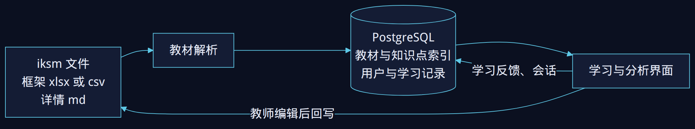

---

02前后端各自做什么

浏览器只通过 REST 访问后端。每个 NestJS 模块自带控制器、服务和数据传输对象。

  

    

      <h4>前端</h4>
      
界面、路由、本地交互状态。

    

    

      <h4>后端</h4>
      
鉴权、文件读写、解析、推荐、分析。

    

  

  

    <h4>六个业务模块</h4>
    <ul class="tight">
      <li><b>auth</b> 认证</li>
      <li><b>textbook</b> 教材与知识点</li>
      <li><b>learning</b> 学习记录</li>
      <li><b>smart-learning</b> 推荐</li>
      <li><b>analytics</b> 分析</li>
      <li><b>study-agent</b> 学习智能体</li>
    </ul>
  

<b>模块名按上游架构和目录。</b>下一页是提示词对两份文件的产出要求，全文留在知识条目里。

---

02目录文件和详情文件

§2.3 的提示词示例，任务是整理「高中数学必修一」。产出两份文件，用知识点编号对齐。下面只列提示词里写明的要求。

  

    <h4>框架 · math01.xlsx</h4>
    <ul class="tight">
      <li>输出到 <b>~/iksm/math01.xlsx</b>，同一张表，表头前无空行</li>
      <li>三级树。一级、二级也各占一行，单元格不合并</li>
      <li>字段：一级、二级、三级、定义、特性、重要性 A/B/C、编号</li>
      <li>编号遵守 <b>a / a.b / a.b.c</b></li>
      <li>文字里的逗号用中文全角，避免和 csv 逗号冲突</li>
    </ul>
  

  

    <h4>详情 · math01.md</h4>
    <ul class="tight">
      <li>Markdown。公式用 LaTeX，关系图用 mermaid</li>
      <li>一级 <b>##</b>，二级 <b>###</b>，三级 <b>####</b></li>
      <li>含编号、定义、重要性、特性、运算方式、定理、公式、二级结论</li>
      <li>编号与 xlsx 一一对应</li>
    </ul>
  

<b>这是生成知识文件的提示词。</b>不是题库组卷。提示词全文、转义和角色说明都在 iksm 原文的代码块里。

---

<!-- _class: shot -->

03模块怎么连

浏览器里的页面连到六个后端模块。首页在图中，上游没有再画到后端的箭头。

  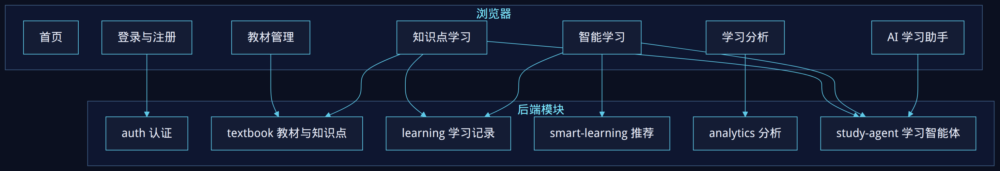

---

03六个模块

谁在用、做什么、从哪进。入口按上游模块表，不把表外的页面补成能力。

  
<h4>认证 · 全部角色</h4>
注册、登录、JWT、角色守卫。入口 /login、/register。

  
<h4>教材管理 · 教师、管理员</h4>
上传、同步、删除教材；编辑框架和 Markdown；校验框架、数据库与详情是否一致；按提纲扩充知识点。入口 /teacher/textbooks、/teacher/textbooks/:id。

  
<h4>知识点学习 · 学生、教师</h4>
树图或思维导图浏览，预览公式和 Mermaid，记录学习反馈。入口 /learning/:textbookId。

  
<h4>智能学习 · 学生、教师</h4>
薄弱点、按重要性、随机三种推荐，界面与普通学习同构。入口 /smart-learning。

  
<h4>学习分析 · 学生看自己，教师看班级</h4>
次数、时长、掌握分布、趋势、薄弱点和导出。入口 /analytics/student、/analytics/teacher。

  
<h4>AI 学习助手 · 已登录用户</h4>
针对当前知识点对话、追问建议、回答反馈；调用可配置的大模型。入口是学习页右下角侧栏。

---

03三种角色

能力按上游那张表叠加上去：教师包含学生能做的，管理员再包含教师能做的。

  

    <h4>学生 STUDENT</h4>
    
学习、提交反馈、查看个人分析、使用学习助手。

  

  

    <h4>教师 TEACHER</h4>
    
在学生能力之上管理教材和知识点，查看班级分析。

  

  

    <h4>管理员 ADMIN</h4>
    
在教师能力之上管理账号与系统配置。

  

<b>统一响应</b>形如 <b>{ success, data }</b>。除登录、注册外，请求携带 Authorization: Bearer &lt;token&gt;。

---

<!-- _class: shot -->

03页面与接口

左边是前端路由，右边是后端控制器。连线按上游 flowchart，/auth 在图中没有入边。

  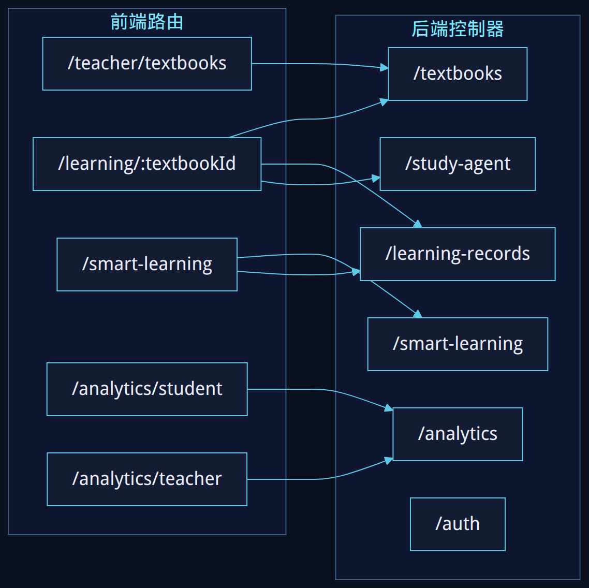

---

<!-- _class: shot -->

03教材管理

用提示词生成的 Excel 与知识内容可以上传。大纲进数据库，知识点正文仍在 md 里。

  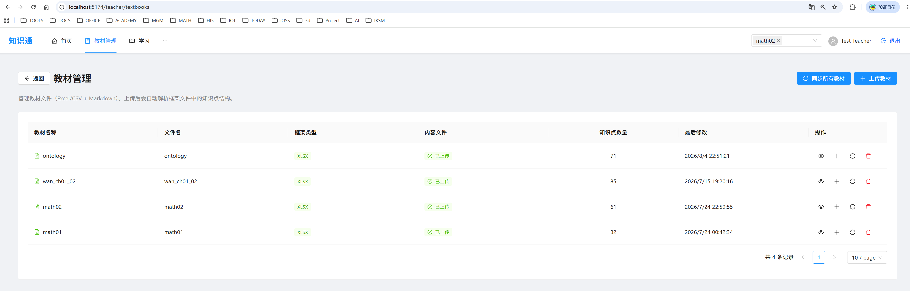

---

<!-- _class: shot -->

03教材详情

直接浏览知识目录和知识点，可以修改，并与数据库同步。

  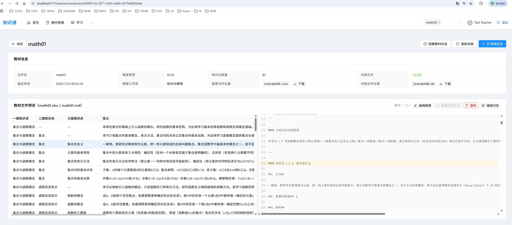

---

<!-- _class: shot -->

03知识点架构学习

树状浏览知识点。学习页同时预览公式和 Mermaid，并记录学习反馈。

  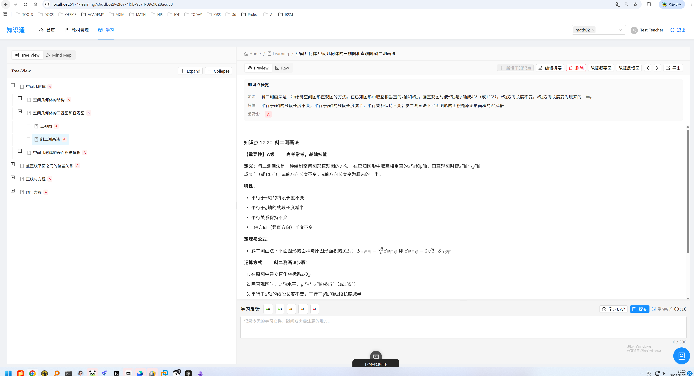

---

<!-- _class: shot -->

03知识点树图

同一学习页可以用知识图谱的方式浏览。上游这张图的文件名是 study_mindmap.png。

  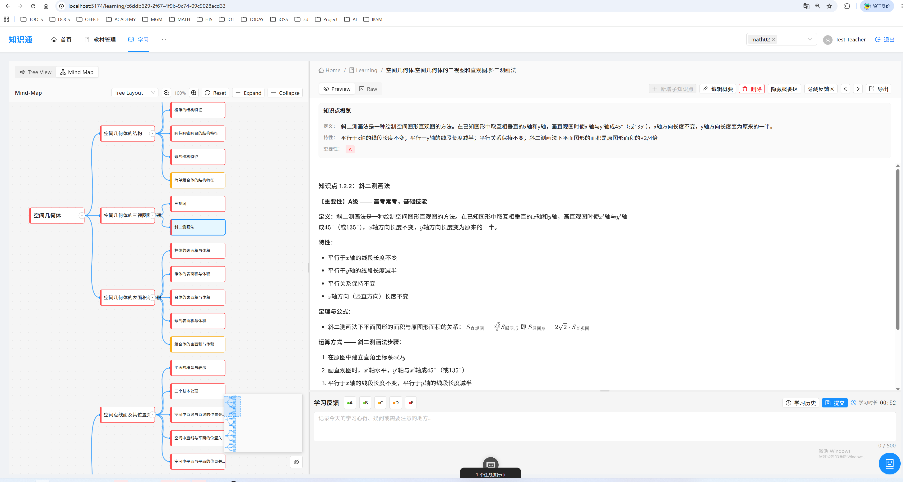

---

<!-- _class: shot -->

03AI 学习助手

学习页侧栏根据当前学习内容追问。助手调用可配置的大模型，并带追问建议和回答反馈。

  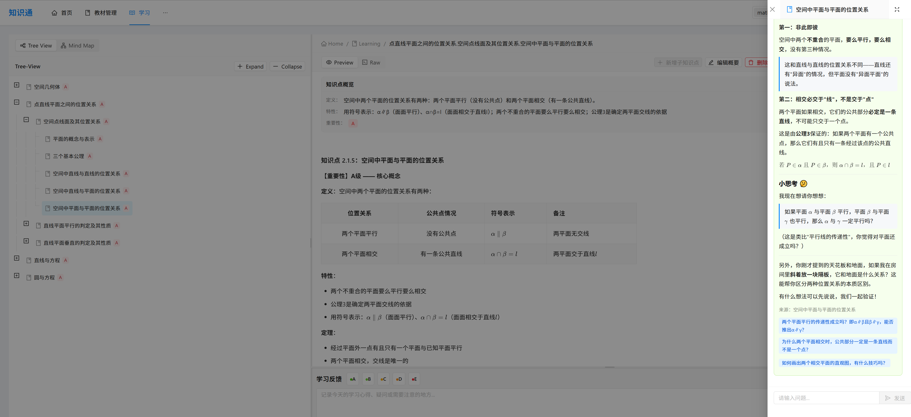

---

<!-- _class: shot -->

03智能学习

按知识点重要性和学习过程反馈做针对性学习。三种推荐：薄弱点、重要性、随机。

  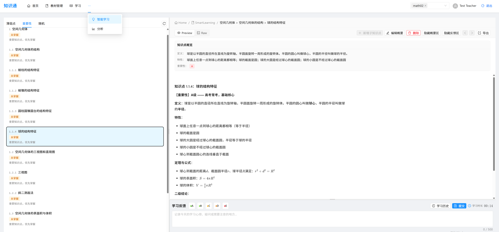

---

03界面图对应哪一节

六张图都是上游正文引用的。files/ 里多一张未引用的 ai_assistant.png，知识目录有副本，这套胶片不单独开页。

  
<h4>books.png</h4>
§3.1 教材管理。上传、同步、删除在模块表里。

  
<h4>book_details.png</h4>
§3.1 教材详情。上游写成 books_details.png，实际文件没有那个 s。

  
<h4>study_treeview.png</h4>
§3.2 树状浏览。

  
<h4>study_mindmap.png</h4>
§3.2 知识点树图。

  
<h4>ai_assistant2.png</h4>
§3.2 侧栏学习助手。

  
<h4>ai_study.png</h4>
§3.3 智能学习的三种方式。

<b>文件名笔误只改知识副本和胶片链接。</b>业务仓 zhenggsh/math 不改。校验接口、按提纲扩充知识点写在模块表里，不另造按钮说明。

---

04两套进程，两类存储

前端开发服务器默认 <em>5173</em>，后端默认 <em>3000</em>，Swagger 在 <em>/api</em>。存储是 PostgreSQL 和 iksm 目录。

  

    <h4>前端 web</h4>
    
React Router、页面与布局、TanStack Query、Axios 的 JWT 拦截器。

  

  

    <h4>后端 server</h4>
    
JWT 与角色守卫、Controller、Service。Service 再接到 Prisma、教材文件服务、Kimi 客户端。

  

  

    <h4>落到哪里</h4>
    
Prisma 到 PostgreSQL。

    
教材文件服务到 iksm（xlsx、csv、md）。

    
Kimi 客户端到大模型接口。

  

<b>下一页是同一张架构图。</b>用户是学生、教师或管理员，浏览器只通过 REST 进入守卫。

---

<!-- _class: shot -->

04总体架构

节点、分组和连线按上游 §4.1 的 flowchart TB。前端内部和后端内部的箭头也保留。

  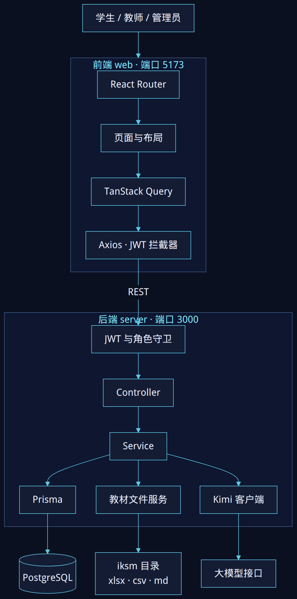

---

<!-- _class: shot -->

04打开知识点并保存反馈

一次典型过程：先取知识树，再读同名 md，学生填时长和掌握程度后追加一条学习记录。

  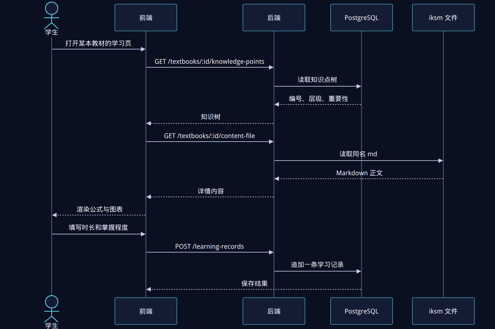

---

<!-- _class: shot -->

04教材怎样进数据库

放入或上传同名框架与 md，忽略无关文件，同步后继承空单元格、补编号，再写入并按编号关联标题。

  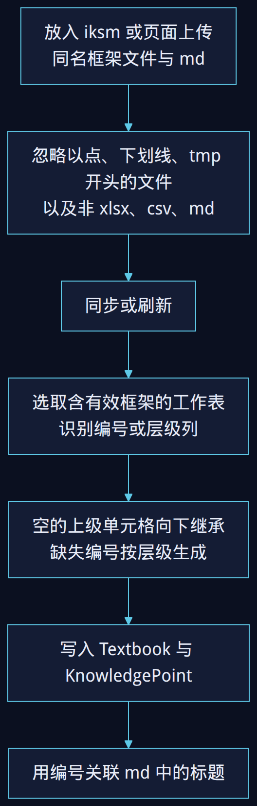

---

<!-- _class: shot -->

04目录结构

仓库根下 web、server、iksm、openspec、doc、mydoc。后端六个模块与前面的职责表同名。

  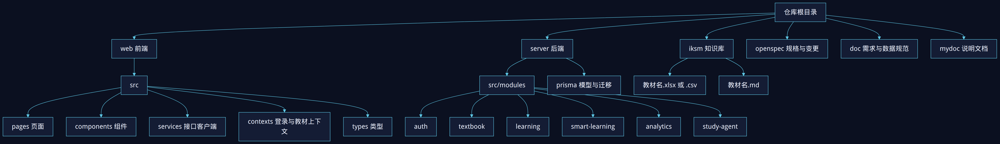

---

<!-- _class: tree -->

04磁盘上的主要位置

与上游代码块一致。共享类型放在各自的 types 或 dto 中，界面组件不直接访问数据库或文件系统。

<pre>.
├── package.json                 # pnpm workspace 脚本
├── web/                         # React + Vite
│   └── src/
│       ├── App.tsx              # 路由
│       ├── pages/               # 登录、教材、学习、分析
│       ├── components/          # 知识树、预览、反馈、图表
│       └── services/            # 按领域拆分的 API 客户端
├── server/                      # NestJS
│   ├── prisma/schema.prisma     # 数据模型
│   └── src/
│       ├── main.ts              # 端口、CORS、Swagger
│       └── modules/             # 六个业务模块
├── iksm/                        # 教材框架与详情
├── openspec/                    # 提案、规格、归档
├── doc/prompt/                  # 项目目标与知识库规范
└── mydoc/                       # 系统介绍</pre>

---

<!-- _class: shot -->

04技术栈

表现层、应用层、数据层、工程四组。连线是表现层到应用层，再到数据层。工程组在上游图里单独列出。

  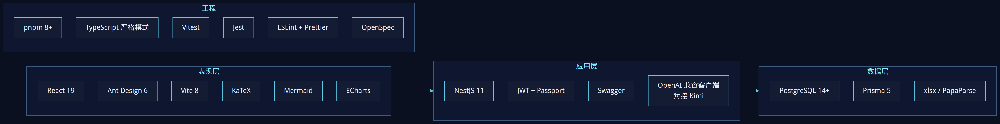

---

04选型用来做什么

表按上游 §4.3。学习助手是可配置的 Kimi 接口，用来针对当前知识点答疑。

  
<h4>React 19 · TypeScript · Vite</h4>
单页应用与开发服务器。

  
<h4>Ant Design</h4>
布局、表单、表格、反馈。主色 #1890FF。

  
<h4>Allotment</h4>
学习页多栏可拖拽。

  
<h4>TanStack Query</h4>
教材、知识点和记录的请求缓存。

  
<h4>KaTeX · Mermaid</h4>
Markdown 里的公式和关系图。

  
<h4>ECharts</h4>
掌握分布、趋势、热度。

  
<h4>NestJS · class-validator</h4>
模块、校验、依赖注入。

  
<h4>bcrypt · JWT</h4>
密码哈希与接口鉴权。

  
<h4>PostgreSQL · Prisma</h4>
用户数据与知识点索引。

<b>还有四行在下一页：</b>xlsx 与 PapaParse、Kimi、Vitest 与 Jest、pnpm workspace。前端默认请求 http://localhost:3000。

---

04文件、助手、测试、包管理

前端地址可用 <em>web/.env</em> 的 <em>VITE_API_BASE_URL</em> 覆盖。后端 CORS 允许 5173，也允许预览端口 4173。

  

    <h4>xlsx · PapaParse</h4>
    
解析 Excel 与 CSV 框架。

  

  

    <h4>可配置的 Kimi 接口</h4>
    
学习助手用它针对当前知识点答疑。

  

  

    <h4>Vitest · Jest</h4>
    
前后端单元测试。

  

  

    <h4>pnpm workspace</h4>
    
根目录同时管理 web 与 server。

  

---

<!-- _class: shot -->

04核心实体

六张表和上游 erDiagram 的字段、关系一致。表名用蛇形复数，文字说明在下一页。

  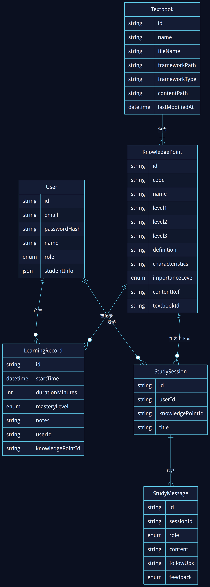

---

04表名和几条约束

同一教材内知识点编号唯一。同一用户对同一知识点只有一个学习助手会话，消息在会话内按时间排列。

  

    <h4>蛇形复数</h4>
    <ul class="tight">
      <li><b>users</b></li>
      <li><b>textbooks</b></li>
      <li><b>knowledge_points</b></li>
      <li><b>learning_records</b></li>
      <li><b>study_sessions</b></li>
      <li><b>study_messages</b></li>
    </ul>
  

  

    
<h4>contentRef</h4>
指向 Markdown 里对应标题。教师修改时，数据库、框架文件和 Markdown 一起更新，再用校验接口看三者是否仍一致。

    
<h4>studentInfo</h4>
JSON。学号、班级等注册资料，不拆成独立表。

  

---

<!-- _class: shot -->

04两套分级不要混

重要性 A/B/C 用来筛选推荐。掌握程度 C、D、E 视为薄弱。两套都用字母，含义不同。

  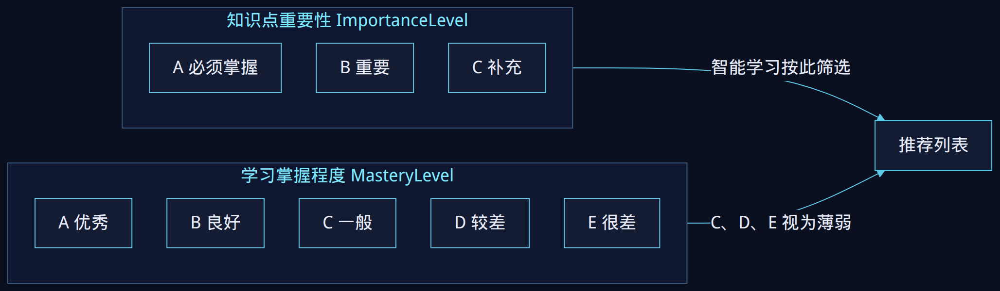

---

04框架列对到哪个字段

空的上级单元格可以向下继承。重要性缺省为 C。编号形如 1、1.1、1.1.1。

  

    
<h4>一级知识点 · level1</h4>
必填，可从上一行继承。

    
<h4>二级知识点 · level2</h4>
可空，可继承。

    
<h4>三级知识点 · level3</h4>
可空，可继承。

  

  

    
<h4>定义 · definition</h4>
简要定义。

    
<h4>特性 / 运算方式 · characteristics</h4>
特性或运算要点。

    
<h4>知识点编号 · code</h4>
1、1.1、1.1.1。

  

  
<h4>重要性级别 · importanceLevel</h4>
A / B / C，缺省为 C。

---

05准备环境

命令都在仓库根目录执行。需要 Node.js 18+、pnpm 8+，以及本机可访问的 PostgreSQL 14+。

  

<pre class="spec">pnpm install
Copy-Item server\.env.example server\.env
Copy-Item web\.env.example web\.env

pnpm --filter server prisma migrate dev
pnpm --filter server prisma generate</pre>
  

  

    
<h4>教材成对放入 iksm/</h4>
同一主文件名，例如 math01.xlsx 与 math01.md。

    
<h4>会被忽略</h4>
以 . 、_ 、tmp 开头的文件。入库流程里还忽略非 xlsx、csv、md。

    
<h4>web/.env</h4>
VITE_API_BASE_URL 默认为 http://localhost:3000。

  

<b>上面是 PowerShell，按上游原文。</b>server/.env 的变量在下一页。

---

05server/.env

库名示例是 <em>mathtong</em>。不用学习助手时，Kimi 三项可以保留占位。生产环境必须更换 JWT_SECRET。

  
<h4>DATABASE_URL</h4>
PostgreSQL 连接串，库名示例为 mathtong。

  
<h4>JWT_SECRET</h4>
签发登录令牌的密钥，生产环境必须更换。

  
<h4>JWT_EXPIRES_IN</h4>
令牌有效期，默认 24h。

  
<h4>PORT</h4>
后端端口，默认 3000。

  
<h4>IKSM_DIR</h4>
教材目录的绝对路径，指向本仓库的 iksm。

  
<h4>KIMI_BASE_URL / KIMI_API_KEY / KIMI_MODEL</h4>
学习助手所用的模型接口；不使用助手时可保留占位。

---

05启动

开两个终端，分别启动后端和前端。括号里的账号按 §5.2 原文列出，这里不把它写成账号体系设计。

  

    
<h4>pnpm dev:server</h4>
一个终端启动后端。

    
<h4>pnpm dev</h4>
另一个终端启动前端。

    
<h4>原文括号</h4>
teacher@test.com/password123,qa-test@example.com/password123

  

  

    <h4>三个地址</h4>
    <ul class="tight">
      <li><b>localhost:5173</b> 前端</li>
      <li><b>localhost:3000</b> 后端</li>
      <li><b>localhost:3000/api</b> Swagger</li>
    </ul>
    
打开前端后注册学生账号，或使用已有教师账号进入教材管理，执行同步，即可在学习页看到知识点。

  

<b>生产构建：</b>pnpm build，再 pnpm --filter server start:prod，以及 pnpm --filter web preview。预览端口 4173，CORS 已放行。

---

05常用指令

根目录同时管两端。只跑一端时加过滤器，例如 pnpm --filter web test --run，或指定 textbook.service.spec.ts。

  

    <h4>根目录</h4>
    <ul class="tight">
      <li><b>pnpm dev</b> 启动前端开发服务器</li>
      <li><b>pnpm dev:server</b> 启动后端并监听文件变化</li>
      <li><b>pnpm build</b> 构建前端和后端</li>
      <li><b>pnpm typecheck</b> 两端 TypeScript 检查</li>
      <li><b>pnpm lint</b> 两端 ESLint</li>
      <li><b>pnpm format</b> 两端 Prettier 格式化</li>
      <li><b>pnpm test</b> 前端 Vitest 与后端 Jest</li>
    </ul>
  

  

    <h4>数据库</h4>
    <ul class="tight">
      <li><b>prisma migrate dev</b> 开发环境执行迁移</li>
      <li><b>prisma generate</b> 重新生成 Prisma Client</li>
      <li><b>prisma studio</b> 打开数据库可视化界面</li>
    </ul>
    
三条都带 <b>pnpm --filter server</b>。

  

---

<!-- _class: shot -->

05本地使用顺序

从安装和 .env 到迁移、启动、登录、同步教材、学习、保存反馈，再到分析页。

  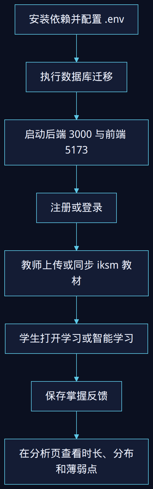

---

05这套胶片停在哪

知识浏览、学习反馈、学习分析，以及围绕它们的教材、推荐和当前知识点答疑。题库组卷和自动阅卷仍然<em class="r">不在系统职责内</em>。

  

    <h4>知识源</h4>
    
iksm/06-math-Project/math_intro.md

    
十一段 mermaid 源码留在原文，没有拆平。

  

  

    <h4>上游</h4>
    
zhenggsh/math

    
mydoc/math_intro.md

    
master · ca118bf · intro3

  

  

    <h4>配图</h4>
    
mydoc/files 整目录在知识条目的 files/。

    
教材详情链接改为 book_details.png，对应目录里的真实文件名。

  

<b>胶片 v1.0.0。</b>§5.2 的两个演示账号只出现在启动页的原文括号里。

